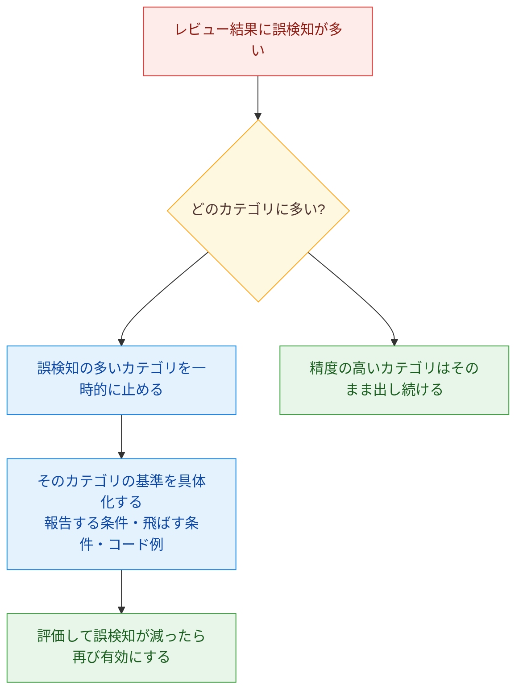

# 明確な基準で誤検知を減らすプロンプト

> ドメイン: 4. プロンプトエンジニアリングと構造化出力（20%） ／ 更新: 2026-11-20

!!! abstract "ひとことで"
    精度（precision、報告したもののうち本当に問題だった割合）は、「控えめに」のような一般的な指示より、==何を報告し、何を飛ばすかをカテゴリで決めた基準==のほうが上がる（ガイド 4.1）。

## 仕組み

誤検知（false positive、問題でないものを問題として報告すること）が多いカテゴリが1つあると、開発者は正しいカテゴリの指摘まで信用しなくなる。信頼は全体で失われる。何を報告するかは、確信度で絞るのでなく、==種類で決める==（ガイド 4.1）。基準には、報告するものと飛ばすものの両方を書く（ガイド 4.1）。

例は自作。1行目はガイド 4.1、4行目の良い例は公式の Code review harnesses の文から取った。

| 目的 | あいまいな指示 | 明確な基準 |
|---|---|---|
| コメントの点検 | 「コメントが正確か確認して」 | 「コメントが述べる動作と、コードの実際の動作が食い違うときだけ報告する」 |
| 精度を上げる | 「控えめに」「確信度の高いものだけ」 | 「報告: 誤った結果・例外・データ破損を起こすバグ、認可漏れなどのセキュリティ。飛ばす: 命名・空白などのスタイル、このリポジトリの慣習どおりの書き方」 |
| 重大度を付ける | 「重大度を high / medium / low で」 | 「high: 本番でデータを失う（例: トランザクション外での削除）。medium: 特定の入力で誤った結果（例: 境界値の off-by-one）。low: 動作は正しいが保守しにくい（例: 重複したロジック）」 |
| 重要度のしきい値 | 「重要なものだけ報告して」 | 「誤った動作・テストの失敗・誤解を招く結果につながるものは報告。純粋なスタイルや命名の好みだけ省く」 |

重大度も、ラベル名だけでは判断がそろわない。レベルごとに、判断の条件と具体的なコード例を添える。特定のカテゴリに誤検知が偏ったら、次の順で立て直す。

出力の形式をそろえたいときは、few-shot（入出力の例を見せる手法）が主役になる（[few-shot のノート](few-shot-prompting.md)、4.2）。複数パスのレビューは [4.6 のノート](independent-multipass-review.md)で扱う。

??? info "公式ドキュメントとガイドの書き方の違い"
    - 「重要なものだけ」のような質的な言葉を避け、具体的なしきい値を書く、というのは公式のモデル別ガイドの記述。ガイド 4.1 の例ではない
    - Opus 4.8 と Sonnet 5 の公式ページ（Opus 5.5 などのページには無い）は、「high-severity だけ」「控えめに」が以前のモデルより忠実に守られる可能性があると書く。精度はたいてい上がるが、報告される数（measured recall）は下がりうる。モデルは同じ深さで調べてバグも特定し、基準より下と判断したものを報告しないだけ
    - 公式は、これをカテゴリの基準と比べていない。ガイドは「カテゴリの基準と比べて」精度が上がらないと言う。正面からの食い違いではない。試験はガイドの書き方を主に覚える
    - 公式は、発見の段階では絞らずに全部報告させ、確信度での絞り込みは後に回す書き方も勧めている。後段の検証が無くても使える（複数パスの話は 4.6）

## 試験での見分け方

| 問われること | ○ 正しい | × ひっかけ |
|---|---|---|
| 指摘が多すぎて無視される | 報告するカテゴリ（バグ、セキュリティ）と飛ばすカテゴリ（軽いスタイル、ローカルの慣習）を明記する | 「控えめに」「確信度の高いものだけ」を足す（カテゴリの基準と比べて精度が上がらない） |
| 特定のカテゴリだけ誤検知が多い | そのカテゴリを一時的に止め、ほかの信頼を守りながら基準を作り直す | 誤検知の多いカテゴリを残したまま、全体を出し続ける |
| 重大度が実行ごとにばらつく | 各レベルに、コード例付きの定義を書く | ラベル名（high / low）や形容詞だけで定義する |
| 「コメントを確認して」で無関係な指摘が出る | 何と何が食い違ったら報告するかまで書く | 確認の対象だけを書いて、報告の条件を書かない |

## 確認問題

**Q1.** CI で Claude Code を動かし、PR の SQL をレビューさせている。「インデックスが無い」という指摘が大量に出て、そのほとんどが誤検知だった。開発者は、正しい SQL インジェクションの指摘まで読み飛ばすようになった。最初の対応として最も適切なものはどれか。（1つ選べ）
{ .quiz-q }

- A. インデックスのカテゴリを一時的に止め、ほかは出し続けながら、報告する条件を具体化し、評価してから戻す
- B. システムプロンプトに「確信度の高い指摘だけを控えめに報告すること」と足し、全カテゴリを出し続ける
- C. 全カテゴリを出し続け、high の指摘を PR コメントの先頭に並べ替えて、目に入りやすくする
- D. レビューボット全体を止め、すべてのカテゴリの基準を作り直してから、まとめて再開する

??? success "答えと解説"
    **正解: A。** 誤検知の多いカテゴリだけを止めれば、精度の高いカテゴリの信頼を守りながら基準を作り直せる。

    - B: 「控えめに」「確信度の高いものだけ」は一般的な指示で、カテゴリの基準と比べて精度が上がらない
    - C: 誤検知の多いカテゴリを残したままでは、開発者の信頼は全体で失われたままになる
    - D: 精度の高いインジェクションの指摘まで止まる。止めるのは誤検知の多いカテゴリだけでよい

**Q2.** 同じ CI のレビューで、ログ出力の点検に「重要なものだけ報告して」と書いた。すると、同じコードでも実行ごとに報告の件数が大きく変わる。プロンプトの直し方として最も適切なものはどれか。（1つ選べ）
{ .quiz-q }

- A. 「重要なもの」を「本当に重要で、確信度の高いものだけ」に言い換えて、指示を強める
- B. 「重要」の定義として、high / medium / low のラベル名を添えて重大度で絞らせる
- C. 報告する種類（トークンのログ出力、例外の握りつぶし）と、飛ばす種類（文言、ログレベルの好み）を書く
- D. 報告する種類（トークンのログ出力、例外の握りつぶし）だけを列挙し、それ以外には触れない

??? success "答えと解説"
    **正解: C。** 何を報告するかは種類で決め、報告するものと飛ばすものの両方を書く。

    - A: 「重要」は人によって解釈が違い、言葉を強めても基準にならない
    - B: ラベル名だけでは判断がそろわない
    - D: 飛ばす種類（文言・ログレベルの好み）を書かないと、その境目にある指摘を報告するかどうかがモデル任せのまま残り、件数のばらつきが止まらない

**Q3.** 同じボットが、同じ種類の欠陥に、ある実行では critical、別の実行では minor を付ける。重大度の定義の書き方として最も適切なものはどれか。（1つ選べ）
{ .quiz-q }

- A. 重大度を critical / major / minor / trivial の4段階に増やし、細かく分けられるようにする
- B. 各レベルを「深刻な」「中程度の」「軽微な」のような形容詞で、短く説明しておく
- C. 「確信度の低い指摘は、重大度を一段下げて付けること」とシステムプロンプトに足す
- D. 各レベルに、判断の条件と具体的なコード例を添えて定義する

??? success "答えと解説"
    **正解: D。** 重大度は、レベルごとに判断の条件と具体的なコード例を添えて定義する。

    - A: レベルの数を増やしても、ラベル名だけの定義では分類がそろわない
    - B: 形容詞だけの定義では、判断がそろわない
    - C: 確信度で調整しても、どのレベルに当たるかの条件は決まらない

## 出典
- [Prompting best practices — Be clear and direct / Add context](https://platform.claude.com/docs/en/build-with-claude/prompt-engineering/claude-prompting-best-practices)（公式）
- [Prompting Claude Opus 4.8 — Code review harnesses / More literal instruction following](https://platform.claude.com/docs/en/build-with-claude/prompt-engineering/prompting-claude-opus-4-8)（公式）
- [Prompting Claude Sonnet 5 — Code review harnesses](https://platform.claude.com/docs/en/build-with-claude/prompt-engineering/prompting-claude-sonnet-5)（公式）
- [Define success criteria and build evaluations](https://platform.claude.com/docs/en/test-and-evaluate/develop-tests)（公式。基準は具体的で測れるものにする）
- Claude Certified Architect – Foundations Exam Guide v1.1、タスクステートメント 4.1（公式）
- 未確認: 「誤検知の多いカテゴリを一時的に止める」「誤検知が開発者の信頼を損なう」「重大度の定義にコード例を添える」は、ガイドでは確かめたが、公式ドキュメントで直接述べた箇所は見つけられなかった
