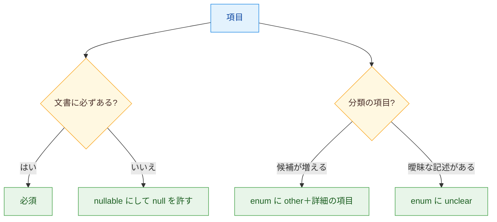

# 抽出用スキーマの設計（必須と任意、nullable、enum の "other"＋詳細と "unclear"）

> ドメイン: 4. プロンプトエンジニアリングと構造化出力（20%） ／ 更新: 2026-11-20

!!! abstract "ひとことで"
    文書に無いこともある項目は、==null を許す（nullable）==。分類の enum には、想定外の受け皿の "other"＋詳細と、決めきれないときの "unclear" を足す。

## 仕組み

抽出用スキーマ（extraction schema）は、抽出ツールの `input_schema` に書く JSON Schema だ。無いこともある項目を必須の値にすると、モデルはスキーマを満たすために値を作り上げてしまう（fabrication）。だから「その情報は文書に必ずあるか」「分類の候補は閉じているか」「曖昧さを区別して後で拾いたいか」で書き方を決める。tool_use で構造化出力を得る仕組みそのものは、[構造化出力のノート](tool-use-json-schema.md)が主。どのツールを呼ばせるか（any・特定ツールの強制）は [tool_choice のノート](../02-tool-design-mcp/tool-choice.md)が主。



| パターン | 書き方 | 使うとき | 使わないとき |
|---|---|---|---|
| 必須（required） | `required` に入れる | 文書に必ずある項目（例: 求人票の職種名） | 無いこともある項目 |
| 任意（optional） | `required` に入れない | キーごと省いてよい項目 | 「無かった」と明示して残したい項目 |
| nullable | `"type": ["string", "null"]` | 文書に無ければ null と返させたい項目 | 必ずある項目（null に逃げられる） |
| enum＋"other"＋詳細 | enum に `"other"`、別項目に `*_detail` | 候補が後から増える分類 | 候補が閉じていて増えない分類 |
| enum＋"unclear" | enum に `"unclear"` | 文書の記述が曖昧で決めきれないことがある | 曖昧さを区別する必要がない |

"unclear" と null は別物だ。=="unclear" は書いてあるが決めきれない、null は書いていない==。ガイドは「optional (nullable)」とまとめて書くが、JSON Schema では任意（キーが無い）と nullable（キーはあり、値が null）は別の指定になる。

!!! example "求人票の抽出（自作）"
    ```json
    {
      "type": "object",
      "properties": {
        "job_title": {"type": "string"},
        "salary_min_yen": {"type": ["integer", "null"], "description": "記載が無ければ null。推定しない"},
        "employment_type": {"type": "string", "enum": ["full_time", "part_time", "contract", "other", "unclear"]},
        "employment_type_detail": {"type": ["string", "null"], "description": "other のときだけ原文の表記を入れる"}
      },
      "required": ["job_title", "salary_min_yen", "employment_type", "employment_type_detail"],
      "additionalProperties": false
    }
    ```

説明（description）に「無ければ null」「推定しない」を書く。公式は、説明を詳しく書くことをツールの性能で最も大事な要素としている。日付の書き方や金額の単位などの揺れは、スキーマだけでなく、プロンプトに正規化のルール（normalization rules）を書いてそろえる。

??? info "strict（`strict: true`）で使うときの制限"
    - `enum`・`required` は使える。`minimum`/`maximum`、`minLength`/`maxLength`、`oneOf` は使えない。オブジェクトには `additionalProperties: false` が要る
    - `["string","null"]` の型の配列が使えることは、上限の表の記述（type arrays の例）で確かめた
    - 上限は、1リクエスト内のすべての strict スキーマ（strict ツールと `output_config.format` の両方）の合計で数える。任意の項目は24個まで、型の配列や `anyOf` を使う項目は16個まで。strict ツールは1リクエスト20個まで
    - 長さや数値の範囲は、strict のスキーマでは書けない。説明とプロンプトに書き、受け取った後に検証する（[検証・再試行のノート](validation-retry-loop.md)）
    - strict でも enum の値の大文字・小文字は保証されない。"other" や "unclear" を後工程で拾うときは、大文字・小文字を区別せずに比べる

## 試験での見分け方

<div class="vs" markdown>

| 問われること | ○ 正しい | × ひっかけ |
|---|---|---|
| 一部の文書にしか無い項目に、もっともらしい値が埋まる | nullable にし、無ければ null と返させる | 必須の値のままにする（スキーマを満たすために値を作る） |
| 想定外の分類が、近い候補に押し込まれる | enum に "other" と、原文を残す詳細の項目を足す | "other" だけ足す（何だったかが失われ、足すべき候補も見えない） |
| 曖昧な文書だけを人のレビューに回したい | enum に "unclear" を足し、"unclear" を拾って回す | null で代用する（「書いていない」と区別できない） |
| 日付や単位の表記がばらばら | スキーマに加えて、プロンプトに正規化のルールを書く | スキーマの型だけでそろえようとする |
| スキーマに合っているのに中身がおかしい（明細の合計が総額と合わない、値が別の項目に入る） | 意味の誤りとして、受け取った後に検証する | スキーマを直せば防げると考える |

</div>

## 確認問題

??? question "Q1. 契約書から「解約予告期間」を抽出している。この条項が無い契約書でも、モデルが「30日」と返してくる。どう直す？"
    項目を `["integer","null"]` の nullable にし、説明に「条項が無ければ null。推定しない」と書く。必須の値だと、スキーマを満たすためにありそうな値を作ってしまう。few-shot を足すより先に、値を作らずに済む逃げ道をスキーマに用意する。

??? question "Q2. 問い合わせメールを、製品カテゴリの enum（5種類）に分類している。新製品の問い合わせが、近いだけの既存カテゴリに入ってしまう。どう直す？"
    enum に "other" を足し、`category_detail` に原文の製品名を入れさせる。押し込みを防げるうえ、"other" の詳細を集計すれば、enum に足すべき候補が分かる。

??? question "Q3. 本文の記述が曖昧で、緊急度を決めきれないメールがある。それだけを人の確認に回したい。どう設計する？"
    緊急度の enum に "unclear" を足し、"unclear" の件だけ人に回す。null（記載なし）とは分けて、曖昧さを明示させる。

## 出典
- [Claude Certified Architect – Foundations Exam Guide v1.1](https://cc.sj-cdn.net/instructor/6nizmqk8tpzpfjvt6qmmav7rh/public/1794946250/Claude_Certified_Architect_-_Foundations_Exam_Guide.pdf)（公式、Task Statement 4.3、演習3）
- [Structured outputs](https://platform.claude.com/docs/en/build-with-claude/structured-outputs)（公式。対応する JSON Schema の機能、Schema complexity limits、Enum value casing）
- [Define tools](https://platform.claude.com/docs/en/agents-and-tools/tool-use/define-tools)（公式。説明を詳しく書く）
