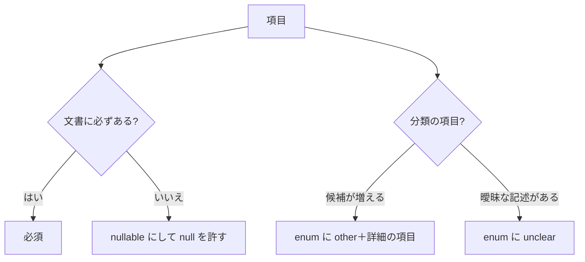

# 抽出用スキーマの設計（必須と任意、nullable、enum の "other"＋詳細と "unclear"）

> ドメイン: 4. プロンプトエンジニアリングと構造化出力（20%） ／ 更新: 2026-11-20

## 3行まとめ
- 文書に無いこともある項目は必須の値にしない。**null を許す（nullable）**ことで、モデルが値を作り上げる（fabrication）のを防ぐ
- 分類の enum には、想定外の値の受け皿 "other"＋詳細の文字列と、判断できないときの "unclear" を足す
- 試験での決め手は「その情報は文書に必ずあるか」「分類の候補は閉じているか」「曖昧さを区別して後で拾いたいか」

## 仕組み
抽出用スキーマ（extraction schema: 抽出ツールの `input_schema` に書く JSON Schema）の項目は、次のパターンで設計する。tool_use で構造化出力を得る仕組みそのものは、別ノート「tool_use と JSON スキーマによる構造化出力」が主。

| パターン | 書き方 | 使うとき | 使わないとき |
|---|---|---|---|
| 必須（required） | `required` に入れる | 文書に必ずある項目（例: 求人票の職種名） | 無いこともある項目 |
| 任意（optional） | `required` に入れない | キーごと省いてよい項目 | 「無かった」と明示して残したい項目 |
| nullable | `"type": ["string", "null"]` | 文書に無ければ null と返させたい項目 | 必ずある項目（null に逃げられる） |
| enum＋"other"＋詳細 | enum に `"other"`、別項目に `*_detail` | 候補が後から増える分類 | 候補が閉じていて増えない分類 |
| enum＋"unclear" | enum に `"unclear"` | 文書の記述が曖昧で決めきれないことがある | 曖昧さを区別する必要がない |

自作の例（求人票の抽出）:

```json
{
  "type": "object",
  "properties": {
    "job_title": {"type": "string"},
    "salary_min_yen": {"type": ["integer", "null"], "description": "記載が無ければ null。推定しない"},
    "employment_type": {"type": "string", "enum": ["full_time", "part_time", "contract", "other", "unclear"]},
    "employment_type_detail": {"type": ["string", "null"], "description": "other のときだけ原文の表記を入れる"}
  },
  "required": ["job_title", "salary_min_yen", "employment_type", "employment_type_detail"],
  "additionalProperties": false
}
```



- 書式の揺れ（日付の書き方、金額の単位など）は、スキーマだけでなくプロンプトに正規化のルール（normalization rules）を書いて揃える
- 説明（description）に「無ければ null」「推定しない」を書く。公式は説明を詳しく書くことをツールの性能で最も大事な要素としている
- strict（`strict: true`）で使う JSON Schema には制限がある。`enum`・`required`・`["string","null"]` の型の配列は使えるが、`minimum`/`maximum`、`minLength`/`maxLength`、`oneOf` は使えない。オブジェクトは `additionalProperties: false` が要る
- strict のスキーマ全体で、任意の項目は24個まで、型の配列や `anyOf` を使う項目は16個まで（公式の上限表。原文の文言は未確認）

## 試験で問われそうなポイント
- 一部の文書にしか無い項目で、モデルがもっともらしい値を埋めてくる → 必須の値をやめて nullable にし、無ければ null と返させる
- 分類に想定外の値が出て、近い候補に無理に押し込まれる → enum に "other" と、原文を残す詳細の項目を足す
- 曖昧な文書を人のレビューに回したい → enum に "unclear" を足し、"unclear" を拾って回す
- 日付や単位の表記がばらばらで後工程が困る → スキーマに加えて、プロンプトに正規化のルールを書く
- どのツールを呼ばせるか（any・特定ツールの強制）は [tool_choice のノート](../02-tool-design-mcp/tool-choice.md) が主

## 間違えやすいところ
- アンチパターン: 文書に無いこともある項目を必須の値にする。スキーマを満たすために、モデルが値を作ってしまう
- スキーマに合っていても中身が正しいとは限らない（意味の誤りは防げない）→ 別ノート「tool_use と JSON スキーマによる構造化出力」
- "other" だけで詳細の項目を付けないと、何だったかが失われ、enum に足すべき候補も見えない
- "unclear" と null は別物。"unclear" は「書いてあるが決めきれない」、null は「書いていない」
- ガイドは「optional (nullable)」とまとめて書く。JSON Schema では任意（キーが無い）と nullable（キーはあり値が null）は別の指定
- 長さや数値の範囲は strict のスキーマでは書けない。説明とプロンプトに書き、受け取った後に検証する（検証と再試行は別ノート「検証・再試行・フィードバックのループ」）

## 確認問題
1. 契約書から「解約予告期間」を抽出している。この条項が無い契約書でも、モデルが「30日」と返してくる。どう直すべきか。
   <details><summary>答え</summary>項目を `["integer","null"]` の nullable にし、説明に「条項が無ければ null。推定しない」と書く。必須の値だと、スキーマを満たすためにありそうな値を作ってしまう。few-shot を足すより先に、値を作らずに済む逃げ道をスキーマに用意する。</details>
2. 問い合わせメールを製品カテゴリの enum（5種類）に分類している。新製品の問い合わせが、近いだけの既存カテゴリに入ってしまう。どう直すべきか。
   <details><summary>答え</summary>enum に "other" を足し、`category_detail` に原文の製品名を入れさせる。押し込みを防げるうえ、"other" の詳細を集計すれば、enum に足すべき候補が分かる。</details>
3. 本文の記述が曖昧で、緊急度を決めきれないメールがある。それだけを人の確認に回したい。どう設計するか。
   <details><summary>答え</summary>緊急度の enum に "unclear" を足し、"unclear" の件だけ人に回す。null（記載なし）とは分けて、曖昧さを明示させる。</details>

## 出典
- [Claude Certified Architect – Foundations Exam Guide v1.1](https://cc.sj-cdn.net/instructor/6nizmqk8tpzpfjvt6qmmav7rh/public/1794946250/Claude_Certified_Architect_-_Foundations_Exam_Guide.pdf)（公式、Task Statement 4.3、演習3）
- [Structured outputs](https://platform.claude.com/docs/en/build-with-claude/structured-outputs)（公式。対応する JSON Schema の機能と上限。ページの後半は要約でしか読めず、文言は未確認）
- [Define tools](https://platform.claude.com/docs/en/agents-and-tools/tool-use/define-tools)（公式。説明を詳しく書く）
