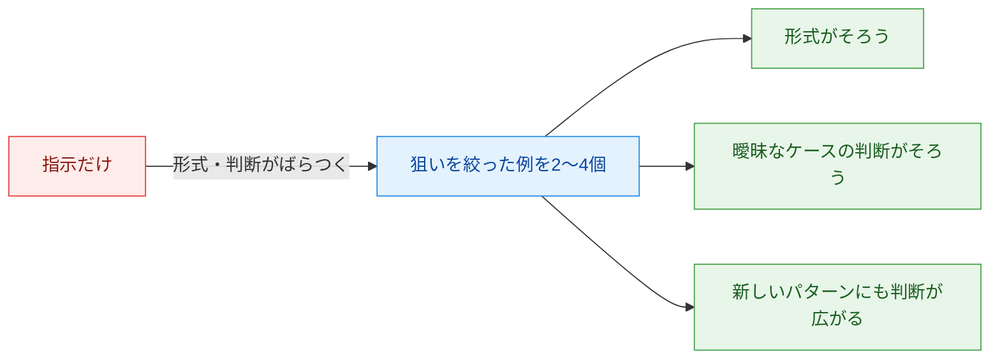

# few-shot プロンプティング（曖昧なケースの判断、出力形式の統一、抽出の精度）

> ドメイン: 4. プロンプトエンジニアリングと構造化出力（20%） ／ 更新: 2026-11-20

!!! abstract "ひとことで"
    詳しい指示を足しても出力がばらつくなら、入出力の例を数個入れる。例には==選んだ判断と、もっともらしい別案を選ばなかった理由==まで書く。

## 仕組み

few-shot（few-shot / multishot prompting）は、プロンプトに入出力の例を数個入れる手法だ。指示だけでは形式や判断がばらつくとき、形式と質をそろえる最も効く手段になる。理由まで示した例は、例と同じものに当てはまるだけではない。判断の考え方が伝わるので、==例に無い新しいパターンにも判断が広がる==。だから、網羅的なルールを列挙するより向く。

例は次の4点を満たすように作る。

- 関連性（Relevant）: 実際の入力に近い題材にする
- 多様性（Diverse）: 端のケースを含める。例が似すぎると、意図しない共通点（いつも同じ長さ、同じ重大度、語順など）まで真似される
- 構造（Structured）: `<example>` タグ（複数なら `<examples>`）で囲み、指示と区別させる
- 理由（ガイド 4.2。best practices の3点には無い）: 曖昧なケースの例には、選んだ行動と、選ばなかった別案とその理由を書く

few-shot は確率的な手段だ。必ず守らせたい順序や、原因が別にある誤りには使わない。

| 場面 | few-shot | 理由・代わりの手段 |
|---|---|---|
| レビュー指摘の形式（場所・問題・重大度・修正案）がばらつく | 効く | 目的の形式の例を見せると、形式がそろう |
| どちらのツールか・指摘するかが曖昧 | 効く | 判断と理由を例で示すと、境界の判断がそろう |
| 許容してよいコードを誤って指摘する（誤検知） | 効く | 「許容されるパターン」と「本当の問題」を対にした例で、違いの理由を示す。例に無いコードにも同じ線引きが広がる |
| 文書の形式が様々で、必須項目が空で返る | 効く | 形式の違いごとに正しい抽出例を見せる。例: 本文中の引用（inline citations）と末尾の参考文献一覧（bibliographies）、独立した「方法」の節と本文に埋め込まれた方法の記述 |
| 在庫の引き当てが済むまで出荷指示を出させない、のような必ず守る順序 | 不十分 | 例は確率的な遵守にとどまり、金銭・安全・業務に影響する場面では足りない。前段の結果が返るまで後段のツールを呼べないよう、プログラムで強制する（[順序の強制のノート](../01-agentic-architecture/programmatic-workflow-enforcement.md)） |
| 似た2つの検索ツール（社員名簿と会議室）の説明が1行ずつで、取り違える | 第一手ではない | 原因は説明文の情報不足なので、例を足しても原因は残る。説明文に扱う入力・使う場面・もう一方との境界を書く。例で直すのは、説明を直した後も曖昧さが残るとき |
| JSON の構文を必ず正しくしたい | 第一手ではない | tool use と JSON スキーマ（structured outputs）を使う（[構造化出力のノート](tool-use-json-schema.md)） |

??? info "例の数・併用・ガイドとの違い"
    - 例の数: ガイド（4.2）は2〜4個、現行の Prompting best practices は3〜5個を勧める。試験はガイドの2〜4個を主に覚える（3.5 の入出力例は2〜3個と書かれている）
    - thinking（思考）と併用できる。例を「問題・解き方・答え」の形で示すと、思考の進め方にも効く
    - 旧ドキュメントの「multishot prompting」の個別ページは、今は Prompting best practices に統合されている
    - エスカレーションの判断がずれるときは、明確な基準と、エスカレーションする例・自分で解決する例をシステムプロンプトに入れる。根拠はガイド 5.2 の Skills（[エスカレーションのノート](../05-context-reliability/escalation-ambiguity.md)）
    - 誤検知を減らす基準そのものの書き方は、[明確な基準のノート](explicit-criteria-false-positives.md)が主
    - 未確認: 公式ドキュメントには「few-shot で抽出の幻覚（ハルシネーション。元に無い値を作ること）が減る」と直接書いた箇所は見つからなかった。公式は「分からないと言ってよいと許可する」「引用で根拠づける」を挙げている。この論点はガイドの記述が根拠

## 試験での見分け方

| 問われること | ○ 正しい | × ひっかけ |
|---|---|---|
| 詳しい指示を足しても形式がばらつく | 目的の形式の例を入れる | 指示をさらに書き足す |
| 曖昧な依頼でツールの選択が割れる | 狙いを絞った例2〜4個で、選んだツールと別案を退けた理由を示す | 判断だけを並べた例にする（理由が無いと、新しいケースへの広がりが弱い。推論） |
| テストの抜けの指摘が浅い（分岐ごとの網羅の抜けを見落とす） | 分岐単位の抜けを指摘した例を見せる | 「網羅性を厳しく見て」と指示だけ足す |
| 文書によって必須項目が null になる、「ひとつかみ」のようなくだけた分量で値を作る | 様々な形式からの正しい抽出例を入れる | 表形式の例だけを見せる |
| 例を列挙しきれない新しいケースが来る | 理由つきの例で考え方を伝える | 網羅的なルールを列挙する |

## 確認問題

**Q1.** 開発チームの社内 Wiki の記事を、Claude に「手順書」「議事録」「仕様書」のどれかに分類させている。指示を何度書き足しても、議事録の中に作業手順が書かれた記事だけ、実行ごとに分類が割れる。次の一手として最も適切なものはどれか。（1つ選べ）
{ .quiz-q }

- A. 「議事録に手順が含まれる場合は…」のような分類ルールを、考えうる組み合わせの分だけ列挙する
- B. 判断の割れる記事の例を2〜4個入れ、選んだ分類と、もっともらしい別の分類を退けた理由を書く
- C. 「分類が曖昧な記事は、内容をよく読んで慎重に判断すること」という指示を、さらに書き足す
- D. 分類の結果を tool use の JSON スキーマで受け取り、enum で3種類のどれかに縛る

??? success "答えと解説"
    **正解: B。** 理由つきの例は判断の考え方を伝えるので、曖昧なケースの判断がそろい、例に無い記事にも広がる。

    - A: 網羅的なルールの列挙は、列挙しきれない新しいケースに弱い
    - C: 指示の書き足しを続けても、曖昧なケースの判断はそろわない
    - D: スキーマがそろえるのは形だけで、どの分類を選ぶかの判断はそろわない

**Q2.** CI で Claude Code に SQL をレビューさせている。チームが意図して使う `SELECT *`（一時テーブルへの全列コピー）まで毎回指摘され、開発者が指摘を読まなくなった。「重要な指摘だけにして」と書き足しても減らない。プロンプトの直し方として適切なものはどれか。（2つ選べ）
{ .quiz-q }

- A. 「重要な指摘だけにして」を「本当に問題のある指摘だけにして」と、さらに強い言葉に書き換える
- B. 一時テーブルへの `SELECT *` の例だけを数個入れ、どれも「指摘しない」とだけ書く
- C. `SELECT *` を含むクエリは、一時テーブルか本番かに関係なく、すべて指摘の対象から外すルールを足す
- D. 一時テーブルへの全列コピー（許容）と、本番クエリで列が増えると壊れる使い方（問題）を対で例に入れる
- E. 各例に、指摘する・しないの判断だけでなく、そう判断した理由を書き添える

??? success "答えと解説"
    **正解: D と E。** 許容されるパターンと本当の問題を対にし、違いの理由を示すと、例に無いコードにも同じ線引きが広がる。

    - A: 「重要」のような曖昧な指示は、言葉を強めても精度が上がらない
    - B: 許容の側だけで理由も無いと、本当の問題との線引きが伝わらない
    - C: 本番のクエリで壊れる、本当に問題のある使い方まで見逃す

**Q3.** 料理ブログからレシピの材料を抽出している。表形式の記事は正しく取れる。本文中に「塩少々」「卵ふたつ」と書く記事では、分量が null になったり、元に無い数値が入ったりする。最も適切な対応はどれか。（1つ選べ）
{ .quiz-q }

- A. 正しく取れている表形式の記事から、抽出の例を数個選んでプロンプトに入れる
- B. 「元に無い値を作らず、分量は正確に抽出すること」という指示を、プロンプトに書き足す
- C. 表形式・本文埋め込み・くだけた分量表記など、様々な形式の記事からの正しい抽出例を入れる
- D. 抽出を tool use と JSON スキーマに切り替え、分量を数値型の項目として受け取る

??? success "答えと解説"
    **正解: C。** 文書の形式が様々で値が空になるときは、形式の違いごとに正しい抽出例を見せる。

    - A: 表形式の例だけでは、本文に埋め込まれた書き方への対処が伝わらない
    - B: 指示の書き足しでは、形式によるばらつきは直らない
    - D: スキーマが保証するのは JSON の形で、本文からの読み取り方は決まらない

## 出典
- [Prompting best practices — Use examples effectively](https://platform.claude.com/docs/en/build-with-claude/prompt-engineering/claude-prompting-best-practices#use-examples-effectively)（公式）
- [Increase output consistency — Constrain with examples](https://platform.claude.com/docs/en/test-and-evaluate/strengthen-guardrails/increase-consistency#constrain-with-examples)（公式）
- [Reduce hallucinations](https://platform.claude.com/docs/en/test-and-evaluate/strengthen-guardrails/reduce-hallucinations)（公式）
- Claude Certified Architect – Foundations Exam Guide v1.1、タスクステートメント 4.2（関連: 2.1、3.5、5.2）（公式）
