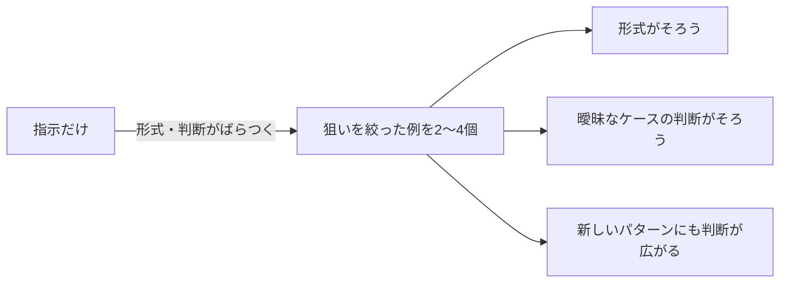

# few-shot プロンプティング（曖昧なケースの判断、出力形式の統一、抽出の精度）

> ドメイン: 4. プロンプトエンジニアリングと構造化出力（20%） ／ 更新: 2026-11-20

## 3行まとめ
- 詳しい指示だけでは出力がばらつくとき、**few-shot**（few-shot / multishot prompting。プロンプトに入出力の例を数個入れること）が形式と質をそろえる最も効く手段
- 使う場面は「曖昧なケースの判断」「出力形式の統一」「誤検知の削減」「形式が様々な文書からの抽出」。決まった順序の強制やツール説明の不足は few-shot では直さない
- 決め手は、例が「なぜその判断か（もっともらしい別案ではなく）」まで示しているか。理由のある例は、例に無い新しいパターンにも判断を広げられる

## 仕組み

### 例の作り方
- 関連性（Relevant）: 実際の入力に近い題材にする
- 多様性（Diverse）: 端のケースを含め、意図しない共通点（長さ、語順など）を真似されないようにばらす
- 構造（Structured）: `<example>` タグ（複数なら `<examples>`）で囲み、指示と区別させる
- 理由: 曖昧なケースの例には「選んだ行動」と「選ばなかった別案とその理由」を書く

### few-shot が効く場面・効かない場面

| 場面 | few-shot | 理由・代わりの手段 |
|---|---|---|
| レビュー指摘の形式がばらつく（場所・問題・重大度・修正案） | 効く | 目的の形式の例を見せると形式がそろう |
| どちらのツールか・指摘するかが曖昧なケース | 効く | 判断と理由を例で示すと、境界の判断がそろう |
| 許容してよいコードを誤って指摘する（誤検知） | 効く | 「許容されるパターン」と「本当の問題」を並べた例で区別させる |
| 引用の書き方や章立てが文書ごとに違い、必須項目が空で返る | 効く | 様々な形式からの正しい抽出例を見せる |
| 必ずこの順序でツールを呼ぶ（本人確認→返金など） | 効かない | 確率的な遵守では足りない。プログラム側の前提チェックで強制する |
| ツールの説明が短すぎて選び間違える | 第一手ではない | まずツールの説明文を詳しくする。例はトークンが増えるだけで原因が残る |
| JSON の構文を必ず正しくしたい | 第一手ではない | tool use と JSON スキーマ（structured outputs）を使う（→ 別ノート: tool_use と JSON スキーマによる構造化出力） |

## 試験で問われそうなポイント
- 詳しい指示を足しても出力の形式がばらつく → 指示をさらに足すより、目的の形式の例を入れる
- 曖昧な依頼でツールの選択が割れる → 2〜4個の狙いを絞った例で、選んだツールと別案を退けた理由を示す
- テストの抜けの指摘が浅い（分岐ごとの網羅の抜けを見落とす）→ 分岐単位の抜けを指摘した例を見せる
- 誤検知が多く、正しい指摘まで信用されない → 許容するパターンと本当の問題を対にした例を入れる（基準そのものの書き方は別ノート: 明確な基準で誤検知を減らすプロンプト）
- 文書によって必須項目が null で返る、測り方がくだけた表現（「ひとつかみ」など）で値を作ってしまう → 様々な形式からの正しい抽出例を入れる
- エスカレーションの判断がずれる → 明確な基準と、エスカレーションする・自分で解決する例をシステムプロンプトに入れる
- 例を列挙しきれない新しいケースが来る → 理由つきの例なら、例に無いパターンにも判断を広げられる。網羅的なルールの列挙より向く

## 間違えやすいところ
- few-shot は「例と同じものだけに当てはめる」ものではない。理由まで示した例は判断の考え方を伝える
- 確率的な手段なので、金銭や安全に関わる順序の保証には使わない（→ 別ノート: ワークフローの順序をプログラムで強制する）
- 根本原因がツールの説明不足なら、例を何個足しても第一手ではない
- 例が似すぎていると、意図しない共通点（いつも同じ長さ、同じ重大度など）まで真似される
- 例の数: ガイド（4.2）は2〜4個、現行の Prompting best practices は3〜5個を勧める。試験はガイドの2〜4個を主に覚える（3.5 の入出力例は2〜3個と書かれている）
- 拡張思考（extended thinking）と併用できる。例を「問題・解き方・答え」の形で示すと、思考の進め方にも効く
- 旧ドキュメントの「multishot prompting」の個別ページは、今は Prompting best practices に統合されている
- 未確認: 公式ドキュメントには「few-shot で抽出の幻覚（ハルシネーション。元に無い値を作ること）が減る」と直接書いた箇所は見つからなかった。公式は「分からないと言ってよいと許可する」「引用で根拠づける」を挙げている。この論点はガイドの記述が根拠

## 確認問題
1. 社内 Wiki の記事を「手順書」「議事録」「仕様書」に分類させている。指示を何度書き足しても、議事録の中に手順が書かれた記事の分類が割れる。まず何をする?
   

答え
判断の割れる記事の例を2〜4個入れ、選んだ分類と、もっともらしい別の分類を選ばなかった理由を示す。指示の書き足しを続けても曖昧なケースはそろわない。

2. SQL のレビューで、チームが意図して使っている `SELECT *`（一時テーブルへの全列コピー）まで毎回指摘され、開発者が指摘を読まなくなった。「重要な指摘だけにして」と書き足しても減らない。どうする?
   

答え
許容してよい使い方の例と、本当に問題になる使い方（本番のクエリで列が増えると壊れる、など）の例を対にして入れる。「重要なものだけ」のような曖昧な指示では精度は上がらない。

3. 料理ブログからレシピの材料を抽出している。表形式の記事は取れるが、本文中に「塩少々」「卵ふたつ」と書く記事では分量が null になったり、元に無い数値が入ったりする。どうする?
   

答え
表形式・本文埋め込み・くだけた分量表記など、様々な形式の記事からの正しい抽出例を入れる（「少々」は数値にせず原文のまま残す、など）。スキーマ側の nullable などの設計は別ノートの範囲。

## 出典
- [Prompting best practices — Use examples effectively](https://platform.claude.com/docs/en/build-with-claude/prompt-engineering/claude-prompting-best-practices#use-examples-effectively)（公式）
- [Increase output consistency — Constrain with examples](https://platform.claude.com/docs/en/test-and-evaluate/strengthen-guardrails/increase-consistency#constrain-with-examples)（公式）
- [Reduce hallucinations](https://platform.claude.com/docs/en/test-and-evaluate/strengthen-guardrails/reduce-hallucinations)（公式）
- Claude Certified Architect – Foundations Exam Guide v1.1、タスクステートメント 4.2（関連: 2.1、3.5、5.2）（公式）
