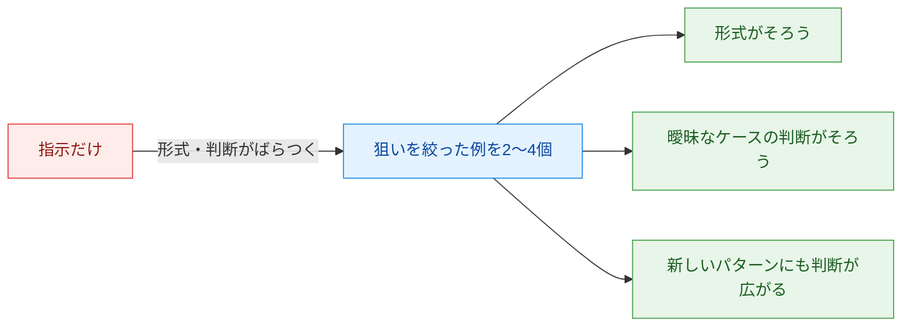

# few-shot プロンプティング（曖昧なケースの判断、出力形式の統一、抽出の精度）

> ドメイン: 4. プロンプトエンジニアリングと構造化出力（20%） ／ 更新: 2026-11-20

!!! abstract "ひとことで"
    詳しい指示を足しても出力がばらつくなら、入出力の例を数個入れる。例には==選んだ判断と、もっともらしい別案を選ばなかった理由==まで書く。

## 仕組み

few-shot（few-shot / multishot prompting）は、プロンプトに入出力の例を数個入れる手法だ。指示だけでは形式や判断がばらつくとき、形式と質をそろえる最も効く手段になる。理由まで示した例は、例と同じものに当てはまるだけではない。判断の考え方が伝わるので、==例に無い新しいパターンにも判断が広がる==。だから、網羅的なルールを列挙するより向く。

例は次の4点を満たすように作る。

- 関連性（Relevant）: 実際の入力に近い題材にする
- 多様性（Diverse）: 端のケースを含める。例が似すぎると、意図しない共通点（いつも同じ長さ、同じ重大度、語順など）まで真似される
- 構造（Structured）: `<example>` タグ（複数なら `<examples>`）で囲み、指示と区別させる
- 理由（ガイド 4.2。best practices の3点には無い）: 曖昧なケースの例には、選んだ行動と、選ばなかった別案とその理由を書く

few-shot は確率的な手段だ。必ず守らせたい順序や、原因が別にある誤りには使わない。

| 場面 | few-shot | 理由・代わりの手段 |
|---|---|---|
| レビュー指摘の形式（場所・問題・重大度・修正案）がばらつく | 効く | 目的の形式の例を見せると、形式がそろう |
| どちらのツールか・指摘するかが曖昧 | 効く | 判断と理由を例で示すと、境界の判断がそろう |
| 許容してよいコードを誤って指摘する（誤検知） | 効く | 「許容されるパターン」と「本当の問題」を対にした例で、違いの理由を示す。例に無いコードにも同じ線引きが広がる |
| 文書の形式が様々で、必須項目が空で返る | 効く | 形式の違いごとに正しい抽出例を見せる。例: 本文中の引用（inline citations）と末尾の参考文献一覧（bibliographies）、独立した「方法」の節と本文に埋め込まれた方法の記述 |
| 在庫の引き当てが済むまで出荷指示を出させない、のような必ず守る順序 | 不十分 | 例は確率的な遵守にとどまり、金銭や業務に影響する場面では足りない。前段の結果が返るまで後段のツールを呼べないよう、プログラムで強制する（[順序の強制のノート](../01-agentic-architecture/programmatic-workflow-enforcement.md)） |
| 似た2つの検索ツール（社員名簿と会議室）の説明が1行ずつで、取り違える | 第一手ではない | 原因は説明文の情報不足なので、例を足しても原因は残る。説明文に扱う入力・使う場面・もう一方との境界を書く。例で直すのは、説明を直した後も曖昧さが残るとき |
| JSON の構文を必ず正しくしたい | 第一手ではない | tool use と JSON スキーマ（structured outputs）を使う（[構造化出力のノート](tool-use-json-schema.md)） |

??? info "例の数・併用・ガイドとの違い"
    - 例の数: ガイド（4.2）は2〜4個、現行の Prompting best practices は3〜5個を勧める。試験はガイドの2〜4個を主に覚える（3.5 の入出力例は2〜3個と書かれている）
    - thinking（思考）と併用できる。例を「問題・解き方・答え」の形で示すと、思考の進め方にも効く
    - 旧ドキュメントの「multishot prompting」の個別ページは、今は Prompting best practices に統合されている
    - エスカレーションの判断がずれるときは、明確な基準と、エスカレーションする例・自分で解決する例をシステムプロンプトに入れる。根拠はガイド 5.2 の Skills（[エスカレーションのノート](../05-context-reliability/escalation-ambiguity.md)）
    - 誤検知を減らす基準そのものの書き方は、[明確な基準のノート](explicit-criteria-false-positives.md)が主
    - 未確認: 公式ドキュメントには「few-shot で抽出の幻覚（ハルシネーション。元に無い値を作ること）が減る」と直接書いた箇所は見つからなかった。公式は「分からないと言ってよいと許可する」「引用で根拠づける」を挙げている。この論点はガイドの記述が根拠

## 試験での見分け方

| 問われること | ○ 正しい | × ひっかけ |
|---|---|---|
| 詳しい指示を足しても形式がばらつく | 目的の形式の例を入れる | 指示をさらに書き足す |
| 曖昧な依頼でツールの選択が割れる | 狙いを絞った例2〜4個で、選んだツールと別案を退けた理由を示す | 判断だけを並べた例にする（理由が無いと新しいケースに広がらない） |
| テストの抜けの指摘が浅い（分岐ごとの網羅の抜けを見落とす） | 分岐単位の抜けを指摘した例を見せる | 「網羅性を厳しく見て」と指示だけ足す |
| 文書によって必須項目が null になる、「ひとつかみ」のようなくだけた分量で値を作る | 様々な形式からの正しい抽出例を入れる | 表形式の例だけを見せる |
| 例を列挙しきれない新しいケースが来る | 理由つきの例で考え方を伝える | 網羅的なルールを列挙する |

## 確認問題

??? question "Q1. 社内 Wiki の記事を「手順書」「議事録」「仕様書」に分類させている。指示を何度書き足しても、議事録の中に手順が書かれた記事の分類が割れる。まず何をする？"
    判断の割れる記事の例を2〜4個入れ、選んだ分類と、もっともらしい別の分類を選ばなかった理由を示す。指示の書き足しを続けても、曖昧なケースはそろわない。

??? question "Q2. SQL のレビューで、チームが意図して使う `SELECT *`（一時テーブルへの全列コピー）まで毎回指摘され、開発者が指摘を読まなくなった。「重要な指摘だけにして」と書き足しても減らない。どうする？"
    許容してよい使い方の例と、本当に問題になる使い方（本番のクエリで列が増えると壊れる、など）の例を対にして入れる。「重要なものだけ」のような曖昧な指示では、精度は上がらない。

??? question "Q3. 料理ブログからレシピの材料を抽出している。表形式の記事は取れるが、本文中に「塩少々」「卵ふたつ」と書く記事では、分量が null になったり、元に無い数値が入ったりする。どうする？"
    表形式・本文埋め込み・くだけた分量表記など、様々な形式の記事からの正しい抽出例を入れる（「少々」は数値にせず原文のまま残す、など）。スキーマ側の nullable などの設計は、別ノートの範囲。

## 出典
- [Prompting best practices — Use examples effectively](https://platform.claude.com/docs/en/build-with-claude/prompt-engineering/claude-prompting-best-practices#use-examples-effectively)（公式）
- [Increase output consistency — Constrain with examples](https://platform.claude.com/docs/en/test-and-evaluate/strengthen-guardrails/increase-consistency#constrain-with-examples)（公式）
- [Reduce hallucinations](https://platform.claude.com/docs/en/test-and-evaluate/strengthen-guardrails/reduce-hallucinations)（公式）
- Claude Certified Architect – Foundations Exam Guide v1.1、タスクステートメント 4.2（関連: 2.1、3.5、5.2）（公式）
