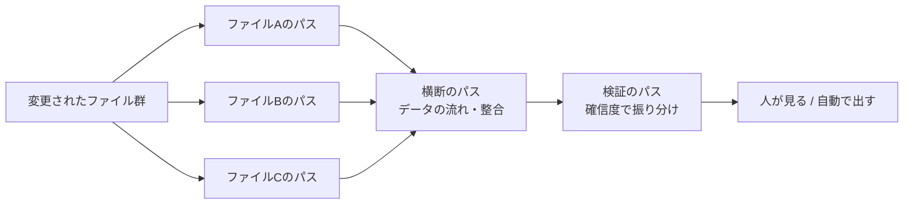

# 独立したインスタンスによるレビューと、複数パスのレビュー（Multi-instance and multi-pass review）

> ドメイン: 4. プロンプトエンジニアリングと構造化出力（20%） ／ 更新: 2026-11-20

## 3行まとめ
- 書いたのと同じセッションに見直させても甘くなる。書いたときの推論（reasoning context）を持たない別のインスタンスにレビューさせる
- 多数のファイルは1回で見ず、ファイル単位のパス（局所の問題）と横断のパス（ファイル間のデータの流れ）に分ける
- 決め手は「見落としの原因」。自分の判断を疑えないなら別インスタンス、注意が散るならパスを分ける

## 仕組み

### 自己レビューの限界（self-review limitations）
- 生成したセッションは自分の推論を覚えているので、自分の判断を疑いにくい
- 「見直して」と指示する・拡張思考（extended thinking、答える前に長く考える機能）を足すだけでは、別インスタンスほど細かい問題を拾えない（ガイドの記述）
- Claude Code の `/code-review` は、会話を見ていない新しいサブエージェント（fresh subagent）で差分を見る。作った推論に引きずられない

### 複数パスのレビューの流れ

### パスごとに見つかるもの

| | ファイル単位のパス（per-file） | 横断のパス（cross-file integration） |
|---|---|---|
| 見る範囲 | 1ファイルに集中 | ファイル間のつながり |
| 見つかるもの | null 未チェック、境界値、例外の握りつぶし | 型や戻り値の契約のずれ、呼び出し側の直し漏れ、データの流れの破綻 |
| 防ぐ問題 | 注意の分散（attention dilution、量が多くて見る深さがばらつく） | 局所だけ見て全体の矛盾を見逃す |
| 苦手 | ファイルをまたぐ問題は見えない | 細部の確認は浅くなる |

### 確信度で振り分ける検証のパス
- 指摘ごとにモデル自身の確信度（confidence）と重大度を付けさせ、低いものを人の確認へ回す（ガイドの「calibrated review routing」）
- 公式のモデル別ガイドの推奨: 別の検証段階があるなら、発見の段階では確信度で絞らず全部報告させ、確信度と重大度を添えさせる
- 「発見は網羅、絞り込みは後段」と役割を分けると、見落とし（recall の低下）を防げる

## 試験で問われそうなポイント
- 生成したコードの見直しで細かいバグが漏れる → 生成時の推論を渡さない2つ目のインスタンスにレビューさせる
- 多数のファイルの1回のレビューで、深さがばらつく・同じコードに逆の指摘が出る → ファイル単位＋横断のパスに分ける
- 呼び出し元と呼び出し先で契約がずれるような問題 → 横断のパスの担当
- 発見の段階で「確信度の高いものだけ」と絞ると、本物のバグまで落ちる → 発見は網羅し、確信度は後段の振り分けに使う

## 間違えやすいところ
- 書いたのと同じセッションで「厳しく自己レビューして」と頼むのはアンチパターン。指示を強めても推論の持ち越しは消えない
- 多数のファイルを1回のパスに詰めるのもアンチパターン。見る深さがばらつき、同じ書き方に逆の指摘が出る
- 確信度は「振り分け」に使う。4.1 の「確信度の高いものだけ報告して」で精度を上げる、とは別（4.1 では明確な基準の方が効く）
- 自己申告の確信度は較正（calibration、ラベル付きデータで閾値を合わせること）しないと当てにならない（5.2・5.5 の論点）
- ガイドの「拡張思考より別インスタンスの方が効く」、「ファイル単位＋横断のパス」は、公式ドキュメントで同じ形の記述は未確認（ガイドの記述が根拠）

## 確認問題
1. エージェントが決済処理を実装し、同じ会話のまま「今の実装を厳しくレビューして」と頼むと毎回「問題なし」と返る。どう直すか。
   

答え
実装の会話を引き継がない別のインスタンス（新しいサブエージェントや別セッション）に、差分と基準だけを渡してレビューさせる。同じセッションは自分の推論を持ち越すので判断を疑いにくい。

2. API のレスポンス型を変えた PR で、各ファイルのレビューはきれいだったのに、本番で別モジュールが古い形を読んで壊れた。どのパスが足りなかったか。
   

答え
横断のパス。ファイル単位のパスは局所の問題に強いが、ファイル間のデータの流れ（型の契約のずれ、読み手の直し漏れ）は見えない。

3. レビューの後段に人の確認とランク付けの段階がある。発見の段階のプロンプトに「確信度の高い指摘だけ出して」と書いている。何が問題か。
   

答え
発見の段階で絞ると、確信度は低いが本物のバグが消える。発見の段階では全部出させ、指摘ごとに確信度と重大度を付けさせて、後段の振り分けに使う。

## 出典
- Claude Certified Architect – Foundations Exam Guide v1.1（公式 PDF、Task Statement 4.6、1.6、3.6、4.1）
- [Best practices for Claude Code](https://code.claude.com/docs/en/best-practices)（公式。`/code-review` は会話を見ていない新しいサブエージェントで見る、別セッションが一番手軽な独立したレビュアー）
- [Code review（ローカルの `/code-review`）](https://code.claude.com/docs/en/code-review-local)（公式。独自のコンテキストを持つサブエージェントで動く）
- [Prompting Claude Opus 4.8 – Code review harnesses](https://platform.claude.com/docs/en/build-with-claude/prompt-engineering/prompting-claude-opus-4-8)（公式。発見の段階は網羅、確信度と重大度を添え、絞り込みは後段）
- [Prompting best practices – Chain complex prompts](https://platform.claude.com/docs/en/build-with-claude/prompt-engineering/claude-prompting-best-practices)（公式。下書き → 基準でレビュー → 直すのチェーン）
- 関連: [タスク分解の選び方](../01-agentic-architecture/prompt-chaining-vs-dynamic-decomposition.md)、[CI での自動レビューとテスト生成](../03-claude-code/ci-review-test-quality.md)
