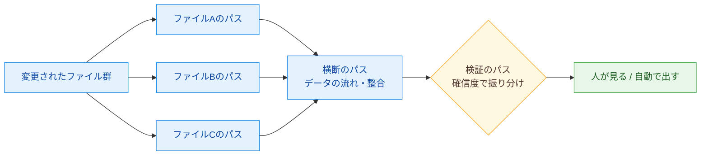

# 独立したインスタンスによるレビューと、複数パスのレビュー（Multi-instance and multi-pass review）

> ドメイン: 4. プロンプトエンジニアリングと構造化出力（20%） ／ 更新: 2026-11-20

!!! abstract "ひとことで"
    書いたのと同じセッションに見直させると甘くなるので、==書いたときの推論を持たない別のインスタンス==にレビューさせる。多数のファイルは、==ファイル単位のパスと横断のパス==に分けて見る。

## 仕組み

どちらの手を使うかは、見落としの原因で決める。生成したセッションは自分の推論（reasoning context）を覚えているので、自分の判断を疑いにくい。「見直して」と指示したり、拡張思考（extended thinking、答える前に長く考える機能）を足したりしても、別インスタンスほど細かい問題は拾えない（ガイドの記述）。Claude Code の `/code-review` も、ターミナルでは会話を見ていない新しいサブエージェント（fresh subagent）で差分を見る。だから作ったときの推論に引きずられない。

原因が量のほうにあるなら、パスを分ける。大きなレビューを1回のパスにまとめると、注意の分散（attention dilution、量が多くて見る深さがばらつく）が起き、指摘どうしが矛盾しやすい（contradictory findings）。

| | ファイル単位のパス（per-file） | 横断のパス（cross-file integration） |
|---|---|---|
| 見る範囲 | 1ファイルに集中 | ファイル間のつながり |
| 見つかるもの | null 未チェック、境界値、例外の握りつぶし | 型や戻り値の契約のずれ、呼び出し側の直し漏れ、データの流れの破綻 |
| 防ぐ問題 | 注意の分散 | 局所だけ見て全体の矛盾を見逃す |
| 苦手 | ファイルをまたぐ問題は見えない | 細部の確認は浅くなる |

最後の検証のパスでは、指摘ごとにモデル自身の確信度（confidence）を付けさせ、較正したレビューの振り分け（calibrated review routing）に使う（ガイド 4.6）。公式のモデル別ガイドは、別の検証段階があるなら、発見の段階では確信度で絞らずに全部報告させ、確信度と重大度を添えさせるよう勧めている。発見の段階から確信度での絞り込みを外すと、よく効く（公式）。効いたかどうかは、評価データで recall（見落としの少なさ）や F1 を測って確かめる。

??? info "ほかの論点との関係と、未確認のこと"
    - 確信度の低いものを人の確認へ回す流れは、5.5 の論点（人によるレビューと確信度の較正）
    - 自己申告の確信度は、較正（calibration、ラベル付きデータで閾値を合わせること）しないと当てにならない（5.2・5.5 の論点）
    - 確信度を振り分けに使う話は、4.1 の「確信度の高いものだけ報告して」で精度を上げる話とは別。4.1 では明確な基準の方が効く
    - ガイドの「拡張思考より別インスタンスの方が効く」「ファイル単位＋横断のパス」は、公式ドキュメントで同じ形の記述は未確認（ガイドの記述が根拠）

## 試験での見分け方

| 問われること | ○ 正しい | × ひっかけ |
|---|---|---|
| 生成したコードの見直しで細かいバグが漏れる | 生成時の推論を渡さない2つ目のインスタンスにレビューさせる | 同じセッションで「厳しく自己レビューして」と頼む（指示を強めても推論の持ち越しは消えない） |
| 大きな複数ファイルのレビュー | ファイル単位のパスと横断のパスに分ける | 1回のパスにまとめる（注意が分散し、指摘が矛盾しやすい） |
| 呼び出し元と呼び出し先の契約のずれ | 横断のパスで見る | ファイル単位のパスだけで済ませる |
| 後段に検証の段階がある、発見の段階 | 全部出させ、確信度と重大度を添えさせて、後段の振り分けに使う | 「確信度の高いものだけ」と絞る（本物のバグまで落ちる） |

## 確認問題

??? question "Q1. エージェントが決済処理を実装し、同じ会話のまま「今の実装を厳しくレビューして」と頼むと、毎回「問題なし」と返る。どう直す？"
    実装の会話を引き継がない別のインスタンス（新しいサブエージェントや別セッション）に、差分と基準だけを渡してレビューさせる。同じセッションは自分の推論を持ち越すので、判断を疑いにくい。

??? question "Q2. API のレスポンス型を変えた PR で、各ファイルのレビューはきれいだったのに、本番で別モジュールが古い形を読んで壊れた。どのパスが足りなかった？"
    横断のパス。ファイル単位のパスは局所の問題に強いが、ファイル間のデータの流れ（型の契約のずれ、読み手の直し漏れ）は見えない。

??? question "Q3. レビューの後段に、人の確認とランク付けの段階がある。発見の段階のプロンプトに「確信度の高い指摘だけ出して」と書いている。何が問題？"
    発見の段階で絞ると、確信度は低いが本物のバグが消える。発見の段階では全部出させ、指摘ごとに確信度と重大度を付けさせて、後段の振り分けに使う。

## 出典
- Claude Certified Architect – Foundations Exam Guide v1.1（公式 PDF、Task Statement 4.6、1.6、3.6、4.1、5.5）
- [Best practices for Claude Code](https://code.claude.com/docs/en/best-practices)（公式。ターミナルでは `/code-review` は会話を見ていない新しいサブエージェントで見る、別セッションが一番手軽な独立したレビュアー）
- [Code review（ローカルの `/code-review`）](https://code.claude.com/docs/en/code-review-local)（公式。ターミナルのセッションでは、独自のコンテキストを持つサブエージェントで動く）
- [Prompting Claude Opus 4.8 – Code review harnesses](https://platform.claude.com/docs/en/build-with-claude/prompt-engineering/prompting-claude-opus-4-8)（公式。発見の段階は網羅、確信度と重大度を添え、絞り込みは後段。評価データで recall・F1 を確かめる）
- [Prompting Claude Sonnet 5 – Code review harnesses](https://platform.claude.com/docs/en/build-with-claude/prompt-engineering/prompting-claude-sonnet-5)（公式。同じ趣旨の節）
- [Prompting best practices – Chain complex prompts](https://platform.claude.com/docs/en/build-with-claude/prompt-engineering/claude-prompting-best-practices)（公式。下書き → 基準でレビュー → 直すのチェーン）
- 関連: [タスク分解の選び方](../01-agentic-architecture/prompt-chaining-vs-dynamic-decomposition.md)、[CI での自動レビューとテスト生成](../03-claude-code/ci-review-test-quality.md)
