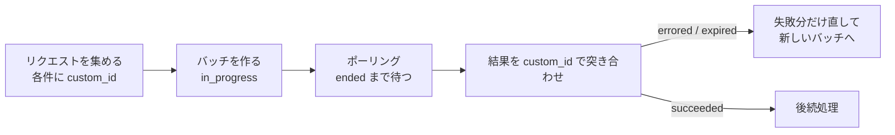

# Message Batches API を使うバッチ処理の設計

> ドメイン: 4. プロンプトエンジニアリングと構造化出力（20%） ／ 更新: 2026-11-20

## 3行まとめ
- Message Batches API（非同期の一括処理）は料金が 50% になる代わりに、処理に最大 24 時間かかり、待ち時間の保証（latency SLA）は無い
- 待てる処理（夜間・週次の分析）に使い、人や後続処理を待たせる処理（ブロッキング）には同期の Messages API を使う
- 結果は `custom_id` で突き合わせ、失敗した分だけを直して出し直す。締め切りから「24 時間＋余裕」を引いて投入の間隔を決める

## 仕組み

### 向く処理と向かない処理

| | 向く（バッチ API） | 向かない（同期 API） |
|---|---|---|
| 待てる時間 | 数時間〜1日待てる | 秒〜分で結果が要る |
| 例 | 夜間のレポート、週次の監査、夜間のテスト生成、大量の評価 | 人が結果を待って次に進む処理、会話の応答 |
| ツール | 1回で完結する処理 | 自分のツールを途中で実行して結果を返す、複数ターンのループ |
| 狙い | コストを半分に、スループットを上げる | 待ち時間を短く、確実に |

### 数字と仕様（公式ドキュメントで確認）
- 料金: 入力・出力ともに標準価格の 50%
- 処理時間: 多くは 1 時間以内。最大 24 時間で、終わらなかった分は `expired`（期限切れ）になる
- 上限: 1 バッチ 100,000 件または 256 MB の、先に達したほう
- 結果の保存: 作成から 29 日。提出後のバッチは変更できない（取り消して作り直す）
- 結果の種類: `succeeded`／`errored`／`canceled`／`expired`。後ろ3つは課金されない
- 1件の失敗は、同じバッチのほかの件に影響しない

### custom_id
- 各リクエストに付ける一意の ID（英数字・`-`・`_` の 1〜64 文字）
- 結果は投入の順に返らない。順番ではなく `custom_id` で元のリクエストと結び付ける
- 意味のある値（例: `invoice-2026-11-0042`）にすると、失敗分の特定と出し直しが楽

### SLA の計算（自作の例）
- 条件: データが届いてから 36 時間以内に結果を出す。バッチは最大 24 時間、後処理に 2 時間
- 最悪の待ち = 投入の間隔 ＋ 24 時間 ＋ 2 時間 ≦ 36 時間 → 間隔は 10 時間以下
- 余裕を持たせて 8 時間ごと（1日3回）に投入する
- 失敗分の出し直しもバッチで回すなら、さらに最大 24 時間が乗る。間に合わないときは同期 API で出し直す

## 試験で問われそうなポイント
- 「結果を待って人や処理が止まる」→ 同期 API。「翌朝までに見ればよい」→ バッチ API
- 「コストを下げたいが一部はリアルタイム」→ 処理ごとに API を分ける。全部をバッチにしない
- 「締め切りが N 時間」→ 投入の間隔 ≦ N − 24 − 後処理の時間
- 「結果の順番がばらばら」→ `custom_id` で突き合わせる
- 「一部が errored（例: 文書が長すぎた）」→ その `custom_id` だけを分割などで直して出し直す
- 「数万件を流す前」→ 少数のサンプルでプロンプトを詰め、1回目の成功率を上げる

## 間違えやすいところ
- ブロッキングの処理（マージ前のチェックなど）を 50% 安いからとバッチに載せる → 最大 24 時間待たせる
- 1つのリクエストの中で、自分のツールを実行して結果を返す複数ターンのループをさせる → できない。ループは同期 API で回す
- ずれ: 現行のドキュメントはツール定義・会話履歴・サーバーツール（web search など）を「バッチにできる」とする。ガイドの「できない」は、クライアント側でツールを実行して途中で返すことを指す
- 一部の失敗で全件を出し直す → 成功分まで二重に課金され、時間も無駄。失敗分だけを出し直す
- サンプルで試さずに大量に流す → 失敗が大量に出て、出し直しのコストと時間が膨らむ
- 「多くは 1 時間以内」を SLA と考える → 保証は無い。計算は最大 24 時間で行う
- 結果を投入順に並んでいると思い込む → 順不同。`custom_id` を使う

## 確認問題
1. カスタマーサポートのチャットで、顧客の質問に答える処理と、前月分の問い合わせ 5 万件を分類して月初の会議資料にする処理がある。コストを下げるにはどうするか。
   

答え
分類だけをバッチ API に移し、チャットの応答は同期 API のままにする。チャットは即答が要り、最大 24 時間の遅れは許されない。分類は待てるので 50% の割引が効く。

2. 届いた請求書を 30 時間以内に処理する約束がある。後処理に 1 時間かかる。バッチ API で回すとき、投入の間隔は最大で何時間か。
   

答え
5 時間。30 − 24 − 1 = 5。届いた直後に投入が終わった件が、次の投入まで最大 5 時間待ち、さらに最大 24 時間の処理と 1 時間の後処理がかかる。

3. 1 万件のバッチのうち 120 件が、入力が長すぎて `errored` になった。どうするか。
   

答え
`errored` の `custom_id` を拾い、その 120 件だけを分割するなど直して新しいバッチで出し直す。全件を出し直すと成功分まで払い直しになる。

4. 各件で社内 DB を引くツールを何度か呼ばせながら調査させたい。バッチ API に向くか。
   

答え
向かない。1つのバッチリクエストの中で、自分のツールを実行して結果を返すことはできない。同期 API でツールのループを回す。

## 出典
- [Batch processing](https://platform.claude.com/docs/en/build-with-claude/batch-processing)（公式）
- [Claude Certified Architect – Foundations Exam Guide v1.1](https://cc.sj-cdn.net/instructor/6nizmqk8tpzpfjvt6qmmav7rh/public/1794946250/Claude_Certified_Architect_-_Foundations_Exam_Guide.pdf)（公式、タスクステートメント 4.5）
- 未確認: Message Batches API のレート制限の具体的な数値（rate limits のページは読んでいない）
