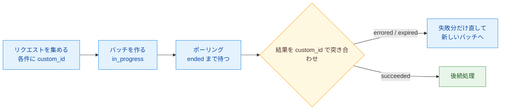

# Message Batches API を使うバッチ処理の設計

> ドメイン: 4. プロンプトエンジニアリングと構造化出力（20%） ／ 更新: 2026-11-20

!!! abstract "ひとことで"
    Message Batches API（非同期の一括処理）は、==料金が 50%== になる代わりに処理に最大 24 時間かかる。待てる処理にだけ使い、人や後続の処理を待たせる処理には同期の Messages API を使う。

## 仕組み

バッチ API は、多くのリクエストをまとめて投げ、後で結果を受け取る仕組みだ。多くは 1 時間以内に終わるが、最大 24 時間かかり、待ち時間の保証（latency SLA）は無い。24 時間で終わらなかった分は `expired`（期限切れ）になる。だから夜間・週次の分析のように待てる処理に向き、結果を待って止まる処理（ブロッキング）には向かない。

| | 向く（バッチ API） | 向かない（同期 API） |
|---|---|---|
| 待てる時間 | 数時間〜1日待てる | 秒〜分で結果が要る |
| 例 | 夜間のレポート、週次の監査、夜間のテスト生成、大量の評価 | 人が結果を待って次に進む処理、会話の応答 |
| ツール | 1回で完結する処理 | 自分のツールを途中で実行して結果を返す、複数ターンのループ |
| 狙い | コストを半分に、スループットを上げる | 待ち時間を短く、確実に |

結果は投入の順に返らない。各リクエストに付けた ==`custom_id`== で、元のリクエストと結び付ける。`invoice-2026-11-0042` のような意味のある値にすると、失敗分を特定して出し直しやすい。結果は `succeeded`／`errored`／`canceled`／`expired` のどれかだ。後ろ3つは課金されず、1件の失敗はほかの件に影響しない。だから失敗した分だけを直して、新しいバッチで出し直す。

自分のツールを使う処理は、バッチに載せにくい。1つのバッチリクエストの中で、アプリ側のツールを実行して結果を返す複数ターンのループはできないからだ。結果を履歴に入れて次のバッチで続けることはできるが、1往復ごとに最大 24 時間かかるので、同期 API で回すのが現実的だ。

!!! example "締め切りからの計算（自作の例）"
    データが届いてから 36 時間以内に結果を出す。バッチは最大 24 時間、後処理に 2 時間かかる。最悪の待ちは「投入の間隔 ＋ 24 時間 ＋ 2 時間」で、これが 36 時間以下なので、間隔は 10 時間以下になる。余裕を持たせて、8 時間ごと（1日3回）に投入する。失敗分の出し直しもバッチで回すなら、さらに最大 24 時間が乗る。間に合わないときは同期 API で出し直す。

??? info "数字と仕様（公式ドキュメントで確認）"
    - 料金: すべての使用量（入力・出力・特殊トークン）が標準価格の 50%
    - 上限: 1 バッチ 100,000 件または 256 MB の、先に達したほう
    - 結果の保存: 作成から 29 日。提出後のバッチは変更できない（取り消して作り直す）
    - `custom_id`: 各リクエストに付ける一意の ID。英数字・`-`・`_` の 1〜64 文字
    - レート制限: Batches API 専用で全モデル共有。Start／Build／Scale で RPM 1,000／2,000／4,000、処理待ちキュー 200,000／300,000／500,000 件（Custom は個別）。Messages API の制限には影響しない

??? info "ガイドとドキュメントのずれ（ツール）"
    - 現行のドキュメントは、ツール定義・会話履歴・サーバーツール（web search など）を「バッチにできる」とする。ガイドの「できない」は、クライアント側でツールを実行して途中で返すことを指す
    - サーバーツールは、1つのバッチリクエストの中でサーバー側のループとして複数回呼ばれる。途中で止まると `pause_turn` が返り、続きは別のリクエストで出す

## 試験での見分け方

| 問われること | ○ 正しい | × ひっかけ |
|---|---|---|
| 結果を待って止まる処理（マージ前のチェックなど） | 同期 API で回す。翌朝までに見ればよい処理だけバッチにする | 50% 安いからとバッチに載せる（最大 24 時間待たせる） |
| コストを下げたいが、一部はリアルタイム | 処理ごとに API を分ける | 全部をバッチにする |
| 締め切りが N 時間 | 投入の間隔 ≦ N − 24 − 後処理の時間 − 余裕。最大 24 時間で計算する | 早く終わった実績をもとに組む（終わる時間の保証は無い） |
| 結果の順番がばらばら | `custom_id` で突き合わせる | 投入順に並んでいると思い込む |
| 一部が `errored`（文書が長すぎたなど） | その `custom_id` だけを分割などで直して出し直す | 全件を出し直す（成功分まで二重に課金され、時間も無駄） |
| 数万件を流す前 | 少数のサンプルでプロンプトを詰め、1回目の成功率を上げる | 試さずに流す（失敗が大量に出て、出し直しのコストと時間が膨らむ） |

## 確認問題

??? question "Q1. サポートのチャットで顧客の質問に答える処理と、前月分の問い合わせ 5 万件を分類して月初の会議資料にする処理がある。コストを下げるにはどうする？"
    分類だけをバッチ API に移し、チャットの応答は同期 API のままにする。チャットは即答が要り、最大 24 時間の遅れは許されない。分類は待てるので、50% の割引が効く。

??? question "Q2. 届いた請求書を 40 時間以内に処理する約束がある。後処理に 2 時間かかり、余裕を 2 時間見たい。バッチ API で回すとき、投入の間隔は最大で何時間？"
    12 時間（40 − 24 − 2 − 2 = 12）。投入の直後に届いた件は、次の投入まで最大 12 時間待つ。そこから最大 24 時間の処理と、2 時間の後処理がかかる。

??? question "Q3. 1 万件のバッチのうち 120 件が、入力が長すぎて `errored` になった。どうする？"
    `errored` の `custom_id` を拾い、その 120 件だけを分割するなどして直し、新しいバッチで出し直す。全件を出し直すと、成功分まで払い直しになる。

??? question "Q4. 各件で、自分のアプリで実行するツール（社内 DB の検索）を何度か呼ばせながら調査させたい。バッチ API に向く？"
    向かない。1つのバッチリクエストの中で、アプリ側のツールを実行して結果を返すことはできない。次のバッチで続けると1往復ごとに最大 24 時間かかるので、同期 API でツールのループを回す。

## 出典
- [Batch processing](https://platform.claude.com/docs/en/build-with-claude/batch-processing)（公式）
- [Claude Certified Architect – Foundations Exam Guide v1.1](https://cc.sj-cdn.net/instructor/6nizmqk8tpzpfjvt6qmmav7rh/public/1794946250/Claude_Certified_Architect_-_Foundations_Exam_Guide.pdf)（公式、タスクステートメント 4.5）
- [Rate limits](https://platform.claude.com/docs/en/api/rate-limits)（公式、Message Batches API の節）
