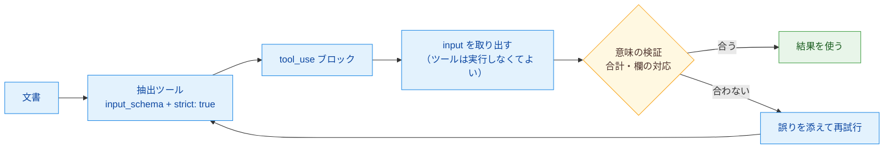

# tool_use と JSON スキーマによる構造化出力

> ドメイン: 4. プロンプトエンジニアリングと構造化出力（20%） ／ 更新: 2026-11-20

!!! abstract "ひとことで"
    抽出したい項目をツールの入力スキーマ（input_schema）にし、tool_use ブロックの `input` を受け取る。==構文の誤りは消えるが、意味の誤りは消えない==。

## 仕組み

抽出用のツールは、実際の処理を持たなくてよい。スキーマを渡す「器」として使い、`input` をそのまま結果にする。これがスキーマどおりの出力を得るいちばん確実な方法だ。ツール定義に `strict: true` を付ける strict tool use は、出力をスキーマに合うトークンだけに絞る（grammar-constrained sampling）。だから型の違い（`"2"` と `2`）や必須項目の抜けも無くなる。必ずツールを呼ばせるのは tool_choice の設定だ。文書の種類が分からず抽出ツールが複数あるなら any、特定の抽出を先に通すなら tool にする（詳細は [tool_choice のノート](../02-tool-design-mcp/tool-choice.md)）。

スキーマが保証するのは形だけだ。その誤りが ==JSON の形の問題か、値の中身の問題か==で手段が分かれる。形ならスキーマで、中身ならアプリ側の検証とプロンプトで直す。

| 誤りの例 | tool use＋厳密なスキーマで | 拾う方法 |
|---|---|---|
| 閉じ括弧の抜けなど、JSON として壊れている | 防げる | — |
| 必須項目の抜け、型の違い（数値が文字列） | 防げる（strict のとき） | — |
| enum に無い値 | 防げる（大文字・小文字の違いは除く） | 大文字・小文字を無視して比べる。大文字・小文字だけが違う enum 値を作らない |
| 明細の合計が total と合わない | 防げない | アプリ側の計算チェック |
| 値が別の欄に入る（請求日と支払期限が逆） | 防げない | 検証＋プロンプトで欄の定義を明記 |
| 元の文書に無い値を作る | 防げない（必須にすると増える） | 任意・nullable にする（[抽出用スキーマのノート](extraction-schema-design.md)） |
| 書き方のばらつき（`2026/3/5` と `5 Mar 2026`） | 型だけでは決まらない | プロンプトに正規化のルールを書く |

`format: "date"`（strict でも対応）で形は縛れる。しかし `03/05` が3月5日か5月3日かは、スキーマでは決まらない。元の書き方をどう解釈するかは、プロンプトに書く。

??? info "スキーマに合わない出力・strict の制限・ガイドとのずれ"
    - `stop_reason: "max_tokens"`: 途中で切れて、スキーマに合わない。`max_tokens` を増やして再実行する
    - `stop_reason: "refusal"`: 安全上の拒否が優先され、スキーマに合わないことがある
    - strict 無しでは何も保証されない。壊れた JSON（構文の誤り）も、型の違い（`"two"`）や必須項目の抜けも起こりうる（頻度は書かれていない）
    - strict でも使えない JSON Schema の機能がある（`minimum` / `maximum`、`minLength` などは 400 エラー）。数値の範囲チェックもアプリ側の検証になる。SDK ヘルパーの多くは、使えない制約を外して description に書き足す。応答を検証するヘルパーなら、元の制約で検証する
    - ガイドとのずれ: ガイドは「tool use＋JSON スキーマ」と書く。現行ドキュメントでは、同じ仕組み（constrained decoding）が structured outputs（`output_config.format`）と strict tool use の2つに分かれている
    - ガイドとのずれ: 現行の define-tools では、Fable 5.2・Mythos 5.2・Opus 5.5・Sonnet 5.5・Fable 5.1・Mythos 5.1 は tool_choice の any / tool を 400 エラーで拒否する（Opus 5・Haiku 5.5 などは受け付ける）。代わりに auto＋strict tool use か structured outputs を勧める。試験はガイドの書き方で覚える
    - モデルに関係なく、手動の extended thinking（`thinking: {type: "enabled"}`）と any / tool を併用するとエラーになる

## 試験での見分け方

| 問われること | ○ 正しい | × ひっかけ |
|---|---|---|
| テキストで返させた JSON が、時々パースできない | 抽出ツールの input_schema（＋strict）に変える | プロンプトの頼み方を工夫する |
| スキーマどおりなのに、合計や欄の対応がおかしい | 検証して、誤りを添えて再試行する（[検証・再試行のノート](validation-retry-loop.md)） | スキーマをさらに厳しくする（保証されるのは形だけ） |
| 文書ごとに日付や単位の書き方がばらばら | スキーマに加えて、プロンプトに「日付は YYYY-MM-DD」などの正規化ルールを書く | `format: "date"` などスキーマだけでそろえる |
| 情報が無い文書もある項目 | 任意・nullable にする | 必須にして抜けを無くす（値を作ってしまう） |

## 確認問題

??? question "Q1. 経費精算のレシートから `items`（品目と金額の配列）と `total` を抽出している。strict なツールにしてからパースエラーは無くなったが、品目の合計と total が時々食い違う。スキーマに何を足せば防げる？"
    スキーマでは防げない。合計の一致は意味の誤りで、strict が保証するのは形（型・必須・enum）だけだ。抽出後にアプリ側で合計を計算して比べる。食い違えば、差を添えて再試行するか、人の確認に回す。

??? question "Q2. 契約書の抽出で、`signed_date` に `2026年3月5日`、`03/05/26`、`5.3.2026` が混ざって届く。スキーマで string 型に `format` の date を付けた以外に、何をする？"
    プロンプトに正規化ルールを書く（YYYY-MM-DD に直す、`03/05/26` のような並びは月/日/年として読む、年が2桁なら20XX など）。スキーマは出力の型を縛るだけで、元の書き方をどう解釈するかは決めない。

??? question "Q3. 抽出結果を JSON のテキストで返すよう頼んでいるが、1,000件に数件、末尾が切れたり引用符が崩れたりしてパースに失敗する。最も確実な改善は？"
    抽出項目を input_schema にしたツールを定義し（`strict: true`）、tool_use の `input` を受け取る。構文の誤りが無くなる。ただし、末尾が切れるのが `max_tokens` のせいなら、上限も見直す（その場合はスキーマに合わない出力になりうる）。

## 出典
- [Strict tool use](https://platform.claude.com/docs/en/agents-and-tools/tool-use/strict-tool-use)（公式）
- [Structured outputs — Invalid outputs / JSON Schema limitations](https://platform.claude.com/docs/en/build-with-claude/structured-outputs)（公式）
- [Define tools — Forcing tool use](https://platform.claude.com/docs/en/agents-and-tools/tool-use/define-tools#forcing-tool-use)（公式）
- [Handle tool calls](https://platform.claude.com/docs/en/agents-and-tools/tool-use/handle-tool-calls)（公式。tool_use ブロックの `input`）
- Claude Certified Architect – Foundations Exam Guide v1.1、タスクステートメント 4.3・4.4（公式）
- 未確認: strict 無しの tool use で、JSON の構文そのものが壊れる頻度。ドキュメントは型の違い・必須の抜けの例を挙げるだけで、構文の誤りの発生率は書いていない
