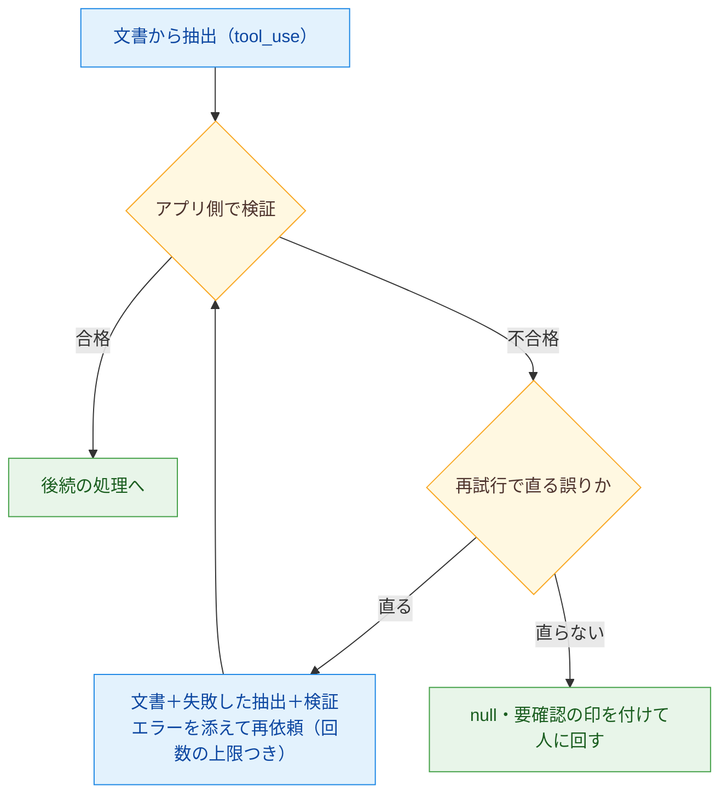

# 検証・再試行・フィードバックのループ

> ドメイン: 4. プロンプトエンジニアリングと構造化出力（20%） ／ 更新: 2026-11-20

!!! abstract "ひとことで"
    抽出結果はアプリ側で検証し、失敗したら==元の文書・失敗した抽出・具体的な検証エラー==を添えて再依頼する。ただし、元の文書に無い情報は何度再試行しても出てこない。

## 仕組み

この再依頼のやり方を、エラーを添えた再試行（retry-with-error-feedback）と呼ぶ。エラーの中身を渡すので、モデルは何を直せばよいかが分かる。再試行するかは、==同じ文書を読み直せば直せる誤りか==で決める。直せないなら、再試行ではなく入力か設計を変える。再試行の回数には上限を設ける。handle-tool-calls も「ループで許す再試行の回数を制限する」としている。

エラーには2種類あり、防ぐ場所が違う。

| 種類 | 例 | どこで防ぐか |
|---|---|---|
| スキーマの構文エラー（schema syntax error） | JSON が壊れている、必須フィールドが無い、型が違う | tool_use で消える。strict tool use でほぼ保証される（例外は下の折りたたみ） |
| 意味の検証エラー（semantic validation error） | 明細の合計が総額と合わない、値が別のフィールドに入っている | アプリ側の検証（Pydantic（Python のデータ検証ライブラリ）など）で見つけ、再試行する |

| 誤り | 再試行 | 理由 |
|---|---|---|
| 日付の形式違い（`11/3/2026` を ISO 形式にしていない） | 直る | 情報は文書にあり、書き方だけが違う |
| 構造の誤り（明細を配列にせず1つの文字列にした） | 直る | 検証エラーで正しい形を示せる |
| 値の置き場所の誤り（請求先の住所を納品先に入れた） | 直る | 文書を読み直せば正しい位置が分かる |
| 合計の食い違い（明細の和が総額と合わない） | 再依頼の対象 | 意味の検証エラー。ずれの額を具体的に添えて再依頼する |
| 文書に無い情報（別紙の契約書にしか無い支払条件） | 直らない | 渡していない文書の中身はモデルには分からない |

合計の食い違いに印を付けられるよう、`calculated_total`（明細から計算した合計）と `stated_total`（文書に書かれた合計）を両方出させ、さらに `conflict_detected`（元データの中に矛盾があるかの真偽値）を持たせて、文書自体の矛盾を抽出ミスと区別する。これらをまとめて自己修正の検証フロー（self-correction validation flow）と呼ぶ。どこで比べるかはガイドに書かれていない。矛盾は再試行で消えないので、人に回すのが筋だ（推論。ガイドには無い）。

同じ考え方は、コードレビューなどの指摘（finding）にも使える。各指摘に `detected_pattern`（どのコードの書き方が指摘のきっかけになったか）を持たせる。開発者が却下した指摘をパターンごとに集計すれば、誤検知（false positive）の多いパターンが分かるので、そのプロンプトや基準を直す。

??? info "strict の例外と、自前の検証で補うこと"
    - tool_use と JSON スキーマの仕組み・スキーマの設計は、4.3 の別ノート（tool-use-json-schema、extraction-schema-design）が主
    - strict の保証は「in most cases」。例外は refusal（200 で課金され、スキーマに合わないことがある）、`max_tokens`（途中で切れる）、enum・const の大文字・小文字
    - 数値範囲（minimum・maximum）や文字数（minLength）は未対応で、そのまま送ると 400 エラーになる
    - 多くの SDK ヘルパーはこれらを description に移して送る。応答を検証するのは、ヘルパーが検証する場合だけ（TypeScript の `jsonSchemaOutputFormat()` は検証しない）。範囲の検証は自前の検証ループで行う
    - 作り話を防ぐのは、nullable なフィールド（4.3）で null を返せるようにすること
    - `detected_pattern`・`calculated_total`・`stated_total`・`conflict_detected` はガイドが示す設計上のフィールド名で、API の機能ではない（公式ドキュメントに同名の機能は未確認）

## 試験での見分け方

| 問われること | ○ 正しい | × ひっかけ |
|---|---|---|
| 検証で合計が食い違った | 元の文書・失敗した抽出・検証エラーの中身（どのフィールドが、いくつずれたか）を添えて再依頼する | エラーを渡さず同じ依頼を再送する（何を直すか分からず、同じ誤りを繰り返しやすい） |
| 再試行しても同じフィールドが埋まらない | 情報が文書にあるか確かめる。無ければ null と要確認の印にし、必要なら別の文書を入力に足す | 再試行を繰り返す（文書に無い情報には効かない） |
| JSON の形が崩れる | tool_use（strict tool use）で防ぐ。`max_tokens` で切れたときは、上限を上げて再試行する | 形の崩れを再試行で直そうとする |
| strict を使っている | 値の正しさと合計の整合は、アプリ側で検証する | 「strict なら検証は不要」と考える（保証はスキーマへの適合だけで、それも in most cases） |
| 文書の中で総額と明細が食い違う | `conflict_detected` で元データの矛盾として示し、印を付けて残す | モデルに「総額に合わせて」直させる（文書側の矛盾が隠れる） |
| 自動レビューの指摘が却下されてばかり | `detected_pattern` で却下の多いパターンを特定し、そのパターンの基準を直す | パターンを記録せず、どこを直すか決められない |

## 確認問題

**Q1.** 取引先から届く発注書の PDF から、明細と合計金額を抽出するパイプラインを作っている。アプリ側の検証で、明細の小計の和が文書の「合計金額」より 1,200円少ないと分かった。次の依頼の組み方として最も適切なものはどれか。（1つ選べ）
{ .quiz-q }

- A. 検証エラーは伝えずに同じ依頼を再送し、合計が合うまで上限の回数まで繰り返す
- B. strict tool use を有効にして、同じ発注書で抽出をやり直させる
- C. 「明細の金額を合計金額に合うように直して」と添えて、抽出結果を直させる
- D. 元の発注書・失敗した抽出・「明細の和が合計より 1,200円少ない」という検証エラーを添えて再依頼する

??? success "答えと解説"
    **正解: D。** 何がいくらずれたかを渡すと、モデルは読み落とした明細を探せる。

    - A: エラーを渡さないと、何を直すか分からず同じ誤りを繰り返しやすい
    - B: strict が保証するのはスキーマへの適合だけで、合計の整合は保証しない
    - C: 総額に合わせて直させると、文書側の矛盾だった場合にそれが隠れる

**Q2.** 保険金の請求書から「保険証券番号」を抽出している。3回再試行しても、このフィールドだけ毎回 null になる。調べると、証券番号は入力に含めていない申込書にだけ載っていた。最も適切な対応はどれか。（1つ選べ）
{ .quiz-q }

- A. 再試行の上限を 3回から 10回に増やし、埋まるまで続ける
- B. 「保険証券番号が null。必ず埋めること」という検証エラーを添えて再依頼する
- C. 再試行をやめ、null と要確認の印を付けて人に回すか、申込書を入力に加える
- D. 証券番号を null を許さない必須フィールドに変え、strict tool use で null を返せなくする

??? success "答えと解説"
    **正解: C。** 情報が入力の文書に無いので、何度再試行しても直らない。

    - A: 回数を増やしても、渡していない文書の中身はモデルには分からない
    - B: エラーを添えた再試行は、文書を読み直せば直せる誤りにだけ効く
    - D: null を返せなくすると作り話を招く。作り話を防ぐのは nullable なフィールドだ

**Q3.** CI で動く社内のコードレビューボットの指摘のうち、約4割が開発者に却下されている。どの指摘の基準を直せばよいか分からない。最も適切な設計の変更はどれか。（1つ選べ）
{ .quiz-q }

- A. 却下された指摘の件数を週ごとに数え、却下率が下がるまでプロンプト全体を書き直す
- B. 各指摘に `detected_pattern` を持たせ、却下をパターンごとに集計して、多いパターンの基準を直す
- C. 却下された指摘を、元のコードと却下の理由を添えて再依頼し、指摘を書き直させる
- D. strict tool use で指摘の出力形式を固定し、形の崩れた指摘が出ないようにする

??? success "答えと解説"
    **正解: B。** パターンごとに集計すると、誤検知の多いパターンが分かり、直す場所が決まる。

    - A: 件数だけでは、どのパターンが却下を生んでいるか分からない
    - C: 個々の指摘を直しても、誤検知を生む基準はそのまま残る
    - D: 問題は形式でなく指摘の中身なので、形を固定しても却下は減らない

## 出典
- Claude Certified Architect – Foundations Exam Guide v1.1, Task Statement 4.4、Exercise 3（公式、PDF）: https://cc.sj-cdn.net/instructor/6nizmqk8tpzpfjvt6qmmav7rh/public/1794946250/Claude_Certified_Architect_-_Foundations_Exam_Guide.pdf
- [Structured outputs](https://platform.claude.com/docs/en/build-with-claude/structured-outputs)（公式。スキーマ適合の保証、strict tool use、未対応の制約は 400 エラー、SDK ヘルパーの変換と検証（検証はヘルパーによる）。後半の制限・refusal・max_tokens の節はページが長く途中までしか読めず、要約での確認にとどまる）
- [Handle tool calls](https://platform.claude.com/docs/en/agents-and-tools/tool-use/handle-tool-calls)（公式。`is_error`、何が悪く次に何をすべきかを書く、再試行の回数を制限する）
- [Reduce hallucinations](https://platform.claude.com/docs/en/test-and-evaluate/strengthen-guardrails/reduce-hallucinations)（公式。情報が足りないときは「分からない」と言わせる）
- [Increase output consistency](https://platform.claude.com/docs/en/test-and-evaluate/strengthen-guardrails/increase-consistency)（公式。スキーマの保証が要るなら structured outputs を使う）
