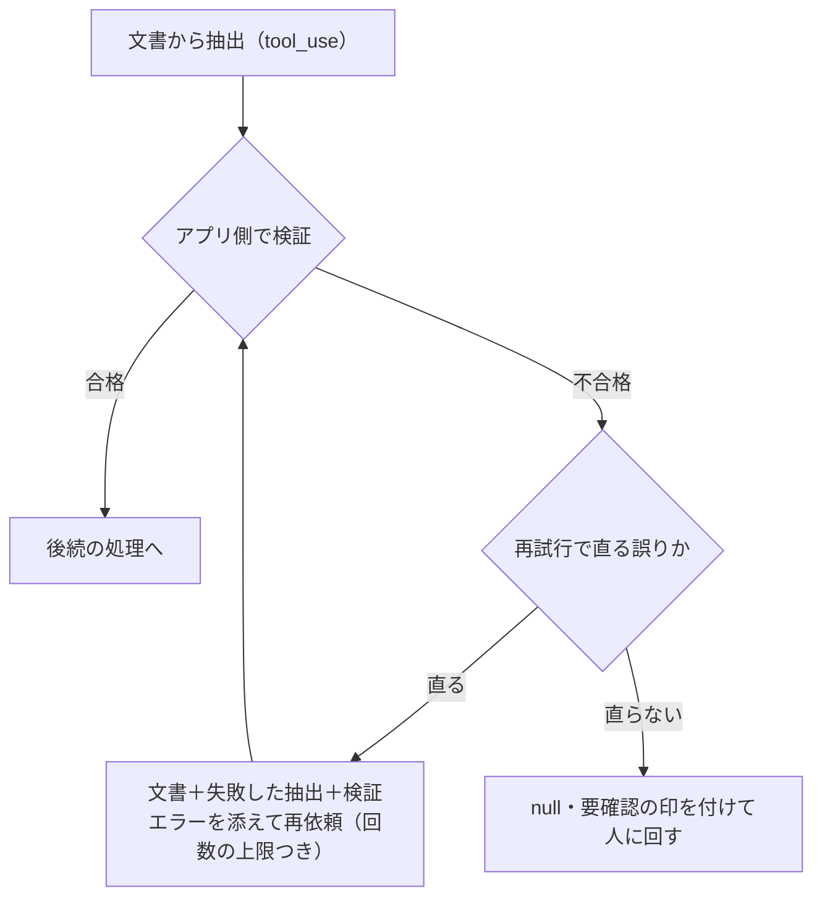

# 検証・再試行・フィードバックのループ

> ドメイン: 4. プロンプトエンジニアリングと構造化出力（20%） ／ 更新: 2026-11-20

## 3行まとめ
- 抽出結果をアプリ側で検証し、失敗したら「元の文書・失敗した抽出・具体的な検証エラー」を添えて再依頼する（retry-with-error-feedback）
- 再試行で直らないのは、元の文書に情報が無いとき。形式・構造の誤りや意味の検証エラーは、エラーを添えて再依頼する対象
- 判断の決め手は「その誤りは、同じ文書をもう一度読めば直せるか」。直せないなら再試行ではなく入力か設計を変える

## 仕組み

### 2種類のエラー
| 種類 | 例 | どこで防ぐか |
|---|---|---|
| スキーマの構文エラー（schema syntax error） | JSON が壊れている、必須フィールドが無い、型が違う | tool_use で消える（strict tool use でほぼ保証。例外は下） |
| 意味の検証エラー（semantic validation error） | 明細の合計が総額と合わない、値が別のフィールドに入っている | アプリ側の検証（Pydantic（Python のデータ検証ライブラリ）など）で見つけて再試行 |

- tool_use と JSON スキーマの仕組み・スキーマの設計は、4.3 の別ノート（tool-use-json-schema、extraction-schema-design）が主
- strict の保証は「in most cases」。例外は refusal（200 で課金され、スキーマに合わないことがある）、max_tokens（途中で切れる。max_tokens を上げて再試行）、enum・const の大文字・小文字
- 数値範囲（minimum・maximum）や文字数（minLength）は未対応で、そのまま送ると 400 エラー。多くの SDK ヘルパーは description に移して送り、応答を検証するのはヘルパーが検証する場合だけ（TypeScript の jsonSchemaOutputFormat() は検証しない）。範囲の検証は自前の検証ループで行う

### 再試行で直る誤り／直らない誤り
| 誤り | 再試行 | 理由 |
|---|---|---|
| 日付の形式違い（`11/3/2026` を ISO 形式にしていない） | 直る | 情報は文書にあり、書き方だけが違う |
| 構造の誤り（明細を配列にせず1つの文字列にした） | 直る | 検証エラーで正しい形を示せる |
| 値の置き場所の誤り（請求先の住所を納品先に入れた） | 直る | 文書を読み直せば正しい位置が分かる |
| 合計の食い違い（明細の和が総額と合わない） | 再依頼の対象 | 意味の検証エラー。ずれの額を具体的に添えて再依頼する |
| 文書に無い情報（別紙の契約書にしか無い支払条件） | 直らない | 渡していない文書の中身はモデルには分からない |

### 自己修正の検証フロー（self-correction validation flow）
- `calculated_total`（明細から計算した合計）と `stated_total`（文書に書かれた合計）を両方出させ、食い違いに印を付けられるようにする（どこで比べるかはガイドに書かれていない）
- `conflict_detected`（元データの中に矛盾があるかの真偽値）を持たせ、文書自体の矛盾を「抽出ミス」と区別する（補足: 矛盾は再試行で消えないので人に回すのが筋だが、これはガイドに無い私の解釈）

### フィードバックのループ（detected_pattern）
- コードレビューなどの指摘（finding）に `detected_pattern`（どのコードの書き方が指摘のきっかけになったか）を持たせる
- 開発者が却下した指摘をパターンごとに集計し、誤検知（false positive）の多いパターンのプロンプトや基準を直す

## 試験で問われそうなポイント
- 検証で合計の食い違いが出た → 検証エラーの中身（どのフィールドが、いくつずれたか）と元の文書・失敗した抽出を添えて再依頼する
- 再試行しても同じフィールドが埋まらない → 情報が文書に無いか確かめる。無ければ null と要確認の印にし、必要なら別の文書を入力に足す
- JSON の形が崩れる問題を減らしたい → 再試行ではなく tool_use（strict tool use）で防ぐ。ただし stop_reason が max_tokens で切れたときは、max_tokens を上げて再試行する
- 文書の中で総額と明細が食い違っている → `conflict_detected` で元データの矛盾として示し、モデルに辻褄を合わせさせない
- 自動レビューの指摘が却下されてばかり → `detected_pattern` で却下の多いパターンを特定し、そのパターンの基準を直す

## 間違えやすいところ
- エラーの中身を渡さず、同じ依頼をそのまま再送する → アンチパターン。何を直すべきか分からず、同じ誤りを繰り返しやすい
- 元の文書に情報が無いのに再試行を繰り返す → アンチパターン。再試行は効かない。作り話を防ぐのは nullable なフィールド（4.3）で null を返せるようにすること
- 「strict なら検証は不要」 → strict が保証するのはスキーマへの適合だけ（それも in most cases）。値の正しさ・合計の整合は保証しない
- 合計の食い違いを、モデルに「総額に合わせて」直させる → 文書側の矛盾を隠す。食い違いは印を付けて残す
- 再試行の上限を決めない → handle-tool-calls も「ループで許す再試行の回数を制限する」としている
- `detected_pattern`・`calculated_total`・`stated_total`・`conflict_detected` はガイドが示す設計上のフィールド名で、API の機能ではない（公式ドキュメントに同名の機能は未確認）

## 確認問題
1. 発注書から明細を抽出するパイプラインで、明細の小計の和が文書の「合計金額」と 1,200円ずれる結果が出た。次の依頼をどう組むか
   

答え
元の発注書、失敗した抽出結果、「明細の和が合計より 1,200円少ない」という具体的な検証エラーを添えて再依頼する。読み落とした明細を探させられる。エラーを伏せて同じ依頼を再送するのは悪手。

2. 保険金請求書から「保険証券番号」を抽出したいが、3回再試行しても毎回 null になる。証券番号は申込書（入力に含めていない）にだけ載っている。どうするか
   

答え
再試行をやめる。情報が入力の文書に無いので、何度やっても直らない。null と要確認の印で人に回すか、申込書を入力に加える設計に変える。

3. 社内のレビューボットの指摘の約4割が開発者に却下されている。どの指摘を直すべきか分からない。どう設計を変えるか
   

答え
各指摘に `detected_pattern`（指摘のきっかけになったコードの書き方）を持たせ、却下された指摘をパターンごとに集計する。却下の多いパターンの基準やプロンプトを直す。

## 出典
- Claude Certified Architect – Foundations Exam Guide v1.1, Task Statement 4.4、Exercise 3（公式、PDF）: https://cc.sj-cdn.net/instructor/6nizmqk8tpzpfjvt6qmmav7rh/public/1794946250/Claude_Certified_Architect_-_Foundations_Exam_Guide.pdf
- [Structured outputs](https://platform.claude.com/docs/en/build-with-claude/structured-outputs)（公式。スキーマ適合の保証、strict tool use、未対応の制約は 400 エラー、SDK ヘルパーの変換と検証（検証はヘルパーによる）。後半の制限・refusal・max_tokens の節はページが長く途中までしか読めず、要約での確認にとどまる）
- [Handle tool calls](https://platform.claude.com/docs/en/agents-and-tools/tool-use/handle-tool-calls)（公式。`is_error`、何が悪く次に何をすべきかを書く、再試行の回数を制限する）
- [Reduce hallucinations](https://platform.claude.com/docs/en/test-and-evaluate/strengthen-guardrails/reduce-hallucinations)（公式。情報が足りないときは「分からない」と言わせる）
- [Increase output consistency](https://platform.claude.com/docs/en/test-and-evaluate/strengthen-guardrails/increase-consistency)（公式。スキーマの保証が要るなら structured outputs を使う）
