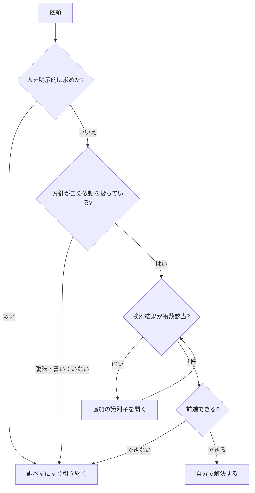

# エスカレーションの基準と、曖昧な依頼の確かめ方（人への引き継ぎ、方針の空白、複数該当、5.2）

> ドメイン: 5. コンテキスト管理と信頼性（15%） ／ 更新: 2026-11-20

## 3行まとめ
- 人に回す基準は3つ: お客様が人を求めた、方針の例外・空白（policy gap。方針に書かれていない依頼）、意味のある前進ができない。「複雑そう」だけでは回さない
- 人を求められたら調べる前にすぐ回す。求められていなければ、苛立ちを受け止めて解決を申し出て、重ねて人を求められたら回す
- 決め手は「明示した基準＋エスカレーションする／自分で解決する例（few-shot）をシステムプロンプトに書く」。感情分析や自己申告の確信度は複雑さの代わりにならない

## 仕組み

### エスカレーションする／自分で解決する

| 状況 | 判断 | 理由 |
|---|---|---|
| 「担当者と話したい」とはっきり言われた | エスカレーションする（すぐ） | 調べてからでは希望を無視したことになる |
| 苛立っているが人は求めていない。方針の範囲の簡単な用件 | 自分で解決する（気持ちを受け止めて解決を申し出る） | 感情の強さは用件の難しさと関係しない |
| 上の申し出のあと、もう一度人を求められた | エスカレーションする | 本人の希望を尊重する |
| 方針が依頼に触れていない（例: 自社の値下げ調整はあるが、他社の価格への合わせは書いていない） | エスカレーションする | 方針の空白を推測で埋めると、権限の無い約束になる |
| 手順が長い・確認が多いが、方針の範囲で進められる | 自分で解決する | 「複雑」だけは基準にならない |
| 必要な情報が取れず、何度試しても前に進めない | エスカレーションする | 意味のある前進ができない |
| 顧客検索で同じ名前が2件以上返った | 自分で確かめる（メールや注文番号を聞く） | どちらかを推測で選ぶと別人の口座を触る |

### 基準の伝え方
- システムプロンプトに3つの基準を明示し、境目のケースの例（エスカレーションする例・自分で解決する例）を添える
- 例には「なぜその判断か」も書く（理由のある例は新しいケースにも広がる。詳しくは [few-shot のノート](../04-prompt-engineering/few-shot-prompting.md)）
- 引き継ぐときに何を渡すか（構造化した要約）は [引き継ぎのノート](../01-agentic-architecture/structured-handoff-request-decomposition.md) が主

## 試験で問われそうなポイント
- エスカレーションが多すぎる・少なすぎる → 明示した基準と few-shot の例をシステムプロンプトに入れる
- 人を求められたのに、エージェントが先に注文を調べている → 調べずにすぐ引き継ぐ設計に直す
- 方針が扱っていない依頼 → 推測で可否を答えず、人に回す
- ツールが複数の候補を返した → 名前の一致度や最新の注文などの経験則で選ばず、追加の識別子を聞く
- 苛立ちの強い問い合わせ → 感情だけで回さず、まず受け止めて解決を申し出る

## 間違えやすいところ
- 感情分析（sentiment analysis）で閾値を超えたら回す → 感情は用件の複雑さと関係しない（ガイド 5.2）
- モデルが自己申告する確信度（self-reported confidence）で回す → 難しいケースほど確信度が当てにならない（ガイド 5.2）
- 人を求められても「まず調べてから」回す → 希望を無視している。調べずにすぐ回す
- 苛立ち＝即エスカレーション、と覚える → 人を求めていなければ、まず解決を申し出る
- 「複雑なケース」を基準にする → 基準は「方針の例外・空白」。複雑でも方針の範囲なら自分で解決する
- 公式の Customer support agent ガイドでは、感情分析は会話の前後で感情が保たれたかを測る指標として出てくる。エスカレーションの引き金ではない
- 同ガイドの指標はエスカレーションの正確さ 95% 以上、人を介さない解決（deflection）70〜80%。ガイドのシナリオの目標（初回解決 80% 以上）とは別の数字

## 確認問題
1. 動画配信サービスの窓口で「解約したいので担当者に代わって」と言われた。エージェントは契約状況を調べてから引き継ごうとしている。どうするべきか
   

答え
調べずにすぐ引き継ぐ。人を明示的に求められたら、先に調べるのは希望の無視になる（ガイド 5.2）。

2. 「3回目の問い合わせだ、いい加減にしろ」と怒っているが、用件はパスワード再設定のメールの再送だけ。人は求めていない。どうするか
   

答え
苛立ちを受け止めたうえで、その場で再送を申し出る。重ねて人を求められたら引き継ぐ。感情の強さだけで回さない。

3. 返品の方針は「購入後30日以内」だけを定めている。贈り物でもらった品の返品（購入者が別人）を頼まれた。どうするか
   

答え
方針がこの依頼に触れていない（空白）ので、可否を推測せず人に引き継ぐ。

4. `get_customer` に名前で問い合わせたら3件返った。1件は最近の注文がある。その人を選んでよいか
   

答え
選ばない。メールアドレスや注文番号など追加の識別子を聞いて1件に絞る。経験則で選ぶと別人の情報を扱う。

## 出典
- Claude Certified Architect – Foundations Exam Guide v1.1、Task Statement 5.2・Scenario 1・準備の推奨（公式。PDF はリポジトリに置かない）
- [Customer support agent](https://platform.claude.com/docs/en/about-claude/use-case-guides/customer-support-chat)（公式。エスカレーションの正確さ・感情の維持の指標、ガードレールの例。ページの後半は取得が切れて未確認）
- [Prompting best practices](https://platform.claude.com/docs/en/build-with-claude/prompt-engineering/claude-prompting-best-practices)（公式。例で判断をそろえる、指示の理由を書く、意図が曖昧なら行動より情報提供。ページの後半は取得が切れて未確認）
- 未確認: 「人を求められたら調べずにすぐ回す」「複数該当は識別子を聞く」「感情・確信度は当てにならない」を直接書いた公式ドキュメントは見つからなかった。この3点の根拠はガイドのみ
