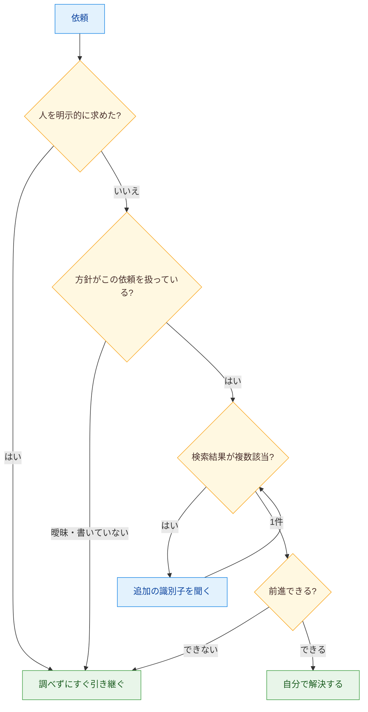

# エスカレーションの基準と、曖昧な依頼の確かめ方（人への引き継ぎ、方針の空白、複数該当、5.2）

> ドメイン: 5. コンテキスト管理と信頼性（15%） ／ 更新: 2026-11-20

!!! abstract "ひとことで"
    人に回す基準は3つ。==お客様が人を求めた、方針の例外・空白、意味のある前進ができない==。「複雑そう」だけでは回さない。基準は、明示した条件と判断の例（few-shot）でシステムプロンプトに書く。

## 仕組み

方針の例外・空白（policy gap）とは、方針に書かれていない依頼のことだ。意味のある前進ができないとは、必要な情報が取れず、何度試しても前に進めない状態を指す。手順が長い・確認が多いだけなら、方針の範囲で進められるので自分で解決する。

人をはっきり求められたら、調べる前にすぐ回す。調べてからでは、希望を無視したことになる。苛立ちや軽い希望があっても、はっきりした要求ではなく、用件がエージェントで対応できる範囲なら、気持ちを受け止めて解決を申し出る。感情の強さは用件の難しさと関係しないからだ。申し出のあとで人への希望を繰り返されたら（reiterate）、本人の希望を尊重して回す。

方針の空白を推測で埋めると、権限の無い約束になる。たとえば、自社の値下げ調整は方針にあるが、他社の価格への合わせは書いていない場合だ。公式ガイドも契約上の約束を避けるとしている。顧客検索で同じ名前が2件以上返ったときは、回さずに自分で確かめ、メールや注文番号を聞く。どちらかを推測で選ぶと、別人の口座を触る。

基準はシステムプロンプトに明示し、境目のケースの例（エスカレーションする例・自分で解決する例）を添える。例には「なぜその判断か」も書く。理由のある例は、新しいケースにも広がる（ガイド 4.2。詳しくは [few-shot のノート](../04-prompt-engineering/few-shot-prompting.md)）。

??? info "確信度の区別と、公式ガイドの指標"
    - 感情分析・自己申告の確信度を退ける根拠は、ガイド 5.2・例題 Q3 の解説
    - 5.2 で否定するのは、会話ごとに自己申告させる較正していない確信度。5.5 の、較正した確信度による人のレビューへの振り分けとは別
    - 公式の Customer support agent ガイドでは、感情分析は会話の前後で感情が保たれたかを測る指標（90% の会話で維持か改善が目標）。エスカレーションの引き金としての記述は無い
    - 同ガイドの指標は、エスカレーションの正確さ 95% 以上、人を介さない解決（deflection）70〜80%。ガイドのシナリオの目標（初回解決 80% 以上）とは別の数字
    - 引き継ぐときに何を渡すか（構造化した要約）は [引き継ぎのノート](../01-agentic-architecture/structured-handoff-request-decomposition.md) が主

## 試験での見分け方

| 問われること | ○ 正しい | × ひっかけ |
|---|---|---|
| エスカレーションが多すぎる・少なすぎる | 明示した基準と few-shot の例をシステムプロンプトに入れる | 感情分析（sentiment analysis）の閾値や、モデルが自己申告する確信度（self-reported confidence）で回す。感情は用件の複雑さと関係せず、確信度は難しいケースほど当てにならない |
| 人を求められた | 調べずにすぐ引き継ぐ | 「まず調べてから」回す |
| 苛立ちの強い問い合わせ | まず受け止めて解決を申し出る | 苛立ち＝即エスカレーション |
| 複雑だが方針の範囲 | 自分で解決する | 「複雑なケース」を基準に回す |
| 方針が扱っていない依頼 | 推測で可否を答えず、人に回す | 方針から類推して可否を答える |
| ツールが複数の候補を返した | 追加の識別子を聞く | 名前の一致度や最新の注文などの経験則で選ぶ |

## 確認問題

**Q1.** 動画配信サービスのサポート窓口で、Claude のエージェントが会員の問い合わせに対応している。会員が「解約したいので担当者に代わってください」と書いてきた。エージェントは、まず契約状況を調べてから引き継ごうとしている。最も適切な対応はどれか。（1つ選べ）
{ .quiz-q }

- A. 契約状況と解約の理由を調べ終えてから、まとめて人に引き継ぐ
- B. 解約の手続きは方針の範囲なので、エージェントが自分で解約を進める
- C. 契約状況は調べずに、その場ですぐ人に引き継ぐ
- D. 引き止めの特典を一度提案し、それでも断られたら人に引き継ぐ

??? success "答えと解説"
    **正解: C。** 人を明示的に求められたら、調べる前にすぐ回す。

    - A: 先に調べると、人と話したいという希望を無視したことになる
    - B: 用件が方針の範囲でも、人をはっきり求められたら回す
    - D: 解決を申し出てから回すのは、はっきりした要求が無いときだ。ここでは明示されている

**Q2.** 同じ窓口で、会員が「3回目の問い合わせだ、いい加減にしろ。人と話したほうが早いんじゃないの」と書いてきた。用件は、パスワード再設定のメールをもう一度送ることだけだ。最も適切な対応はどれか。（1つ選べ）
{ .quiz-q }

- A. 苛立ちを受け止めて、その場で再送を申し出る。それでも人を望まれたら引き継ぐ
- B. 苛立ちが強いので、再送の申し出はせずに、その場ですぐ人に引き継ぐ
- C. 3回目の問い合わせなので、複雑なケースとして人に引き継ぐ
- D. 人への希望とみなし、契約や過去の問い合わせを調べてから引き継ぐ

??? success "答えと解説"
    **正解: A。** はっきりした要求ではなく、用件も対応できる範囲なので、気持ちを受け止めて解決を申し出る。希望を繰り返されたら回す。

    - B: 感情の強さは用件の難しさと関係しない。苛立ちだけを基準に回さない
    - C: 問い合わせの回数が多くても、用件は方針の範囲で進められる
    - D: はっきりした要求とは言えず、用件もエージェントで対応できる

**Q3.** 日用品の通販サイトのサポートエージェント。配送の方針は「発送前なら配送先を1か所に変更できる」とだけ定めている。客から「1つの注文を、自宅と実家の2か所に分けて送ってほしい」と頼まれた。最も適切な対応はどれか。（1つ選べ）
{ .quiz-q }

- A. 配送先の変更は認められているので、分割も同じ扱いとして受け付ける
- B. 方針に書かれていないので、できないと答えて会話を終える
- C. 注文番号を聞いて対象を1件に絞り、そのうえで可否を答える
- D. 方針がこの依頼を扱っていないので、可否を推測せず人に引き継ぐ

??? success "答えと解説"
    **正解: D。** 方針の空白を推測で埋めず、人に回す。

    - A: 方針から類推して受け付けると、権限の無い約束になる
    - B: 「できない」と決めるのも推測で可否を答えることになる
    - C: 識別子を聞くのは、検索結果が複数該当したときの手だ。方針の空白は解消しない

## 出典
- Claude Certified Architect – Foundations Exam Guide v1.1、Task Statement 5.2・4.2・5.5・Scenario 1・準備の推奨・例題 Q3 の解説（公式。PDF はリポジトリに置かない）
- [Customer support agent](https://platform.claude.com/docs/en/about-claude/use-case-guides/customer-support-chat)（公式。エスカレーションの正確さ・感情の維持の指標、ガードレールの例（Avoid contractual commitments）。後半も確認済み。エスカレーションの基準・感情との関係の記述なし）
- [Prompting best practices](https://platform.claude.com/docs/en/build-with-claude/prompt-engineering/claude-prompting-best-practices)（公式。例で出力をそろえる、指示の理由を書く。後半も確認済み。エスカレーションの記述なし）
- 未確認: 「人を求められたら調べずにすぐ回す」「複数該当は識別子を聞く」「感情・確信度は当てにならない」を直接書いた公式ドキュメントは見つからなかった。この3点の根拠はガイドのみ
