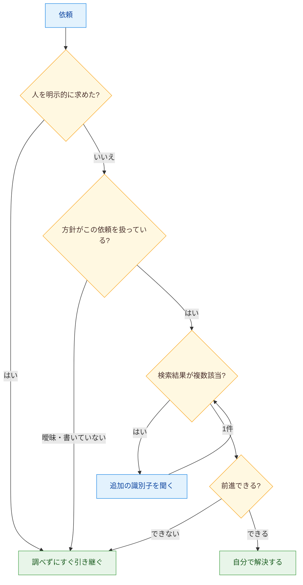

# エスカレーションの基準と、曖昧な依頼の確かめ方（人への引き継ぎ、方針の空白、複数該当、5.2）

> ドメイン: 5. コンテキスト管理と信頼性（15%） ／ 更新: 2026-11-20

!!! abstract "ひとことで"
    人に回す基準は3つ。==お客様が人を求めた、方針の例外・空白、意味のある前進ができない==。「複雑そう」だけでは回さない。基準は、明示した条件と判断の例（few-shot）でシステムプロンプトに書く。

## 仕組み

方針の例外・空白（policy gap）とは、方針に書かれていない依頼のことだ。意味のある前進ができないとは、必要な情報が取れず、何度試しても前に進めない状態を指す。手順が長い・確認が多いだけなら、方針の範囲で進められるので自分で解決する。

人をはっきり求められたら、調べる前にすぐ回す。調べてからでは、希望を無視したことになる。苛立ちや軽い希望があっても、はっきりした要求ではなく、用件がエージェントで対応できる範囲なら、気持ちを受け止めて解決を申し出る。感情の強さは用件の難しさと関係しないからだ。申し出のあとで人への希望を繰り返されたら（reiterate）、本人の希望を尊重して回す。

方針の空白を推測で埋めると、権限の無い約束になる。たとえば、自社の値下げ調整は方針にあるが、他社の価格への合わせは書いていない場合だ。公式ガイドも契約上の約束を避けるとしている。顧客検索で同じ名前が2件以上返ったときは、回さずに自分で確かめ、メールや注文番号を聞く。どちらかを推測で選ぶと、別人の口座を触る。

基準はシステムプロンプトに明示し、境目のケースの例（エスカレーションする例・自分で解決する例）を添える。例には「なぜその判断か」も書く。理由のある例は、新しいケースにも広がる（ガイド 4.2。詳しくは [few-shot のノート](../04-prompt-engineering/few-shot-prompting.md)）。

??? info "確信度の区別と、公式ガイドの指標"
    - 感情分析・自己申告の確信度を退ける根拠は、ガイド 5.2・例題 Q3 の解説
    - 5.2 で否定するのは、会話ごとに自己申告させる較正していない確信度。5.5 の、較正した確信度による人のレビューへの振り分けとは別
    - 公式の Customer support agent ガイドでは、感情分析は会話の前後で感情が保たれたかを測る指標（90% の会話で維持か改善が目標）。エスカレーションの引き金としての記述は無い
    - 同ガイドの指標は、エスカレーションの正確さ 95% 以上、人を介さない解決（deflection）70〜80%。ガイドのシナリオの目標（初回解決 80% 以上）とは別の数字
    - 引き継ぐときに何を渡すか（構造化した要約）は [引き継ぎのノート](../01-agentic-architecture/structured-handoff-request-decomposition.md) が主

## 試験での見分け方

| 問われること | ○ 正しい | × ひっかけ |
|---|---|---|
| エスカレーションが多すぎる・少なすぎる | 明示した基準と few-shot の例をシステムプロンプトに入れる | 感情分析（sentiment analysis）の閾値や、モデルが自己申告する確信度（self-reported confidence）で回す。感情は用件の複雑さと関係せず、確信度は難しいケースほど当てにならない |
| 人を求められた | 調べずにすぐ引き継ぐ | 「まず調べてから」回す |
| 苛立ちの強い問い合わせ | まず受け止めて解決を申し出る | 苛立ち＝即エスカレーション |
| 複雑だが方針の範囲 | 自分で解決する | 「複雑なケース」を基準に回す |
| 方針が扱っていない依頼 | 推測で可否を答えず、人に回す | 方針から類推して可否を答える |
| ツールが複数の候補を返した | 追加の識別子を聞く | 名前の一致度や最新の注文などの経験則で選ぶ |

## 確認問題

??? question "Q1. 動画配信サービスの窓口で「解約したいので担当者に代わって」と言われた。エージェントは契約状況を調べてから引き継ごうとしている。どうするべき？"
    調べずにすぐ引き継ぐ。人を明示的に求められたら、先に調べるのは希望の無視になる（ガイド 5.2）。

??? question "Q2. 「3回目の問い合わせだ、いい加減にしろ」と怒りつつ「人と話したほうが早いんじゃないの」とも言う。用件はパスワード再設定のメールの再送だけ。どうする？"
    苛立ちを受け止めたうえで、その場で再送を申し出る。はっきりした要求ではなく、用件も対応できる範囲だからだ。それでも人への希望を繰り返されたら引き継ぐ。感情の強さだけで回さない。

??? question "Q3. 返品の方針は「購入後30日以内」だけを定めている。贈り物でもらった品の返品（購入者が別人）を頼まれた。どうする？"
    方針がこの依頼に触れていない（空白）ので、可否を推測せず人に引き継ぐ。

??? question "Q4. `get_customer` に名前で問い合わせたら3件返った。1件は最近の注文がある。その人を選んでよいか？"
    選ばない。メールアドレスや注文番号など追加の識別子を聞いて1件に絞る。経験則で選ぶと、別人の情報を扱う。

## 出典
- Claude Certified Architect – Foundations Exam Guide v1.1、Task Statement 5.2・4.2・5.5・Scenario 1・準備の推奨・例題 Q3 の解説（公式。PDF はリポジトリに置かない）
- [Customer support agent](https://platform.claude.com/docs/en/about-claude/use-case-guides/customer-support-chat)（公式。エスカレーションの正確さ・感情の維持の指標、ガードレールの例（Avoid contractual commitments）。後半も確認済み。エスカレーションの基準・感情との関係の記述なし）
- [Prompting best practices](https://platform.claude.com/docs/en/build-with-claude/prompt-engineering/claude-prompting-best-practices)（公式。例で出力をそろえる、指示の理由を書く。後半も確認済み。エスカレーションの記述なし）
- 未確認: 「人を求められたら調べずにすぐ回す」「複数該当は識別子を聞く」「感情・確信度は当てにならない」を直接書いた公式ドキュメントは見つからなかった。この3点の根拠はガイドのみ
