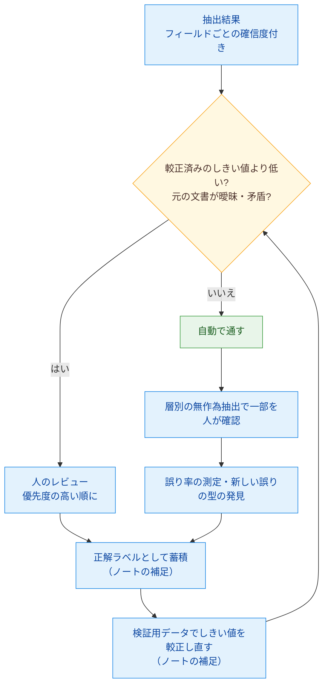

# 人によるレビューの流れと確信度の較正

> ドメイン: 5. コンテキスト管理と信頼性（15%） ／ 更新: 2026-11-20

!!! abstract "ひとことで"
    人のレビューは、確信度が低いものと、元の文書が曖昧・矛盾しているものに優先して当てる。確信度は==検証用データで較正してから==しきい値に使い、自動で通すものも==層別に抜き取り続ける==。

## 仕組み

レビュー担当の数は限られるので、全件を均等には見ない。モデルにフィールドごとの確信度（field-level confidence score）を出させ、それで振り分ける。ただし自己申告の確信度は実際の正答率とずれうる。だから正解付きの検証用データ（labeled validation set）で較正（calibration、確信度と実際の正答率を合わせること）してから、しきい値を決める。曖昧・矛盾した元の文書は、確信度が高く出ても人に回す（ガイド 5.5 の Skills）。

図の G→H（人が直した結果を正解ラベルとして足し、較正し直す）は、ガイドに無いノートの補足だ。（ノートの補足）較正の一例は、確信度の帯ごとに実際の正答率を測ることだ（例: 0.9 以上の帯が実際に何%正しいか）。目標の正答率を満たす帯より下を、人のレビューに回す。しきい値は文書の種類やフィールドで変わりうる。

自動で通したものからも、層（stratum、分けたグループ）ごとに抜き取って人が見る。これが層別の無作為抽出（stratified random sampling）だ。目的は2つある。誤り率を測り続けることと、まだ知らない誤りの型（novel error pattern、例: 新しい様式の帳票）を見つけることだ。（ノートの補足）層の分け方の一例は、文書の種類×フィールドだ。層に分けない単純な無作為抽出では、件数の少ない種類がほとんど抽出されず、見落とされる。

!!! example "全体の正答率が隠すもの（自作の例）"
    | 文書の種類 | 件数の割合 | 正答率 | 弱いフィールド |
    |---|---|---|---|
    | 印刷の請求書 | 85% | 99% | なし |
    | スキャンの領収書 | 10% | 92% | 合計金額 |
    | 手書きの申込書 | 5% | 80% | 生年月日（65%） |
    | 全体 | 100% | 約97%（97.35%） | 見えない |

??? info "関連ノートと、公式ドキュメントでの言葉"
    - 指摘ごとに確信度を付けさせてレビューを振り分ける話は 4.6 にも出る（[独立したインスタンスによるレビューと、複数パスのレビュー](../04-prompt-engineering/independent-multipass-review.md)）。ここは抽出結果に人をどう当てるかが主
    - 公式ドキュメント（develop tests など）には「層別抽出」「フィールドごとの確信度の較正」という言葉は見つからない。試験はガイドの書き方で覚える

## 試験での見分け方

| 問われること | ○ 正しい | × ひっかけ |
|---|---|---|
| 全体の正答率が高いので、人のレビューを減らしたい | 文書の種類・フィールドごとに正答率を出し、全部の層で基準を満たすか確かめる | 全体の正答率（ガイドの例では 97%）だけで決める。件数の少ない種類やフィールドの弱さが埋もれる |
| レビュー担当が足りない | 確信度が低いもの、元の文書が曖昧・矛盾しているものを優先して回す | 全件を均等に見る |
| 確信度で振り分けたい | フィールドごとの確信度を出させ、検証用データでしきい値を較正する | 自己申告の確信度を、較正せずにそのまましきい値に使う |
| 自動で通すものの品質の監視 | 層別の無作為抽出で誤り率を測り続け、新しい誤りの型を拾う | 確信度が高いものは見ない。誤り率の変化や新しい誤りの型に気づけない |
| 確信度は高いが、元の文書が矛盾している | 人に回す | 確信度だけを見て自動で通す |

## 確認問題

??? question "Q1. 配送伝票の抽出で、全体の正答率が 98% になった。チームは人の確認をやめたい。その前に何をする？"
    伝票の種類（例: 国内・海外・手書き）とフィールド（例: 住所・重量）ごとに正答率を出し、すべての層で目標を満たすか確かめる。件数の少ない海外伝票の住所だけ低い、といった弱さは全体の数字に埋もれる。

??? question "Q2. 抽出モデルがフィールドごとに 0〜1 の確信度を出す。0.8 未満を人に回すと決め打ちしたが、0.9 の帯でも誤りが多い。どう直す？"
    正解付きの検証用データで、確信度の帯ごとの実際の正答率を測る。目標を満たす位置にしきい値を置き直す（必要なら文書の種類・フィールドごとに）。自己申告の数字をそのまま信じない。

??? question "Q3. 確信度の高い抽出は半年前から自動で通している。最近、取引先が帳票の様式を変えた。どんな仕組みがあれば早く気づける？"
    文書の種類×フィールドの層ごとに、自動で通したものからも無作為に抜き取って、人が確認し続ける仕組み。確信度が高いままでも、誤り率の上昇や新しい誤りの型を見つけられる。

## 出典
- [Define success criteria and build evaluations](https://platform.claude.com/docs/en/test-and-evaluate/develop-tests)（公式。5.5 の中心の主張は直接支えない。関連する考え方として: 基準は多次元で測る、エッジケースや人でも判断が割れる曖昧な入力を評価に入れる、評価は実際のタスクの分布に合わせる）
- [Reduce hallucinations](https://platform.claude.com/docs/en/test-and-evaluate/strengthen-guardrails/reduce-hallucinations)（公式。関連する考え方として: 分からないと言うことを許す、引用で根拠を示させる）
- [Demystifying evals for AI agents](https://www.anthropic.com/engineering/demystifying-evals-for-ai-agents)（公式ブログ。関連する考え方として: モデルの採点は人の判断と較正する、人による抜き取り確認、点数を鵜呑みにせず中身を読む）
- Claude Certified Architect – Foundations Exam Guide v1.1、タスクステートメント 5.5（公式）
- 未確認: 層別の無作為抽出、フィールドごとの確信度を検証用データで較正すること、文書の種類・フィールド別に確かめてから自動化すること、は公式ドキュメントで直接述べた箇所を見つけられなかった（ガイドでは確認）
