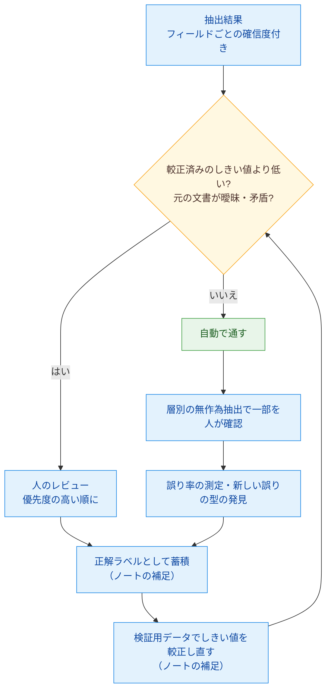

# 人によるレビューの流れと確信度の較正

> ドメイン: 5. コンテキスト管理と信頼性（15%） ／ 更新: 2026-11-20

!!! abstract "ひとことで"
    人のレビューは、確信度が低いものと、元の文書が曖昧・矛盾しているものに優先して当てる。確信度は==検証用データで較正してから==しきい値に使い、自動で通すものも==層別に抜き取り続ける==。

## 仕組み

レビュー担当の数は限られるので、全件を均等には見ない。モデルにフィールドごとの確信度（field-level confidence score）を出させ、それで振り分ける。ただし自己申告の確信度は実際の正答率とずれうる。だから正解付きの検証用データ（labeled validation set）で較正（calibration、確信度と実際の正答率を合わせること）してから、しきい値を決める（較正はガイド）。曖昧・矛盾した元の文書は、確信度が高く出ても人に回す（ガイド 5.5 の Skills）。

図の G→H（人が直した結果を正解ラベルとして足し、較正し直す）は、ガイドに無いノートの補足だ。以下はノートの補足だ。較正の一例は、確信度の帯ごとに実際の正答率を測ることだ（例: 0.9 以上の帯が実際に何%正しいか）。目標の正答率を満たす帯より下を、人のレビューに回す（ノートの補足）。しきい値は文書の種類やフィールドで変わりうる（ノートの補足）。

自動で通したものからも、層（stratum、分けたグループ）ごとに抜き取って人が見る（ガイド）。これが層別の無作為抽出（stratified random sampling）だ。目的は2つある。誤り率を測り続けることと、まだ知らない誤りの型（novel error pattern、例: 新しい様式の帳票）を見つけることだ。層の分け方の一例は、文書の種類×フィールドだ（ノートの補足）。層に分けると、件数の少ない種類が抜き取りから漏れて見落とされるのを防げる（ノートの補足）。

!!! example "全体の正答率が隠すもの（自作の例）"
    | 文書の種類 | 件数の割合 | 正答率 | 弱いフィールド |
    |---|---|---|---|
    | 印刷の請求書 | 85% | 99% | なし |
    | スキャンの領収書 | 10% | 92% | 合計金額 |
    | 手書きの申込書 | 5% | 80% | 生年月日（65%） |
    | 全体 | 100% | 約97%（97.35%） | 見えない |

??? info "関連ノートと、公式ドキュメントでの言葉"
    - 指摘ごとに確信度を付けさせてレビューを振り分ける話は 4.6 にも出る（[独立したインスタンスによるレビューと、複数パスのレビュー](../04-prompt-engineering/independent-multipass-review.md)）。ここは抽出結果に人をどう当てるかが主
    - 公式ドキュメント（develop tests など）には「層別抽出」「フィールドごとの確信度の較正」という言葉は見つからない。試験はガイドの書き方で覚える

## 試験での見分け方

| 問われること | ○ 正しい | × ひっかけ |
|---|---|---|
| 全体の正答率が高いので、人のレビューを減らしたい | 文書の種類・フィールドごとに正答率を出し、全部の層で基準を満たすか確かめる | 全体の正答率（ガイドの例では 97%）だけで決める。件数の少ない種類やフィールドの弱さが埋もれる |
| レビュー担当が足りない | 確信度が低いもの、元の文書が曖昧・矛盾しているものを優先して回す | 全件を均等に見る |
| 確信度で振り分けたい | フィールドごとの確信度を出させ、検証用データでしきい値を較正する | 自己申告の確信度を、較正せずにそのまましきい値に使う |
| 自動で通すものの品質の監視 | 層別の無作為抽出で誤り率を測り続け、新しい誤りの型を拾う | 確信度が高いものは見ない。誤り率の変化や新しい誤りの型に気づけない |
| 確信度は高いが、元の文書が矛盾している | 人に回す | 確信度だけを見て自動で通す |

## 確認問題

**Q1.** 物流会社が、配送伝票から住所や重量を抽出する仕組みを Claude で作っている。抽出の全体の正答率が 98% になり、チームは人の確認をやめたいと考えている。やめる前に行うこととして最も適切なものはどれか。（1つ選べ）
{ .quiz-q }

- A. 全体の正答率が目標の 95% を上回っているので、確かめることは無い。全件を自動で通す
- B. 全件から無作為に 200件を選んで人が確かめ直し、全体の正答率が再現すれば確認をやめる
- C. 確信度が低い抽出だけを人に回すことにし、それ以外は抜き取りもせずに通す
- D. 伝票の種類とフィールドごとに正答率を出し、すべての層で目標を満たすかを確かめる

??? success "答えと解説"
    **正解: D。** 全体の正答率は、件数の少ない種類やフィールドの弱さを埋もれさせるので、層ごとに確かめる。

    - A: 全体の数字だけで決めている。件数の少ない伝票の弱いフィールドが見えない
    - B: 確かめ直しても、見ているのは全体の正答率のままだ。少ない種類は抜き取りから漏れうる
    - C: 自動で通すものを見なくなる。誤り率の変化や新しい誤りの型に気づけない

**Q2.** 保険会社が、申込書から項目を抽出し、怪しいものを人が確かめる流れを作っている。レビュー担当が1日に見られる件数は限られる。人に回すものを振り分ける設計として適切なものはどれか。（2つ選べ）
{ .quiz-q }

- A. フィールドごとの確信度を出させ、正解付きの検証用データで帯ごとの正答率を測ってしきい値を決める
- B. モデルが自己申告した確信度を信じ、0.8 未満を人に回すしきい値として決め打ちする
- C. 担当が偏らないように、すべての申込書を到着順に均等に担当へ割り振る
- D. 確信度が高く出ても、元の申込書の記載が曖昧なものや矛盾しているものは人に回す
- E. 確信度が高い抽出は人が一切見ないことにし、担当の手を低いものに集中させる

??? success "答えと解説"
    **正解: A と D。** 振り分けには較正済みの確信度を使い、元の文書が曖昧・矛盾しているものは確信度にかかわらず人に回す。

    - B: 自己申告の確信度は実際の正答率とずれうる。較正せずにしきい値に使わない
    - C: 担当が足りないのに全件を均等に見ることになり、優先すべきものに手が回らない
    - E: 自動で通すものも層別に抜き取って見続ける。見なければ誤り率の変化に気づけない

**Q3.** 経理部門が、取引先の請求書から金額を抽出する仕組みを運用している。確信度の高い抽出は、半年前から人を通さずに自動で処理している。取引先が予告なく帳票の様式を変えても、早く気づけるようにしたい。最も適切な仕組みはどれか。（1つ選べ）
{ .quiz-q }

- A. 確信度のしきい値を 0.9 から 0.95 に上げ、人に回る件数を今より増やしておく
- B. 全体の正答率を毎月集計し、目標を下回った月だけ原因を調べる運用にする
- C. 自動で通した抽出からも、文書の種類×フィールドの層ごとに無作為に抜き取って人が確かめる
- D. 確信度が低く出た抽出を人が確かめ、その誤りの傾向を毎月まとめて分析する

??? success "答えと解説"
    **正解: C。** 層別の無作為抽出なら、確信度が高いままでも、誤り率の上昇や新しい誤りの型を見つけられる。

    - A: 新しい様式でも確信度が高く出れば、しきい値を上げても自動で通ってしまう
    - B: 全体の正答率は、件数の少ない取引先や種類の誤りを埋もれさせる
    - D: 確信度が高いまま間違えている抽出は、人の目に入らない

## 出典
- [Define success criteria and build evaluations](https://platform.claude.com/docs/en/test-and-evaluate/develop-tests)（公式。5.5 の中心の主張は直接支えない。関連する考え方として: 基準は多次元で測る、エッジケースや人でも判断が割れる曖昧な入力を評価に入れる、評価は実際のタスクの分布に合わせる）
- [Reduce hallucinations](https://platform.claude.com/docs/en/test-and-evaluate/strengthen-guardrails/reduce-hallucinations)（公式。関連する考え方として: 分からないと言うことを許す、引用で根拠を示させる）
- [Demystifying evals for AI agents](https://www.anthropic.com/engineering/demystifying-evals-for-ai-agents)（公式ブログ。関連する考え方として: モデルの採点は人の判断と較正する、人による抜き取り確認、点数を鵜呑みにせず中身を読む）
- Claude Certified Architect – Foundations Exam Guide v1.1、タスクステートメント 5.5（公式）
- 未確認: 層別の無作為抽出、フィールドごとの確信度を検証用データで較正すること、文書の種類・フィールド別に確かめてから自動化すること、は公式ドキュメントで直接述べた箇所を見つけられなかった（ガイドでは確認）
