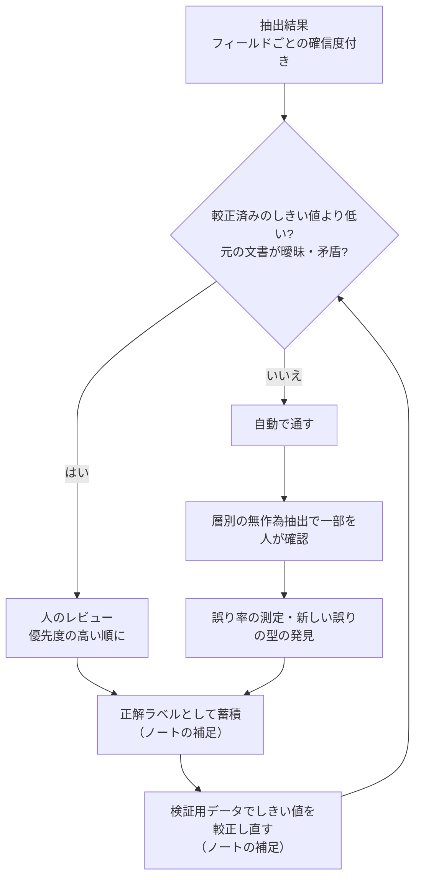

# 人によるレビューの流れと確信度の較正

> ドメイン: 5. コンテキスト管理と信頼性（15%） ／ 更新: 2026-11-20

## 3行まとめ
- 人のレビューは数が限られるので、**確信度が低いもの、元の文書が曖昧・矛盾しているもの**に優先して当てる
- モデルが出すフィールドごとの確信度は、そのまま信じず、正解付きの検証用データ（labeled validation set）で較正（calibration、確信度と実際の正答率を合わせること）してからしきい値を決める
- 試験の決め手は「全体の正答率ではなく、文書の種類×フィールドごとに確かめたか」と「自動で通すものも層別に抜き取り続けているか」

## 仕組み

- 図の G→H（人が直した結果を正解ラベルとして足し、較正し直す）はガイドに無い、ノートの補足

### 確信度の較正
- フィールドごとの確信度（field-level confidence score）を出させる
- 正解付きの検証用データで確信度を較正する（ガイド）
- （ノートの補足）較正の一例: 確信度の帯ごとに実際の正答率を測る（例: 0.9 以上の帯が実際に何%正しいか）
- （ノートの補足）目標の正答率を満たす帯より下を人のレビューに回す。しきい値は文書の種類やフィールドで変わりうる

### 層別の無作為抽出（stratified random sampling）
- 確信度の高い＝自動で通したものから、層（stratum、分けたグループ）ごとに抜き取って人が見る（ガイド）
- （ノートの補足）層の分け方の一例は、文書の種類×フィールド
- 目的は2つ。誤り率を測り続けること、まだ知らない誤りの型（novel error pattern、例: 新しい様式の帳票）を見つけること
- （ノートの補足）層に分けると、件数の少ない種類が抜き取りから漏れて見落とされるのを防げる

### 全体の正答率が隠すもの（自作の例）

| 文書の種類 | 件数の割合 | 正答率 | 弱いフィールド |
|---|---|---|---|
| 印刷の請求書 | 85% | 99% | なし |
| スキャンの領収書 | 10% | 92% | 合計金額 |
| 手書きの申込書 | 5% | 80% | 生年月日（65%） |
| 全体 | 100% | 約97%（97.35%） | 見えない |

## 試験で問われそうなポイント
- 全体で高い正答率が出たので人のレビューを減らしたい → 先に文書の種類・フィールドごとに正答率を出し、全部の層で基準を満たすか確かめる
- レビュー担当が足りない → 確信度が低いもの、元の文書が曖昧・矛盾しているものを優先して回す。全件を均等に見ない
- 確信度で振り分けたい → モデルにフィールドごとの確信度を出させ、検証用データでしきい値を較正する
- 自動で通しているものの品質をどう監視するか → 層別の無作為抽出で誤り率を測り続け、新しい誤りの型を拾う

## 間違えやすいところ
- 全体の正答率（ガイドの例では 97%）だけで自動化を決めるのは誤り。件数の少ない種類やフィールドの弱さが埋もれる
- モデルの自己申告の確信度を、較正せずにそのまましきい値に使うのは誤り。自己申告の確信度は実際の正答率とずれうる
- 「確信度が高いものは見なくてよい」は誤り。抜き取りを止めると、誤り率の変化や新しい誤りの型に気づけない
- （ノートの補足）層に分けない単純な無作為抽出では、件数の少ない種類がほとんど抽出されない
- 曖昧・矛盾した元の文書は、確信度が高く出ても人に回す対象（ガイド 5.5 の Skills）
- 指摘ごとに確信度を付けさせてレビューを振り分ける話は 4.6 にも出る（「独立したインスタンスによるレビューと、複数パスのレビュー」のノート）。ここは抽出結果に人をどう当てるかが主
- 公式ドキュメント（develop tests など）には「層別抽出」「フィールドごとの確信度の較正」という言葉は見つからない。試験はガイドの書き方で覚える

## 確認問題
1. 配送伝票の抽出で、全体の正答率が 98% になった。チームは人の確認をやめたい。その前に何をする?
   

答え
伝票の種類（例: 国内・海外・手書き）とフィールド（例: 住所・重量）ごとに正答率を出し、すべての層で目標を満たすか確かめる。件数の少ない海外伝票の住所だけ低い、といった弱さは全体の数字に埋もれる。

2. 抽出モデルがフィールドごとに 0〜1 の確信度を出す。0.8 未満を人に回すと決め打ちしたが、0.9 の帯でも誤りが多い。どう直す?
   

答え
正解付きの検証用データで確信度の帯ごとの実際の正答率を測り、目標を満たす位置にしきい値を置き直す（必要なら文書の種類・フィールドごとに）。自己申告の数字をそのまま信じない。

3. 確信度の高い抽出は半年前から自動で通している。最近、取引先が帳票の様式を変えた。どんな仕組みがあれば早く気づける?
   

答え
文書の種類×フィールドの層ごとに、自動で通したものからも無作為に抜き取って人が確認し続ける仕組み。誤り率の上昇や新しい誤りの型を、確信度が高いままでも見つけられる。

## 出典
- [Define success criteria and build evaluations](https://platform.claude.com/docs/en/test-and-evaluate/develop-tests)（公式。5.5 の中心の主張は直接支えない。関連する考え方として: 基準は多次元で測る、エッジケースや人でも判断が割れる曖昧な入力を評価に入れる、評価は実際のタスクの分布に合わせる）
- [Reduce hallucinations](https://platform.claude.com/docs/en/test-and-evaluate/strengthen-guardrails/reduce-hallucinations)（公式。関連する考え方として: 分からないと言うことを許す、引用で根拠を示させる）
- [Demystifying evals for AI agents](https://www.anthropic.com/engineering/demystifying-evals-for-ai-agents)（公式ブログ。関連する考え方として: モデルの採点は人の判断と較正する、人による抜き取り確認、点数を鵜呑みにせず中身を読む）
- Claude Certified Architect – Foundations Exam Guide v1.1、タスクステートメント 5.5（公式）
- 未確認: 層別の無作為抽出、フィールドごとの確信度を検証用データで較正すること、文書の種類・フィールド別に確かめてから自動化すること、は公式ドキュメントで直接述べた箇所を見つけられなかった（ガイドでは確認）
