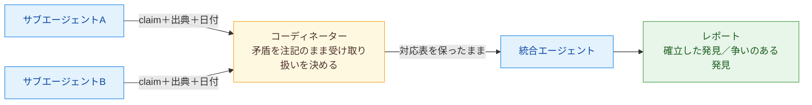

# 複数ソースの統合で出典を保ち、矛盾と時期の違いを扱う

> ドメイン: 5. コンテキスト管理と信頼性（15%） ／ 更新: 2026-11-20

!!! abstract "ひとことで"
    サブエージェントに==主張と出典の対応表（claim-source mapping）==を構造化して返させ、統合でも保つ。信頼できる出典どうしが食い違ったら、片方を選ばず==両方を出典付きで並べて注記する==。

## 仕組み

要約で発見を圧縮すると、「どの主張がどの出典か」が消える。だからサブエージェントには、主張・出典・抜粋・日付を欄に分けて返させる。統合エージェントは、複数のサブエージェントの対応表を「保ち、まとめる（preserve and merge）」。文章に書き直して対応を捨てない。

| 欄（ガイドが挙げる項目） | 中身 |
|---|---|
| claim | 主張 |
| 出典 | 出典 URL・文書名 |
| 抜粋 | 根拠になる箇所（relevant excerpt） |
| 日付 | 公開日またはデータの収集日 |

文書分析は、矛盾する値を両方含め、明示的に注記した状態で完了させる。和解（reconcile）は、コーディネーターが統合の前に決める。日付の欄が要るのは、時期の違いを矛盾と取り違えないためだ。日付があれば「2022年の調査で40%、2025年の調査で55%」は変化として読める。日付が無いと矛盾に見える。

レポートは、確立した発見（well-established）と争いのある発見（contested）を明示的な節に分ける。元の出典の言い方と方法の文脈も残す（例の「推定」「暫定値」「調査対象・手法」は私の解釈による具体化）。形式は内容の種類で変える（ガイドの例）。財務データは表、ニュースは文章、技術的な発見は構造化した箇条書きにする。

??? info "公式ドキュメントでの裏付け（API・プロンプト側）"
    - Citations（引用機能）: 文書ごとに有効にすると、主張ごとに `cited_text`・`document_index`・`document_title` と位置（文字・ページ）を返す
    - 長い文書では、先に関係する箇所を引用させてから作業させる。引用で裏付けられない主張は撤回させる（Reduce hallucinations）
    - Anthropic の調査システムは、発見をまとめた後に CitationAgent（文書とレポートから引用箇所を特定する役）へ渡す
    - Skill authoring best practices の調査統合の例: 出典どうしが一致・対立する点を確かめ、各論点を支える出典を記し、要約に対立する見方を含める

??? info "ずれと関連ノート"
    - ずれ: Citations は structured outputs（JSON スキーマでの出力）と同時に使えない（400 エラー）。ガイドの「構造化した対応表」は設計パターンで、Citations の機能名ではない。回避策は1フィールド1行で答えさせてコードで解析する（「JSON だけを返せ」は引用が減るので避ける）
    - 補足（私の解釈）: `conflict_detected` は抽出時の矛盾フラグ（4.4、[検証と再試行のループ](../04-prompt-engineering/validation-retry-loop.md)）。5.6 は統合での扱いが主
    - サブエージェントへ構造化メタデータを渡す側の話は [サブエージェントへのコンテキストの渡し方](../01-agentic-architecture/subagent-context-passing.md)。日付・出典を返させる受け渡しの構造化は、別ノート「[位置の影響への対策と、エージェント間で渡す情報の構造化](lost-in-the-middle-structured-passing.md)」

## 試験での見分け方

| 問われること | ○ 正しい | × ひっかけ |
|---|---|---|
| 最終レポートで出典が消えている | サブエージェントに claim・抜粋・URL/文書名・日付を、欄を分けた構造化データで返させ、統合でも保つ（ガイドの Exercise 4） | 出典を本文の文章に混ぜる、「出典を残して」と頼むだけ（統合で落ちやすい。私の推論） |
| 信頼できる2つの統計が食い違う | 両方を出典付きで載せて注記し、争いのある発見の節に置く | 一方を勝手に選ぶ、平均を取る、新しいほうだけ残す（「平均」「新しいほう」はガイドの「arbitrarily selecting」を私が具体化した例） |
| 古い資料と新しい資料で値が違い「矛盾」と報告される | 出力に公開日・収集日を必須にする | 時期の違うデータを同じ時点の値として並べる（変化を矛盾と誤読させる） |
| 文書分析の段で矛盾を見つけた | 注記して返し、コーディネーターに決めさせる | 分析の段で解決する |
| 不確かさのある発見を書く | 確立した発見と争いのある発見を節で分け、元の言い方を残す | 同じ調子で書く、「推定」を断定に言い換える（不確かさが消える） |
| 統合結果が全部同じ形式で読みにくい | 内容の種類ごとに表・文章・箇条書きを使い分ける | すべて同じ形式で書く |

## 確認問題

**Q1.** コンサルティング会社が、複数のサブエージェントで調べて1つのレポートにまとめる市場調査エージェントを作っている。レポートに「国内の家庭用蓄電池の普及率は 8% と 12%」と出典なしで両方書かれ、読者が混乱した。調べると、2つは別の年の統計だった。最も適切な直し方はどれか。（1つ選べ）
{ .quiz-q }

- A. 統合エージェントのプロンプトに「出典と年を必ず本文に残すこと」と書き足す
- B. サブエージェントの出力に出典と公開日・収集日を欄として必須にし、統合でも保つ
- C. 値が食い違うときは、新しい調査の値だけを残すように統合の規則を変える
- D. 2つの値を争いのある発見の節に移し、出典どうしが矛盾していると注記する

??? success "答えと解説"
    **正解: B。** 出典と日付を欄として持たせて統合でも保てば、2つの値は年による変化として読める。

    - A: 頼むだけでは、要約で圧縮するときに出典の対応が落ちやすい
    - C: 古い値を捨てると、年による変化という情報が消える
    - D: 時期の違いを矛盾と取り違えている。日付が無いままでは、何が違うのかも読めない

**Q2.** 同じ市場調査エージェントで、2つの公的機関が、同じ年の同じ指標について違う値を公表していた。統合エージェントは2つの中間の値を書いた。統合の設計として最も適切なものはどれか。（1つ選べ）
{ .quiz-q }

- A. 両方の値を出典付きで残して矛盾と注記し、争いのある発見の節に置く
- B. 後から公表されたほうの値だけを残し、もう一方は本文から外して簡潔にする
- C. 中間の値を書いたうえで、計算に使った2つの出典を並べて示す
- D. 両方の値を出典付きで、確立した発見の節にほかの発見と同じ調子で並べる

??? success "答えと解説"
    **正解: A。** 信頼できる出典どうしが食い違ったら、片方を選ばず、両方を出典付きで並べて注記する。

    - B: 新しいほうを選ぶのは、一方を勝手に選ぶことにあたる
    - C: 中間の値は、どの出典にも無い値になる。出典を添えても変わらない
    - D: 争いのある発見を確立した発見と同じ調子で書くと、不確かさが読み手に伝わらない

**Q3.** 社内の調査システムで、文書分析のサブエージェントが、文書どうしの矛盾を見つけるたびに自分で片方の値を選んで報告している。コーディネーターはその後で統合エージェントに渡している。分析のサブエージェントへの指示として最も適切なものはどれか。（1つ選べ）
{ .quiz-q }

- A. 出典の信頼性の基準を与え、それに従って片方の値を選ばせる
- B. 矛盾を見つけたら分析をそこで止め、エラーとして返させる
- C. 矛盾する値を両方含めて注記したまま、分析を完了させる
- D. 選んだ値に加えて、その値を選んだ理由を文章で添えさせる

??? success "答えと解説"
    **正解: C。** 文書分析は矛盾を注記した状態で完了させ、扱いはコーディネーターが統合の前に決める。

    - A: 基準があっても、分析の段で解決していることに変わりはない
    - B: 矛盾は分析の結果として注記して返す。止めると、ほかの発見も届かない
    - D: 理由を添えても、選ばなかった値は消える。和解はコーディネーターが決める

## 出典
- [Claude Certified Architect – Foundations Exam Guide v1.1（タスクステートメント 5.6、Exercise 4）](https://cc.sj-cdn.net/instructor/6nizmqk8tpzpfjvt6qmmav7rh/public/1794946250/Claude_Certified_Architect_-_Foundations_Exam_Guide.pdf)（公式）
- [Citations](https://platform.claude.com/docs/en/build-with-claude/citations)（公式。引用の欄、structured outputs と併用不可）
- [Prompting best practices](https://platform.claude.com/docs/en/build-with-claude/prompt-engineering/claude-prompting-best-practices)（公式。文書を `<document>`・`<source>` タグで渡す、先に引用させる、出力形式の指示）
- [Reduce hallucinations](https://platform.claude.com/docs/en/test-and-evaluate/strengthen-guardrails/reduce-hallucinations)（公式。引用で裏付けられない主張を撤回させる）
- [Skill authoring best practices](https://platform.claude.com/docs/en/agents-and-tools/agent-skills/best-practices)（公式。Research synthesis workflow の例: 一致・対立の確認、論点ごとの出典、Conflicting viewpoints）
- [How we built our multi-agent research system](https://www.anthropic.com/engineering/multi-agent-research-system)（公式。CitationAgent、一次情報を優先する評価）
- 未確認: 矛盾する統計の扱い方や、時期の違いを日付で区別することまで書いた公式ドキュメント（ガイド以外では見つからなかった）
