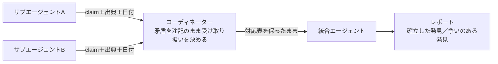

# 複数ソースの統合で出典を保ち、矛盾と時期の違いを扱う

> ドメイン: 5. コンテキスト管理と信頼性（15%） ／ 更新: 2026-11-20

## 3行まとめ
- 要約で発見を圧縮すると「どの主張がどの出典か」が消える。サブエージェントに claim-source mapping（主張と出典の対応表）を構造化して返させ、統合でも保つ
- 信頼できる2つの出典で値が食い違ったら、片方を選ばず両方を出典付きで並べて注記する。どう扱うかはコーディネーターが統合の前に決める
- 時期の違いを矛盾と取り違えないよう、公開日・収集日を必ず出力に含める。レポートは確立した発見と争いのある発見を節で分ける

## 仕組み

### claim-source mapping の欄（ガイドが挙げる項目）
| 欄 | 中身 |
|---|---|
| claim | 主張 |
| 出典 | 出典 URL・文書名 |
| 抜粋 | 根拠になる箇所（relevant excerpt） |
| 日付 | 公開日またはデータの収集日 |

- 統合エージェントは、複数のサブエージェントの対応表を「保ち、まとめる（preserve and merge）」。文章に書き直して対応を捨てない
- サブエージェントへ構造化メタデータを渡す側の話 → [サブエージェントへのコンテキストの渡し方](../01-agentic-architecture/subagent-context-passing.md)。日付・出典を返させる受け渡しの構造化は、別ノート「位置の影響への対策と、エージェント間で渡す情報の構造化」

### 矛盾と時期の違い
- 文書分析は、矛盾する値を両方含めて明示的に注記した状態で完了させる。和解（reconcile）はコーディネーターが統合の前に決める
- 日付があれば「2022年の調査で40%、2025年の調査で55%」は変化として読める。日付が無いと矛盾に見える

### レポートの書き方
- 確立した発見（well-established）と争いのある発見（contested）を、明示的な節に分ける
- 元の出典の言い方（例: 「推定」「暫定値」）と方法の文脈（調査対象・手法）を残す

| 内容の種類 | 形式（ガイドの例） |
|---|---|
| 財務データ | 表 |
| ニュース | 文章 |
| 技術的な発見 | 構造化した箇条書き |

### 公式ドキュメントでの裏付け（API・プロンプト側）
- Citations（引用機能）: 文書ごとに有効にすると、主張ごとに `cited_text`・`document_index`・`document_title` と位置（文字・ページ）を返す
- 長い文書では、先に関係する箇所を引用させてから作業させる。引用で裏付けられない主張は撤回させる（Reduce hallucinations）
- Anthropic の調査システムは、発見をまとめた後に CitationAgent（文書とレポートから引用箇所を特定する役）へ渡す

## 試験で問われそうなポイント
- 最終レポートで出典が消えている → 要約の段で対応表が捨てられている。サブエージェントに claim・抜粋・URL/文書名・日付を構造化で返させ、統合でも保つ
- 信頼できる2つの統計が食い違う → 両方を出典付きで載せて注記し、争いのある発見の節に置く
- 古い資料と新しい資料で値が違い「矛盾」と報告される → 出力に公開日・収集日を必須にする
- 文書分析の段で矛盾を見つけた → 分析の段で解決せず、注記して返し、コーディネーターに決めさせる
- 統合結果が全部同じ形式で読みにくい → 内容の種類ごとに表・文章・箇条書きを使い分ける

## 間違えやすいところ
- 矛盾する値の一方を勝手に選ぶ、平均を取る、新しいほうだけ残す → どれもアンチパターン。両方を注記して残す（「平均」「新しいほう」はガイドの「arbitrarily selecting」を私が具体化した例）
- 時期の違うデータを同じ時点の値として並べる → 変化を矛盾と誤読させる
- 出典を本文の文章に混ぜる・「出典を残して」と頼むだけ → 統合で落ちやすい。欄を分けた構造化データにする
- 確立した発見と争いのある発見を同じ調子で書く・「推定」を断定に言い換える → 不確かさが消える
- ずれ: Citations は structured outputs（JSON スキーマでの出力）と同時に使えない（400 エラー）。ガイドの「構造化した対応表」は設計パターンで、Citations の機能名ではない
- 補足（私の解釈）: `conflict_detected` は抽出時の矛盾フラグ（4.4、[検証と再試行のループ](../04-prompt-engineering/validation-retry-loop.md)）。5.6 は統合での扱いが主

## 確認問題
1. 市場調査エージェントのレポートに「国内の家庭用蓄電池の普及率は 8% と 12%」と出典なしで両方書かれ、読者が混乱している。2つの値は別の年の統計だった。何を直すか。
   

答え
サブエージェントの出力に出典（URL・文書名）と公開日・収集日を必須にし、統合でも保つ。日付があれば年による変化と読め、矛盾ではないと分かる。

2. 2つの公的機関が同じ年の同じ指標で違う値を出していた。統合エージェントは中間の値を書いた。どう設計し直すか。
   

答え
両方の値を出典付きで残し、矛盾として注記する。争いのある発見の節に置き、元の出典の言い方や調査方法の違いも添える。平均は根拠の無い値を作るので不可。

3. 文書分析のサブエージェントが、矛盾を見つけるたびに自分で片方を選んで報告している。どうさせるべきか。
   

答え
矛盾する値を両方含めて注記したまま分析を完了させ、扱いはコーディネーターが統合の前に決める。

## 出典
- [Claude Certified Architect – Foundations Exam Guide v1.1（タスクステートメント 5.6、Exercise 4）](https://cc.sj-cdn.net/instructor/6nizmqk8tpzpfjvt6qmmav7rh/public/1794946250/Claude_Certified_Architect_-_Foundations_Exam_Guide.pdf)（公式）
- [Citations](https://platform.claude.com/docs/en/build-with-claude/citations)（公式。引用の欄、structured outputs と併用不可）
- [Prompting best practices](https://platform.claude.com/docs/en/build-with-claude/prompt-engineering/claude-prompting-best-practices)（公式。文書を `<document>`・`<source>` タグで渡す、先に引用させる、出力形式の指示）
- [Reduce hallucinations](https://platform.claude.com/docs/en/test-and-evaluate/strengthen-guardrails/reduce-hallucinations)（公式。引用で裏付けられない主張を撤回させる）
- [How we built our multi-agent research system](https://www.anthropic.com/engineering/multi-agent-research-system)（公式。CitationAgent、一次情報を優先する評価）
- 未確認: 矛盾する統計や時期の違いの扱い方そのものを説明する公式ドキュメント（ガイド以外では見つからなかった。調査システムの記事にも記述は無い）
- 未確認: Citations と Prompting best practices のページは途中で切れて読めた部分があり、後半の記述は要約でしか確かめていない
