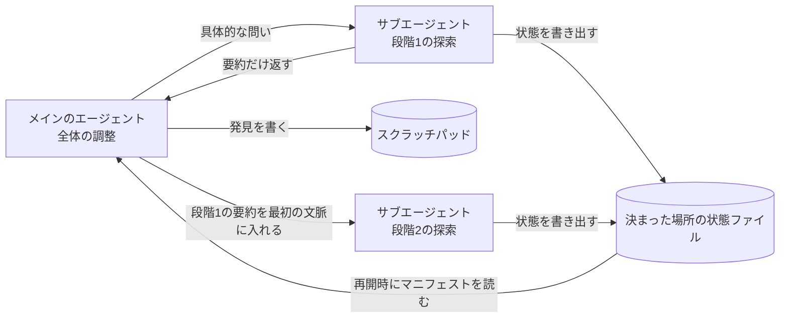

# 大きなコードベースの探索でのコンテキスト管理

> ドメイン: 5. コンテキスト管理と信頼性（15%） ／ 更新: 2026-11-20

## 3行まとめ
- 長い探索では文脈が劣化（context degradation）する。前に見つけた具体的なクラス名ではなく「よくあるパターン」で答え始めたら合図
- 発見はスクラッチパッド（作業メモのファイル）に書き出し、うるさい探索はサブエージェントに任せ、満杯なら `/compact`、落ちても戻れるようにマニフェストを置く
- 決め手は「重要な事実を会話の外（ファイル・要約）に置き、次の段階には要約を明示的に渡す」こと

## 仕組み

### どの手法を、どんな状況で使うか

| 手法 | 使う状況 | やること | 使わない状況 |
|---|---|---|---|
| スクラッチパッド（scratchpad file） | 探索が長く、前に見つけた事実を後の質問で使う | 主要な発見（クラス名・呼び出し関係・結論）をファイルに書き、次の質問の前に読み返す | 数ターンで終わる小さな調査 |
| サブエージェント | 検索結果・ファイルの中身など、出力が多い調査 | 「テストファイルを全部挙げて」のような具体的な問いを渡し、要約だけ受け取る | やり取りを何度も重ねる作業、すぐ終わる直し |
| `/compact`（会話を要約して詰めるコマンド） | 探索の出力で文脈が埋まってきた | `/compact <焦点>` で、残したい論点を指定して要約させる | 無関係な作業に切り替える（`/clear` を使う） |
| マニフェスト（manifest。状態ファイルの一覧） | 複数エージェントの長い処理が途中で落ちうる | 各エージェントが決まった場所に状態を書き出し、コーディネーターが再開時に読んでプロンプトに入れる | 1回で終わる短い処理 |

### 劣化の症状と対策
- 症状: 同じ問いへの答えが前と食い違う。具体的なクラス名の代わりに「一般的には〜」と答える
- 対策: スクラッチパッドを読み返させる。`/compact` で詰める。探索の続きはサブエージェントに出す
- `/compact` で残るもの: CLAUDE.md（ルート）・プランモードのプランは読み込み直される。会話の細かい指示や、`paths:` 付きのルールは要約に埋もれうる

### 段階をまたぐときの要約
- 段階1（例: 依存関係の洗い出し）が終わったら、発見を要約する
- 段階2のサブエージェントの最初の文脈に、その要約を入れる。サブエージェントは親の会話を自動では引き継がない（フォークを除く）

## 試験で問われそうなポイント
- 長い探索の後半で、答えが前の発見と食い違う → スクラッチパッドに発見を記録し、次の質問の前に参照させる
- メインの会話が検索結果で埋まる → 具体的な問いごとにサブエージェントへ任せ、メインは全体の調整に専念する
- 次の段階のサブエージェントを起動する → 前の段階の要約を最初の文脈に入れて渡す
- 複数エージェントの処理が落ちた後の再開 → 各エージェントの状態ファイルをマニフェストから読み、プロンプトに入れて続きから
- 探索の出力で文脈が満杯 → `/compact <焦点>` で、今後も使う論点を指定して詰める

## 間違えやすいところ
- アンチパターン: 次の段階のサブエージェントに、前の段階の発見を要約して渡さない。同じ探索を最初からやり直すことになる
- アンチパターン: 重要な発見を会話の中だけに置く。compaction（要約で詰めること）や文脈の境目で失われる
- アンチパターン: 落ちたら最初からやり直す設計。状態を書き出しておけば、終わった分は読み込むだけで済む
- サブエージェントに渡すのは「具体的な問い」。「全部調べて」のような曖昧な丸投げではない
- `/compact` は同じ会話を続けたまま詰める。`/clear` は会話を空にする（別の作業向け）
- ガイドは「サブエージェントで文脈を守る」と書くが、現行の Best practices は1M トークンと自動 compaction のため古い助言とし、今も有効な利点を並列作業・うるさい出力を外に出す・独立したレビューとしている
- 「マニフェスト」という言葉は、確かめた範囲の Claude Code の公式ドキュメントには無い（ガイドの用語。未確認）
- 関連: 組み込みツールの選び方と段階的な探索は [builtin-tools-incremental-exploration](../02-tool-design-mcp/builtin-tools-incremental-exploration.md)、プランモードと Explore サブエージェントは [plan-mode-vs-direct](../03-claude-code/plan-mode-vs-direct.md)、セッションの再開とフォークは [session-resume-fork](../01-agentic-architecture/session-resume-fork.md)

## 確認問題
1. 決済ライブラリの移行調査を3時間続けたら、最初に特定した `LedgerAdapter` について聞いても「一般的なアダプターは〜」と答えるようになった。まず何をする？
   

答え
文脈の劣化の症状。特定したクラス名や呼び出し関係をスクラッチパッドに書き出させ、以後の質問ではそれを読み返させる。必要なら `/compact <焦点>` で詰める。会話の中で同じ質問を繰り返しても戻らない。

2. 「ログ出力の呼び出し元を全部洗い出す」段階が終わり、次は「各呼び出し元を新しい API に置き換える計画」をサブエージェントに作らせる。どう起動する？
   

答え
段階1の発見（呼び出し元の一覧と注意点）を要約し、段階2のサブエージェントの最初の文脈に入れる。サブエージェントは空の文脈で始まるので、渡さないと洗い出しをやり直す。

3. 5つのサブエージェントで夜間に依存関係を調べる処理が、3つ目の途中で落ちた。再開の設計は？
   

答え
各エージェントが決まった場所に状態（終わった範囲・発見・未完了）を書き出しておき、コーディネーターが再開時にマニフェストを読み、終わっていない分のエージェントのプロンプトに状態を入れて続きから動かす。最初からやり直さない。

## 出典
- [Exam Guide v1.1 タスクステートメント 5.4](https://cc.sj-cdn.net/instructor/6nizmqk8tpzpfjvt6qmmav7rh/public/1794946250/Claude_Certified_Architect_-_Foundations_Exam_Guide.pdf)（公式）
- [Explore the context window](https://code.claude.com/docs/en/context-window)（公式。compaction で残るもの、`/compact` の焦点、サブエージェントへの委任）
- [Best practices](https://code.claude.com/docs/en/best-practices)（公式。サブエージェントが役立つ場面、古い助言の表）
- [Create custom subagents](https://code.claude.com/docs/en/sub-agents)（公式。うるさい出力の隔離、サブエージェントの連鎖）
- [Commands](https://code.claude.com/docs/en/commands)（公式。`/compact [instructions]`、`/clear`）
- [Set up Claude Code in a monorepo or large codebase](https://code.claude.com/docs/en/large-codebases)（公式。プランのファイルは compaction 後も残る）
- [Effective context engineering for AI agents](https://www.anthropic.com/engineering/effective-context-engineering-for-ai-agents)（公式。context rot、構造化したメモ、サブエージェントは要約だけ返す）
- [Effective harnesses for long-running agents](https://www.anthropic.com/engineering/effective-harnesses-for-long-running-agents)（公式。進捗ファイルと git 履歴で新しい文脈から状態をつかむ。マニフェストに近い考え方）
