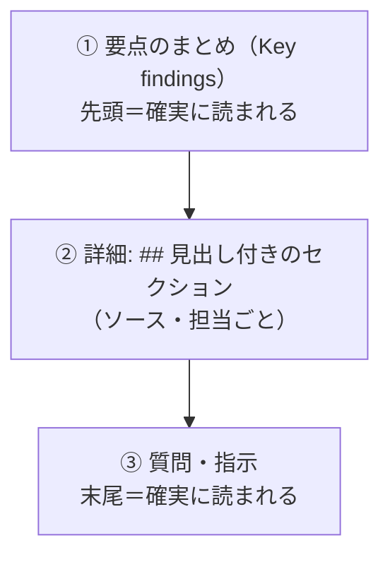

# 位置の影響（lost in the middle）への対策と、エージェント間で渡す情報の構造化

> ドメイン: 5. コンテキスト管理と信頼性（15%） ／ 更新: 2026-11-20

## 3行まとめ
- 長い入力では、先頭と末尾は確実に処理されるが、**真ん中の発見は抜けやすい**（lost in the middle（位置の影響））
- 対策は並べ方: 要点のまとめを先頭に置き、詳細は見出し付きのセクションに分ける。長い資料は上、質問・指示は末尾
- 渡す側を直す: サブエージェントには日付・出典・方法などのメタデータ付きの構造化データを返させ、長い推論の文章は返させない

## 仕組み

### 位置の影響を受けにくい並べ方



- ①: 統合する入力（複数の結果を束ねたもの）の先頭に、重要な発見の要約を置く（ガイド 5.1）
- ②: 詳細は明示的な見出しで区切る。複数文書なら `<document>` タグに `<source>` などのメタデータを添える（公式）
- ③: 20k トークンを超える長い入力では、資料を上に、質問を末尾に置く。公式のテストで回答の質が最大 30% 上がった
- 補助: 長い文書では、先に関係する箇所を引用させてから作業させると、関係ない部分に引きずられにくい（公式）

### 上流のエージェントに返させるもの

| 返させるもの | 返させないもの |
|---|---|
| 要点（key facts）、引用・出典（citations）、関連度（relevance scores） | 長い本文の写し、推論の過程（reasoning chains） |
| メタデータ: 日付、出典の場所（URL・文書・ページ）、方法の文脈（どう調べた・どの条件で測った） | メタデータの無い結論だけ |

```json
{"key_facts": [{"fact": "…", "date": "2026-03", "source": "report.pdf p.4",
  "method": "社内調査 n=200", "relevance": 0.9}]}
```

- 理由: 下流（統合役）のコンテキストの予算が限られていると、長い文章は真ん中が埋もれ、日付や方法が無いと正しく統合できない
- 公式のブログでも、サブエージェントは数万トークン探索しても、返すのは 1,000〜2,000 トークンの凝縮した要約が多いとしている

## 試験で問われそうなポイント
- 統合レポートで、入力の中ほどにあった結果だけが抜ける → 要点のまとめを先頭に置き、詳細を見出しで区切る
- 統合役のコンテキストが溢れそう → 上流が冗長な文章ではなく、要点・出典・関連度の構造化データを返すように上流を直す
- 統合で「いつの」「どう測った」数字かが混ざる → サブエージェントの出力に日付・出典の場所・方法の文脈を必須の欄として入れさせる
- 長い資料と質問の順 → 資料が上、質問は末尾
- 要約で数値・日付が落ちる、事実ブロック、ツール出力の絞り込み → 別ノート（長い対話で重要な事実を保つ）
- 前段の結果を丸ごと渡す・出典を本文と分ける → [サブエージェントへのコンテキストの渡し方](../01-agentic-architecture/subagent-context-passing.md)

## 間違えやすいところ
- アンチパターン: 重要な発見を、長い入力の真ん中に埋もれさせたまま統合させる
- アンチパターン: 上流が推論の過程まで全文を返し、予算の限られた下流に流し込む
- 「コンテキストウィンドウが大きいから全部入れれば良い」は誤り。トークンが増えるほど想起の精度が落ちる（context rot（文脈の劣化））
- 「先頭に置く」のは要点のまとめ、「末尾に置く」のは質問・指示。どちらも中央を避ける点で矛盾しない
- 「丸ごと渡す」（1.3）と「凝縮して返す」（5.1）は場面が違う。後者は下流の予算が限られるときで、出典・メタデータは削らない
- 名前のずれ: 「lost in the middle」はガイドの用語。現行の公式ドキュメントでは確認できず、context rot や配置の指示（資料は上、質問は末尾）として書かれている

## 確認問題
1. 8件の調査結果を順に連結して統合役に渡したら、4〜6件目の内容がレポートにほぼ出てこない。何を変えるか。
   <details><summary>答え</summary>先頭に全件の要点のまとめを置き、各結果を見出し付きのセクションに分ける。中ほどの情報が抜ける位置の影響への対策。件数を減らすことが目的ではない。</details>
2. 価格調査のサブエージェントが「A 社は安い。理由は…」と長い文章を返し、統合役が古い価格と新しい価格を混ぜた。上流をどう直すか。
   <details><summary>答え</summary>各価格を、値・調べた日付・出典の場所・調べ方を欄に持つ構造化データで返させる。推論の文章は返させない。日付のメタデータがあれば統合役は新旧を区別できる。</details>
3. 50ページの仕様書と「矛盾している箇所を挙げて」という依頼を1つのプロンプトに入れる。並べ方は？
   <details><summary>答え</summary>仕様書を上に、依頼を末尾に置く。必要なら先に該当箇所を引用させてから答えさせる。</details>

## 出典
- [Prompting best practices — Long context prompting](https://platform.claude.com/docs/en/build-with-claude/prompt-engineering/claude-prompting-best-practices)（公式。旧 long context tips を統合）
- [Context windows](https://platform.claude.com/docs/en/build-with-claude/context-windows)（公式。context rot）
- [Effective context engineering for AI agents](https://www.anthropic.com/engineering/effective-context-engineering-for-ai-agents)（公式・エンジニアリングブログ）
- [How we built our multi-agent research system](https://www.anthropic.com/engineering/multi-agent-research-system)（公式・エンジニアリングブログ）
- Claude Certified Architect – Foundations Exam Guide v1.1、Task Statement 5.1（公式）
- 未確認: 位置の影響の大きさ（真ん中でどれだけ落ちるか）を示す公式の数値。公式にあるのは「質問を末尾に置くと最大 30%」だけ
