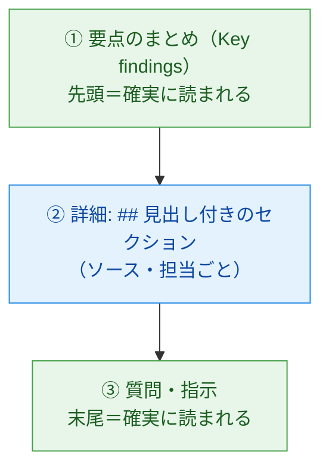

# 位置の影響（lost in the middle）への対策と、エージェント間で渡す情報の構造化

> ドメイン: 5. コンテキスト管理と信頼性（15%） ／ 更新: 2026-11-20

!!! abstract "ひとことで"
    長い入力の真ん中は抜けやすい。==要点のまとめを先頭==に置き、詳細は見出しで区切り、質問は末尾に置く。下流の予算が限られるときは、上流のエージェントに、長い推論の文章ではなく ==メタデータ付きの構造化データ==を返させる。

## 仕組み

長い入力では、先頭と末尾は確実に処理されるが、真ん中の発見は抜けやすい。これを位置の影響（lost in the middle）と呼ぶ。対策は並べ方で、重要なものを中央に置かない。先頭に置くのは要点のまとめ、末尾に置くのは質問・指示なので、両者は矛盾しない。



①は、統合する入力（複数の結果を束ねたもの）の先頭に置く重要な発見の要約だ（ガイド 5.1）。②は明示的な見出しで区切る。複数文書なら `<document>` タグに `<source>` などのメタデータを添える（公式）。③について、20k トークンを超える長い入力では、資料を上に、質問を末尾に置く。公式のテストでは、これで回答の質が最大 30% 上がった。

渡す側も直す。下流（統合役）のコンテキストの予算が限られるときは、メタデータが下流での正確な統合を支える（ガイド 5.1）。そのときサブエージェントには、次の形で返させる。

| 返させるもの | 返させないもの |
|---|---|
| 要点（key facts）、引用・出典（citations）、関連度（relevance scores） | 長い本文の写し、推論の過程（reasoning chains） |
| メタデータ: 日付、出典の場所（URL・文書・ページ）、方法の文脈（どう調べた・どの条件で測った） | メタデータの無い結論だけ |

```json
{"key_facts": [{"fact": "…", "date": "2026-03", "source": "report.pdf p.4",
  "method": "社内調査 n=200", "relevance": 0.9}]}
```

??? info "補足・推論・用語のずれ"
    - 補助: 長い文書では、先に関係する箇所を引用させてから作業させると、関係ない部分に引きずられにくい（公式）
    - （推論）長い文章が積み重なると入力が長くなり、位置の影響も受けやすくなると考えられる（ガイド・公式に記述なし）
    - 参考: Effective context engineering の記事では、サブエージェントは数万トークン探索しても、返すのは 1,000〜2,000 トークンの凝縮した要約が多いとしている
    - 「丸ごと渡す」（1.3）と「凝縮して返す」（5.1）は場面が違う。後者は下流の予算が限られるときで、出典・メタデータは削らない
    - 名前のずれ: 「lost in the middle」はガイドの用語。現行の公式ドキュメントでは確認できず、context rot や配置の指示（資料は上、質問は末尾）として書かれている
    - 関連: 要約で数値・日付が落ちる話、事実ブロック、ツール出力の絞り込みは [長い対話で重要な事実を保つ](preserving-key-facts.md)。前段の結果を丸ごと渡す・出典を本文と分ける話は [サブエージェントへのコンテキストの渡し方](../01-agentic-architecture/subagent-context-passing.md)

## 試験での見分け方

<div class="vs" markdown>

| 問われること | ○ 正しい | × ひっかけ |
|---|---|---|
| 統合レポートで、入力の中ほどの結果だけが抜ける | 要点のまとめを先頭に置き、詳細を見出しで区切る | 重要な発見を真ん中に埋もれさせたまま統合させる |
| 統合役のコンテキストが溢れそう | 上流に、要点・出典・関連度の構造化データを返させる | 上流が推論の過程まで全文を返し、下流に流し込む |
| 「いつの」「どう測った」数字かが混ざる | 日付・出典の場所・方法の文脈を必須の欄にする | メタデータの無い結論だけを返させる |
| 長い資料と質問の並べ方 | 資料が上、質問は末尾 | 質問や指示を先頭に置き、資料を後ろに続ける |
| コンテキストウィンドウが大きい | 入れる量でなく、並べ方と構造で抜けを防ぐ | コンテキストウィンドウが大きいから全部入れれば良い（トークンが増えるほど想起の精度が落ちる。context rot（文脈の劣化）） |

</div>

## 確認問題

**Q1.** 市場調査のマルチエージェントシステムで、8つのサブエージェントの調査結果を順に連結して統合役に渡している。できあがったレポートには、4〜6件目の結果がほとんど出てこない。最も適切な直し方はどれか。（1つ選べ）
{ .quiz-q }

<div class="quiz" data-answer="D" markdown>

- A. 4〜6件目を返したサブエージェントに、結果をより詳しく長く書き直させる
- B. 統合の指示を入力の先頭に置き、8件の結果をその後ろに続ける
- C. コンテキストウィンドウの大きいモデルに替え、連結したまま渡す
- D. 先頭に全件の要点のまとめを置き、各結果を見出し付きのセクションに分ける

</div>

??? success "答えと解説"
    **正解: D。** 中ほどが抜けるのは位置の影響なので、要点のまとめを先頭に置き、詳細を見出しで区切る。

    - A: 原因は位置の影響で、中身の詳しさではない。真ん中に置いたまま長くしても抜けやすい位置は変わらず、入力が延びるだけだ
    - B: 長い入力では、資料を上に、質問・指示を末尾に置く
    - C: 窓が大きくても、入れる量が増えるほど想起の精度は落ちる（context rot）

**Q2.** 同じシステムで、価格を調べるサブエージェントが「A 社は安い。理由は…」と長い文章を返している。統合役のコンテキストには余裕が無く、統合役は税込の価格と税抜の価格を混ぜて比べてしまった。上流のサブエージェントの直し方として適切なものはどれか。（2つ選べ）
{ .quiz-q }

<div class="quiz" data-answer="A,B" markdown>

- A. 各価格を、値・出典の場所・取得した条件（方法の文脈）を欄に持つ構造化データで返させる
- B. 推論の過程や本文の写しは返させず、要点・出典・関連度に絞って返させる
- C. 推論の過程をすべて返させ、統合役が文章から税込か税抜かを読み取れるようにする
- D. 結論の価格だけを1行で返させ、統合役のトークンを節約する
- E. 上流は本文の写しを返し、税込か税抜かは統合役があとで調べ直す

</div>

??? success "答えと解説"
    **正解: A と B。** 下流の予算が限られるときは、要点・出典・関連度をメタデータ付きの構造化データで返させる。方法の文脈の欄に税込か税抜かが入れば、統合役はそろえて比べられる。

    - C: 推論の過程まで流し込むと、統合役のコンテキストを圧迫する
    - D: メタデータの無い結論だけでは、どの条件の価格かが分からず、また混ざる
    - E: 長い本文の写しは返させない。取得した条件は上流で欄として付ける

**Q3.** 開発チームが、50ページの API 仕様書と「仕様の中で矛盾している箇所を挙げて」という依頼を、1つのプロンプトにまとめて Claude に渡す。並べ方として最も適切なものはどれか。（1つ選べ）
{ .quiz-q }

<div class="quiz" data-answer="A" markdown>

- A. 仕様書を上に、依頼を末尾に置く
- B. 依頼を先頭に置き、仕様書をその後ろにすべて続ける
- C. 依頼を仕様書の真ん中、関係しそうな章の直前に挟み込む
- D. 窓に収まる長さなので並べ方は結果に影響しない。どちらを先に入れてもよい

</div>

??? success "答えと解説"
    **正解: A。** 20k トークンを超える長い入力では、資料を上に、質問を末尾に置く。公式のテストでは回答の質が最大 30% 上がった。

    - B: 質問や指示を先頭に置き、資料を後ろに続けるのは、推奨と逆の並べ方だ
    - C: 真ん中は抜けやすい位置で、依頼そのものが読み落とされかねない
    - D: 窓に収まっても、長い入力では並べ方で回答の質が変わる。並べ方と構造で抜けを防ぐ

## 出典
- [Prompting best practices — Long context prompting](https://platform.claude.com/docs/en/build-with-claude/prompt-engineering/claude-prompting-best-practices)（公式。旧 long context tips を統合）
- [Context windows](https://platform.claude.com/docs/en/build-with-claude/context-windows)（公式。context rot）
- [Effective context engineering for AI agents](https://www.anthropic.com/engineering/effective-context-engineering-for-ai-agents)（公式・エンジニアリングブログ。1,000〜2,000 トークンの要約の参考。構造化データを返させる推奨の根拠はガイド 5.1）
- Claude Certified Architect – Foundations Exam Guide v1.1、Task Statement 5.1（公式）
- 未確認: 位置の影響の大きさ（真ん中でどれだけ落ちるか）を示す公式の数値。公式にあるのは「質問を末尾に置くと最大 30%」だけ
