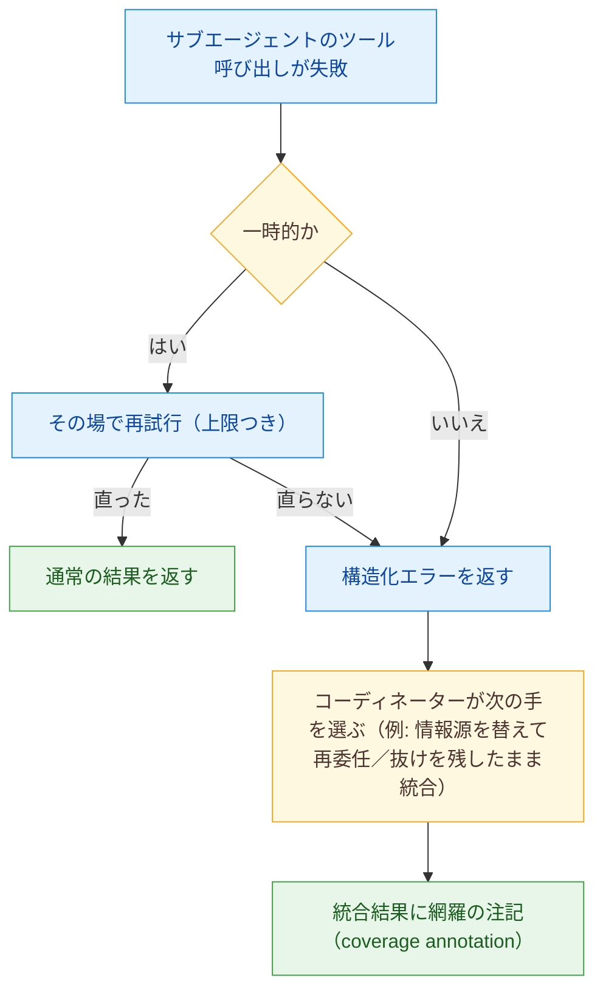

# マルチエージェントでのエラーの伝え方（Error propagation）

> ドメイン: 5. コンテキスト管理と信頼性（15%） ／ 更新: 2026-11-20

!!! abstract "ひとことで"
    サブエージェントは、直せない失敗だけを ==構造化したエラー文脈==としてコーディネーターに返す。「アクセス失敗」と「正当な0件」は必ず分ける。握りつぶし（空の成功）と全体停止は、どちらも誤り。

## 仕組み

判断の決め手は、コーディネーターが次の手を選べる情報が届くかどうかだ。一時的な失敗はサブエージェント内で回復する（局所的な回復（local recovery））。何でも上げると、調整の負担が増えるからだ。直らないものだけを、取れた分の結果と一緒に返す。そうすればコーディネーターは、残りだけを手配できる。

| | アクセス失敗（access failure） | 正当な0件（valid empty result） |
|---|---|---|
| 何が起きたか | 情報源に届かなかった（タイムアウト、接続拒否、権限なし） | 問い合わせは成功し、該当が無かった |
| 「無い」と言えるか | 言えない。分からないだけ | 言える。それ自体が発見 |
| 返し方 | エラーとして返す（種類・試したこと付き） | 成功として「0件」を返す |
| コーディネーターの次の手 | 再試行するか、別の情報源に回すか、抜けとして注記 | そのまま統合に使う |

構造化エラー文脈の中身は、ガイドの4要素だ。社内の販売DBを引くサブエージェントで例を示す。

| 要素 | 例 |
|---|---|
| 失敗の種類（failure type） | 接続タイムアウト（一時的と判断して2回再試行済み） |
| 試したこと（attempted query） | 2026年Q3・東日本の売上を地域別に集計するクエリ |
| 途中の結果（partial results） | 西日本分の集計は取得済み |
| 代わりの手（alternative approaches） | 前日のレポートのスナップショットなら読める |

情報源の一部に届かなくても、全体は止めずに統合する。そのうえで、どの結論が十分な裏付けを持ち、どの領域が抜けているかを注記する。注記が無いと、読む人は全情報源を見た結論だと受け取る。

??? info "API・SDK での返し方と、名前のずれ"
    - MCP ツール側のエラーの返し方（`isError`、分類、retriable）は [MCP ツールの構造化エラー応答](../02-tool-design-mcp/mcp-structured-errors.md) が主
    - Claude API の自前ツールでは、`tool_result` に `is_error: true` を立て、「failed」ではなく何が起きて次に何を試すかを書く（Handle tool calls）
    - Agent SDK のサブエージェントは、途中のツール呼び出しを親に見せず、最後のメッセージだけを返す。中のツール呼び出しの失敗の文脈は、最終報告に書かないと親に届かない
    - 抜けを埋めにいく、狙いを絞った再委任のループは [調査範囲の分割と反復ループ](../01-agentic-architecture/scope-partitioning-iterative-refinement.md) が主
    - 名前のずれ: ガイドの「構造化エラー文脈」「網羅の注記」は設計の考え方で、SDK や API に同名の機能があるわけではない（公式ドキュメントで同名の機能は確認できなかった）

## 試験での見分け方

| 問われること | ○ 正しい | × ひっかけ |
|---|---|---|
| コーディネーターが回復の判断を誤る | 種類・試したこと・途中の結果・代わりの手を返させる | 「検索できませんでした」だけを返す（一般的なエラー状態（generic error status）は文脈を隠す） |
| 失敗を上に伝えるか | 直せない失敗は、握りつぶさずエラーとして返す | 握りつぶして空の結果を成功として返す（「該当なし」と誤って結論づけられ、回復の機会も失う） |
| 該当が0件だった | 成功として「0件」を返す | エラーとして返す（届かなかった場合と区別できず、無駄な再試行を招く） |
| 一時的な失敗 | サブエージェント内で再試行し、直らないものだけを上げる | 一時的な失敗のたびにコーディネーターを呼ぶ |
| 一部の情報源に届かない | 止めずに統合し、網羅の注記を付ける | ワークフロー全体を止める（他のサブエージェントの成果まで捨てる） |
| 途中まで取れた | 取れた分を添えて返す | 途中の結果を捨てて失敗だけ返す |

## 確認問題

**Q1.** 特許調査のマルチエージェントシステムで、サブエージェントが特許DBに検索をかけたところ、条件に合う出願は1件も無かった。今の実装は、この場合に `is_error: true` と「見つかりません」を返している。最も適切な直し方はどれか。（1つ選べ）
{ .quiz-q }

- A. エラーのまま返し、コーディネーターに検索の再試行を任せる
- B. 別の特許DBにも検索をかけ、どちらも0件ならエラーとして返す
- C. 成功として「0件」を返し、試した検索条件を添える
- D. 0件は異常とみなし、ワークフロー全体を止めて人に知らせる

??? success "答えと解説"
    **正解: C。** 問い合わせは成功して該当が無かったので、正当な0件として成功で返す。

    - A: エラーにすると接続失敗と区別できず、無駄な再試行を招く
    - B: 情報源を増やしても、0件をエラーにする点が変わらない
    - D: 0件はそれ自体が発見だ。全体を止める理由にならない

**Q2.** 競合分析のマルチエージェントシステムで、4つのサブエージェントのうち1つが、有料の業界レポートの API に権限エラーで弾かれた。ほかの3つは成功している。コーディネーターの対応として最も適切なものはどれか。（1つ選べ）
{ .quiz-q }

- A. ワークフロー全体を止め、権限の問題が解決するまで統合を待つ
- B. 成功した3つで統合し、業界レポートの領域に網羅の注記を付ける
- C. 同じ API への再試行を、権限エラーが消えるまで繰り返させる
- D. 成功した3つだけで、抜けには触れずに統合レポートを書く

??? success "答えと解説"
    **正解: B。** 一部の情報源に届かなくても止めずに統合し、どの領域が抜けているかを注記する。代わりの情報源への再委任も検討できる。

    - A: 全体を止めると、成功した3つの成果まで捨てることになる
    - C: 権限エラーは一時的な失敗ではないので、再試行しても直らない
    - D: 注記が無いと、読む人は全情報源を見た結論だと受け取る

**Q3.** 価格比較のマルチエージェントシステムで、価格を集めるサブエージェントが、ある通販サイトへの接続で一時的なエラーを1回受けた。このサブエージェントの設計として最も適切なものはどれか。（1つ選べ）
{ .quiz-q }

- A. すぐにコーディネーターへエラーを返し、再試行するか別の情報源に回すかを任せる
- B. そのサイトを飛ばし、取れた価格だけを、抜けに触れずに成功として返す
- C. その場で上限つきで再試行し、直らなければ種類・試したこと・取れた分・代わりの手を返す
- D. その場で上限つきで再試行し、直らなければ「取得に失敗しました」とだけ返す

??? success "答えと解説"
    **正解: C。** 一時的な失敗はサブエージェント内で回復し、直らないものだけを構造化したエラー文脈で返す。

    - A: 一時的な失敗のたびに上げると、コーディネーターの調整の負担が増える
    - B: 握りつぶして成功として返すと、抜けに気づかれず、回復の機会も失う
    - D: 一般的なエラー状態だけでは、コーディネーターが次の手を選べない

## 出典
- Claude Certified Architect – Foundations Exam Guide v1.1, Task Statement 5.3（公式、PDF）: https://cc.sj-cdn.net/instructor/6nizmqk8tpzpfjvt6qmmav7rh/public/1794946250/Claude_Certified_Architect_-_Foundations_Exam_Guide.pdf
- [How we built our multi-agent research system](https://www.anthropic.com/engineering/multi-agent-research-system)（公式、エンジニアリングブログ。エラーは積み重なる、失敗した場所から再開する、ツールの失敗をエージェントに知らせて適応させる、再試行とチェックポイントを組み合わせる）
- [Handle tool calls（Handling errors with is_error）](https://platform.claude.com/docs/en/agents-and-tools/tool-use/handle-tool-calls)（公式。汎用の「failed」でなく、何が起きて次に何を試すかを書く）
- [Subagents in the SDK](https://code.claude.com/docs/en/agent-sdk/subagents)（公式。最後のメッセージだけが親に返る）
- [Create custom subagents（API errors in subagents）](https://code.claude.com/docs/en/sub-agents)（公式。API エラーで途中終了したとき: フォアグラウンドでテキストを出していれば途中の出力と打ち切りの注記、出力なし／ツール呼び出しだけなら `Agent terminated early due to an API error` とエラーの詳細で失敗、バックグラウンドなら failed になり終了時のメッセージにエラー名と最後の出力。SDK のページでは、API エラーで早く終わったときそれが結果として渡されることはない）
- 「アクセス失敗と0件の区別」「網羅の注記」を直接扱う公式ドキュメントのページ: 未確認（ガイドの Task Statement 5.3 と 2.2 の Skills でのみ確認）
