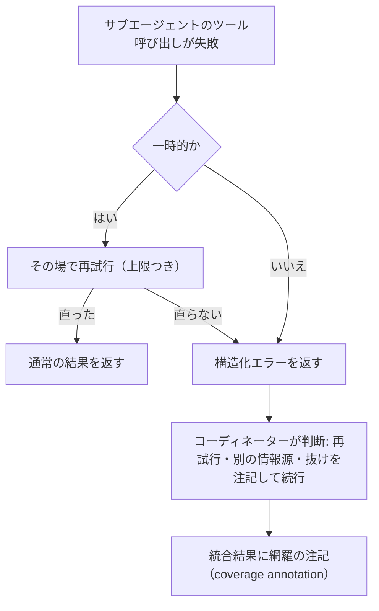

# マルチエージェントでのエラーの伝え方（Error propagation）

> ドメイン: 5. コンテキスト管理と信頼性（15%） ／ 更新: 2026-11-20

## 3行まとめ
- サブエージェントは失敗を、構造化したエラー文脈（種類・試したこと・途中の結果・代わりの手）としてコーディネーターに返す
- 一時的な失敗はサブエージェント内で回復し、直せないものだけを上げる。「アクセス失敗」と「正当な0件」は必ず分ける
- 判断の決め手は、コーディネーターが次の手を選べる情報が届くか。握りつぶし（空の成功）と全体停止はどちらも誤り

## 仕組み

### 失敗の流れ

### アクセス失敗と正当な0件
| | アクセス失敗（access failure） | 正当な0件（valid empty result） |
|---|---|---|
| 何が起きたか | 情報源に届かなかった（タイムアウト、接続拒否、権限なし） | 問い合わせは成功し、該当が無かった |
| 「無い」と言えるか | 言えない。分からないだけ | 言える。それ自体が発見 |
| 返し方 | エラーとして返す（種類・試したこと付き） | 成功として「0件」を返す |
| コーディネーターの次の手 | 再試行するか、別の情報源に回すか、抜けとして注記 | そのまま統合に使う |

### 構造化エラー文脈の中身（ガイドの4要素）
| 要素 | 例（社内の販売DBを引くサブエージェント） |
|---|---|
| 失敗の種類（failure type） | 接続タイムアウト（一時的と判断して2回再試行済み） |
| 試したこと（attempted query） | 2026年Q3・東日本の売上を地域別に集計するクエリ |
| 途中の結果（partial results） | 西日本分の集計は取得済み |
| 代わりの手（alternative approaches） | 前日のレポートのスナップショットなら読める |

- MCP ツール側のエラーの返し方（`isError`、分類、retriable）は [MCP ツールの構造化エラー応答](../02-tool-design-mcp/mcp-structured-errors.md) が主
- Claude API の自前ツールでは `tool_result` に `is_error: true` を立て、「failed」ではなく何が起きて次に何を試すかを書く（Handle tool calls）
- Agent SDK のサブエージェントは、途中のツール呼び出しを親に見せず、最後のメッセージだけを返す。失敗の文脈は最終報告に書かないと親に届かない

## 試験で問われそうなポイント
- コーディネーターが回復の判断を誤る → サブエージェントに、種類・試したこと・途中の結果・代わりの手を返させる
- 「検索できませんでした」だけが返る → 一般的なエラー状態（generic error status）は文脈を隠す。具体的な構造化エラーに替える
- 一時的な失敗のたびにコーディネーターが呼ばれる → 一時的な失敗はサブエージェント内で再試行し、直らないものだけを上げる
- 情報源の一部に届かないまま最終報告を出す → 止めずに統合し、どの結論が十分な裏付けを持ち、どの領域が抜けているかを注記する
- 抜けを埋めにいく → 狙いを絞った再委任のループは [調査範囲の分割と反復ループ](../01-agentic-architecture/scope-partitioning-iterative-refinement.md) が主

## 間違えやすいところ
- エラーを握りつぶして空の結果を成功として返す → アンチパターン。コーディネーターは「該当なし」と誤って結論づけ、回復の機会も失う
- 1件の失敗でワークフロー全体を止める → アンチパターン。他のサブエージェントの成果まで捨てることになる
- 0件をエラーとして返す → 届かなかった場合と区別できず、無駄な再試行を招く
- 何でもコーディネーターに上げる → 一時的な失敗まで上げると調整の負担が増える。局所的な回復（local recovery）が先
- 途中の結果を捨てて失敗だけ返す → 取れた分は添えて返す。コーディネーターが残りだけを手配できる
- 統合結果で抜けを黙る → 網羅の注記が無いと、読む人は全情報源を見た結論だと受け取る
- 名前のずれ → ガイドの「構造化エラー文脈」「網羅の注記」は設計の考え方で、SDK や API に同名の機能があるわけではない（公式ドキュメントで同名の機能は確認できなかった）

## 確認問題
1. 特許調査のシステムで、サブエージェントが特許DBに検索をかけ、条件に合う出願が1件も無かった。現状は `is_error: true` と「見つかりません」を返している。どう直すか
   

答え
検索は成功しているので、成功として「0件」を返す（試した検索条件も添える）。エラーにすると接続失敗と区別できず、コーディネーターが無駄に再試行したり、別の情報源を探したりする。

2. 競合分析で、サブエージェントの1つが有料の業界レポートの API に権限エラーで弾かれた。ほかの3つは成功している。コーディネーターはどうするべきか
   

答え
全体を止めず、成功した3つで統合し、業界レポート由来の領域は「情報源にアクセスできず未確認」と網羅の注記を付ける。権限エラーは再試行しても直らないので、代わりの公開情報源への再委任を検討する。

3. 価格を集めるサブエージェントが、ある通販サイトへの接続で一時的なエラーを1回受けた。すぐコーディネーターにエラーを返す設計は妥当か
   

答え
妥当ではない。一時的な失敗は、まずサブエージェント内で上限つきで再試行する。それでも直らなければ、失敗の種類・試したこと・取れた分の価格・代わりの手を付けて返す。

## 出典
- Claude Certified Architect – Foundations Exam Guide v1.1, Task Statement 5.3（公式、PDF）: https://cc.sj-cdn.net/instructor/6nizmqk8tpzpfjvt6qmmav7rh/public/1794946250/Claude_Certified_Architect_-_Foundations_Exam_Guide.pdf
- [How we built our multi-agent research system](https://www.anthropic.com/engineering/multi-agent-research-system)（公式、エンジニアリングブログ。エラーは積み重なる、失敗した場所から再開する、ツールの失敗をエージェントに知らせて適応させる、再試行とチェックポイントを組み合わせる）
- [Handle tool calls（Handling errors with is_error）](https://platform.claude.com/docs/en/agents-and-tools/tool-use/handle-tool-calls)（公式。汎用の「failed」でなく、何が起きて次に何を試すかを書く）
- [Subagents in the SDK](https://code.claude.com/docs/en/agent-sdk/subagents)（公式。最後のメッセージだけが親に返る）
- [Create custom subagents（API errors in subagents）](https://code.claude.com/docs/en/sub-agents)（公式。API エラーで途中終了したとき、途中の出力と打ち切りの注記が親に返る）
- 「アクセス失敗と0件の区別」「網羅の注記」を直接扱う公式ドキュメントのページ: 未確認（ガイドのみで確認）
