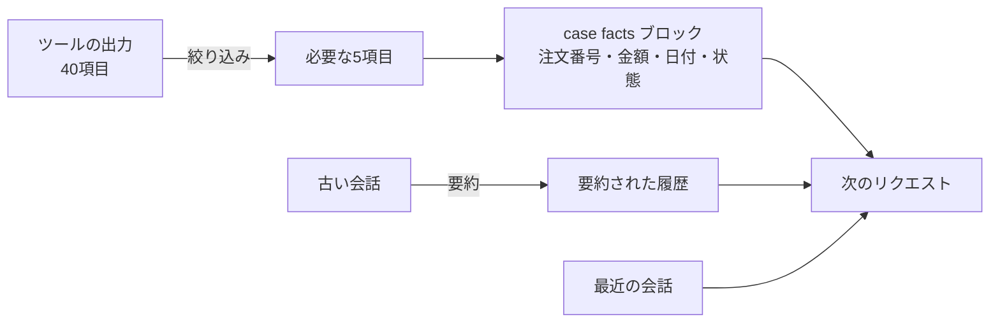

# 長い対話で重要な事実を保つ

> ドメイン: 5. コンテキスト管理と信頼性（15%） ／ 更新: 2026-11-20

## 3行まとめ
- 要約を重ねる（progressive summarization）と、金額・日付・割合・顧客が言った期待がぼやける。正確さが要る事実は要約に任せない
- 取引の事実（金額・日付・注文番号・状態）は「case facts」ブロックに抜き出し、要約された履歴の外に置いて毎回のプロンプトに入れる
- ツールの出力は、必要なフィールドだけに絞ってから会話に積む。履歴そのものは毎回すべて渡す（API はステートレス）

## 仕組み

| 層 | 中身 | 要約してよいか |
|---|---|---|
| case facts ブロック | 金額、日付、注文番号、状態（ガイドの4項目）。顧客が言った期待を足すのはノート独自の追加 | しない。そのまま毎回入れる |
| 問題ごとの構造化データ | 複数の問題を扱うとき、問題ごとの注文 ID・金額・状態 | しない。別の層として持つ |
| 会話の履歴 | やりとりの流れ、経緯 | してよい（compaction など） |

### ツールの出力が積もる
- ツールの結果（tool_result）は会話の履歴に足され、以降のリクエストでも毎回トークンを使う
- 注文の照会で40項目返っても、返品の判断に要るのが5項目なら、残り35項目は関係が薄いのにコンテキストを占め続ける
- 対策は、履歴に入れる前に必要なフィールドだけを残すこと（例: 返品に関わる項目だけ）
- 結果を変換してからモデルに渡す PostToolUse フック（1.5）は、絞り込みを実装する場所の1つ

### 履歴はすべて渡す
- Messages API はステートレス（サーバーが会話を覚えていない）。続くリクエストでは、会話の履歴をすべて送る
- 前のターンを送らないと、モデルは前に何を話したかを知らず、話がつながらない
- 長くなったときは、捨てるのではなく compaction（古い部分を要約して置き換えること）や、古いツール結果の消去（tool result clearing）で詰める

## 試験で問われそうなポイント
- 長い対応の後半で金額や期日を取り違える → case facts ブロックを作り、要約の外で毎回入れる
- 1回の対話で複数の注文・問題を扱う → 問題ごとに構造化データ（ID・金額・状態）を別の層で持つ
- ツールの出力でコンテキストがすぐ埋まる → 履歴に積む前に必要なフィールドへ絞る
- 2ターン目から前の話を覚えていない → 続くリクエストに会話の履歴をすべて含める
- 位置の影響（長い入力の真ん中を見落とす）への対策と、エージェント間で渡す情報の構造化 → 別ノート「位置の影響への対策と、エージェント間で渡す情報の構造化」
- サブエージェントに日付・出典などのメタデータを付けて返させる → [サブエージェントへのコンテキストの渡し方](../01-agentic-architecture/subagent-context-passing.md)

## 間違えやすいところ
- 「150ドル前後」「来週あたり」のように、要約の中で金額・日付・注文番号をぼかすのはアンチパターン
- ツールの出力を丸ごと積み続けるのはアンチパターン。窓が大きくても、関係の薄いトークンが増えるほど精度と想起は落ちる（context rot）
- 「コンテキストを節約するため、前のターンを送らない」は誤り。詰めるなら要約・消去で、履歴を切り捨てない
- 自動の compaction や `/compact` は既定では何を残すかをモデルが決める。残したい事実があるなら、要約の指示（API の `instructions`、`/compact <焦点>`）で指定するか、要約の外に置く
- ずれ: 現行の公式ドキュメントは compaction（ベータ）を主な戦略としている。窓はモデルによって最大 1M。試験はガイドの「事実を抜き出して要約の外に置く」を主に答える
- ガイドの「case facts」は設計パターンの名前で、API の機能名ではない（公式ドキュメントにこの名前の機能は無い）

## 確認問題
1. 旅行予約の窓口エージェント。会話が長くなると、途中で客が言った「出発は 3月14日、予算は1人 8万円まで」が、要約後に「春ごろ、予算は控えめ」に変わってしまう。最も効果的な対策は？
   

答え
出発日・予算・予約番号などを構造化した事実ブロックに抜き出し、要約された履歴とは別に毎回のプロンプトへ入れる。要約を細かくするだけでは、要約を重ねるうちにまたぼやける。

2. 在庫照会ツールが1商品につき60項目を返し、10件照会すると会話がすぐ重くなる。必要なのは在庫数・入荷予定日・倉庫の3項目だけ。どうする？
   

答え
ツールの結果を履歴に入れる前に、3項目だけに絞る（フックやラッパーで変換する）。そのまま積むと、関係の薄い項目が以降の全リクエストでトークンを使い続ける。

3. API で作ったチャットボットが、2通目の質問で1通目の内容を覚えていない。原因と対策は？
   

答え
Messages API はステートレス。続くリクエストの `messages` に、それまでの user と assistant のやりとりをすべて含める。

## 出典
- [Claude Certified Architect – Foundations Exam Guide v1.1（タスクステートメント 5.1、1.5）](https://cc.sj-cdn.net/instructor/6nizmqk8tpzpfjvt6qmmav7rh/public/1794946250/Claude_Certified_Architect_-_Foundations_Exam_Guide.pdf)（公式）
- [Context windows](https://platform.claude.com/docs/en/build-with-claude/context-windows)（公式。履歴の積み上がり、tool_result も窓に数える、context rot）
- [Using the Messages API](https://platform.claude.com/docs/en/build-with-claude/working-with-messages)（公式。ステートレスで、履歴をすべて送る）
- [Compaction overview](https://platform.claude.com/docs/en/build-with-claude/compaction)、[Compaction on demand](https://platform.claude.com/docs/en/build-with-claude/compaction-on-demand)（公式。要約の指示 `instructions`）
- [Context editing](https://platform.claude.com/docs/en/build-with-claude/context-editing)（公式。tool result clearing）
- [Prompting best practices](https://platform.claude.com/docs/en/build-with-claude/prompt-engineering/claude-prompting-best-practices)（公式。状態は JSON などの構造化形式で持つ）
- [Explore the context window](https://code.claude.com/docs/en/context-window)（公式。compaction で残るもの、`/compact` に焦点を指定）
- 未確認: 「case facts」ブロックの具体的な書式（ガイドに例が無く、公式ドキュメントにもこの名前の記述は見つからなかった）
