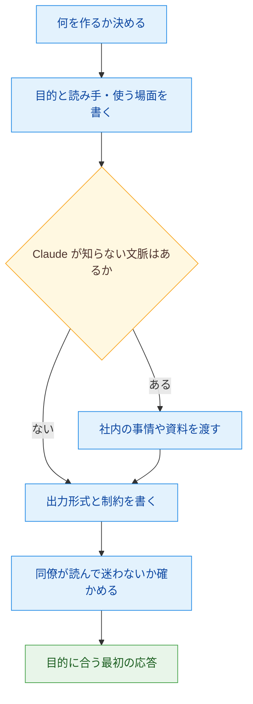

# プロンプトの組み立て

> ドメイン: 1. タスクの定義とプロンプト（15%） ／ 更新: 2026-11-26

!!! abstract "ひとことで"
    依頼には目的・読み手・制約・材料を書き、==Claude が既定では知らない文脈==（社内の事情、何に使うか、誰が読むか）を渡す。文脈の少ない同僚が読んで迷う依頼は、Claude も迷う。

## 仕組み

公式のガイドは、Claude を「優秀だが入ったばかりで、こちらのやり方や流れを知らない社員」にたとえる。一般的な知識はあるが、自社の制度、読み手の立場、成果物の使い道は知らない。だから一言の依頼には、もっともらしい一般論が返る。最初の応答を目的に合わせるには、この欠けた文脈を依頼の側で埋める。

| 要素 | 書くこと | 例（新任マネージャー向けの1on1ガイド） |
|---|---|---|
| 役割・観点 | どの立場で、何を重く見るか | 人事の研修担当として、部下の定着を重く見る |
| 文脈 | 目的、読み手、使う場面、社内の事情 | 初めて部下を持つ人が研修の前に読む。評価面談とは分ける決まりがある |
| タスク | 何をするか。順序が大事なら番号付きの手順 | 1回目の1on1の進め方を、準備・当日・その後の順に書く |
| 出力形式・制約 | 長さ、形式、トーン、入れる・入れないもの | A4 1枚。です・ます調。評価の話題は入れない |

制約には理由を添える。理由が分かると、Claude は書かれていない場面にも同じ考え方を当てはめる。禁止だけを並べるより、「何をしてほしいか」を書くほうが効く。

役割は一文でも出力の焦点とトーンを変える。ただし公式ブログは、役割を細かく作り込むより「どの観点で見てほしいか」を書くほうが効くことが多いとしている。役割だけを足して、文脈を渡さないのでは足りない。

??? info "細かい注記"
    - 「してほしいことが最低限より多いなら、推測させずに明示して頼む」と公式ガイドは書く
    - AI Fluency の Description（成果物・進め方・振る舞いの指定）との対応は、今回は公式ページを読めず未確認
    - 毎回同じ文脈を書くなら、Project の instructions や knowledge に置く（ドメイン5）

## 試験での見分け方

| 問われること | ○ 正しい | × ひっかけ |
|---|---|---|
| 一般論しか返らない | 読み手・用途・社内の事情を足す | 「もっと詳しく」とだけ返す。足りない文脈は埋まらない |
| 役割の付け方 | 観点と文脈を添える | 「世界一の専門家として」だけを足す |
| 何を書き足すか | Claude が知り得ない事実（自社の制度、読み手） | Claude が既に知る一般的な定義を説明する |
| 守らせたい制約 | してほしい形を、理由と一緒に書く | 禁止を大文字や繰り返しで強める |

## 確認問題

**Q1.** 製造業のミナト精機で、人事の研修担当が「新任マネージャー向けに1on1のガイドを書いて」と頼んだ。返ってきたのは、どの会社にも当てはまる一般論だった。最も適切な次の一手はどれか。（1つ選べ）
{ .quiz-q }

- A. 「もっと詳しく、具体的に書いて」と返し、同じ依頼をもう一度出させる
- B. 読み手の経験、使う場面、評価面談と分ける社内の決まりを書き足して頼み直す
- C. 一般論になるのはモデルの力不足なので、上位のモデルに切り替えて同じ依頼を出す
- D. 「あなたは世界一の人事コンサルタントです」と冒頭に書き足して頼み直す

??? success "答えと解説"
    **正解: B。** 一般論の原因は、Claude が知らない社内の文脈と読み手の情報が無いことだ。

    - A: 「詳しく」では、欠けた文脈が埋まらない。長い一般論になるだけ
    - C: モデルを替えても、社内の事情は分からない
    - D: 役割だけでは、読み手や社内の決まりは伝わらない

**Q2.** 同じ研修担当が依頼を書き直す。Claude が既定では持っておらず、依頼に入れるべき情報はどれか。（2つ選べ）
{ .quiz-q }

- A. ミナト精機の評価制度の要点（社内資料を添付する）
- B. 1on1 とは何かという、一般的な定義の説明
- C. 「正確に、間違いのないように書くこと」という注意書き
- D. 読み手が初めて部下を持つ人で、研修の前日に読むこと
- E. 「プロとして最高の品質で仕上げること」という意気込み

??? success "答えと解説"
    **正解: A と D。** 自社の制度と、読み手・使う場面は、Claude には知りようがない。

    - B: 一般的な定義は Claude が既に知っている。足しても出力は変わりにくい
    - C: 何が正確かの基準を示していない。注意書きは文脈の代わりにならない
    - E: 品質の基準が無い意気込みは、具体的な指定にならない

**Q3.** 保険代理店のコールセンターで、運営担当が問い合わせ対応の回答文を作らせている。依頼に「箇条書きは使わないこと」と書いたのに、ときどき箇条書きが混じる。最も適切な直し方はどれか。（1つ選べ）
{ .quiz-q }

- A. 「箇条書きは絶対に禁止」と大文字の強調を付け、同じ注意を3か所に書く
- B. 混じったときは担当者が手で文章に直す前提で、今の依頼のまま使い続ける
- C. 冒頭に「あなたは熟練のコールセンター文書の担当者です」と役割を書き足す
- D. 「担当者が電話で読み上げるので、つながった文章の段落で書く」と理由と形を書く

??? success "答えと解説"
    **正解: D。** 禁止より、してほしい形を理由と一緒に書くほうが効く。理由があれば、書いていない場面にも当てはまる。

    - A: 強調を重ねても、何を書けばよいかは示されない
    - B: 直す手間が毎回残る。依頼の側の抜けを放置している
    - C: 役割では、出力の形の指定にならない

## 出典
- [Prompting best practices](https://platform.claude.com/docs/en/build-with-claude/prompt-engineering/claude-prompting-best-practices)（公式。Be clear and direct、Add context、Give Claude a role、Control the format of responses）
- [Best practices for prompt engineering](https://claude.com/blog/best-practices-for-prompt-engineering)（公式ブログ、2025-11-10）
- [My prompt isn't giving me a helpful answer](https://support.claude.com/en/articles/7996857-my-prompt-isn-t-giving-me-a-helpful-answer)（公式ヘルプセンター）
- Claude Certified Associate – Foundations Exam Guide v1.1, Domain 1 Prompt Construction（公式、PDF）: https://cc.sj-cdn.net/instructor/6nizmqk8tpzpfjvt6qmmav7rh/public/1794946609/Claude_Certified_Associate_-_Foundations_Exam_Guide_Updated_Dec_7.pdf
