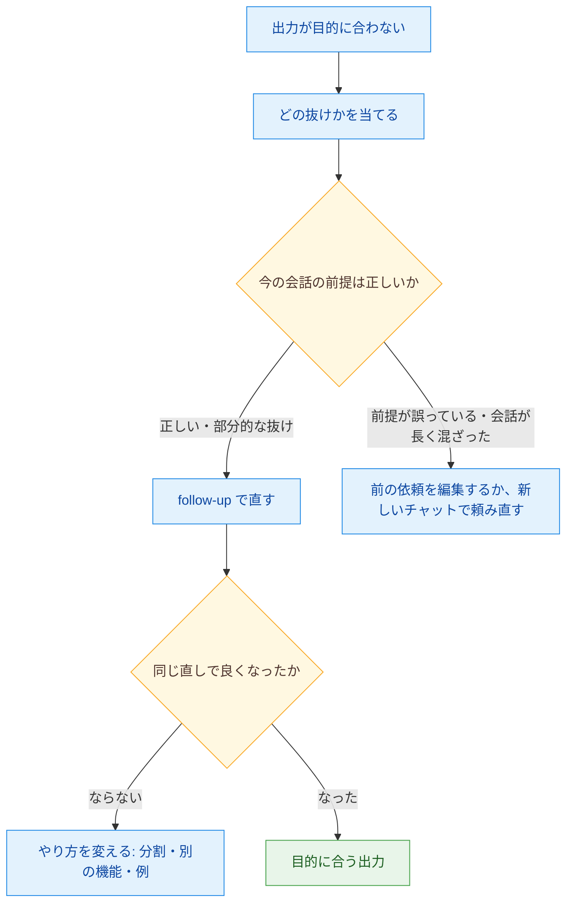

# うまくいかないプロンプトの診断と、直す・やり直す・やり方を変える

> ドメイン: 1. タスクの定義とプロンプト（15%） ／ 更新: 2026-11-26

!!! abstract "ひとことで"
    出力が悪いときは、原因を ==文脈の欠落・あいまいな指示・制約の欠如・種類に合わない戦略== のどれかに当ててから直す。方向が合っていれば続けて直し、前提が誤っていればやり直し、同じ直しで良くならなければやり方を変える。

## 仕組み

試験ガイドは、出力の不足を「仕様の抜け」に帰す力を問う。抜けは4種類に分けられ、それぞれ直し方が違う。症状だけを見て「もっとちゃんと」と頼み直しても、抜けが埋まらなければ同じ出力が返る。

| 抜け | よく出る症状 | 直し方 |
|---|---|---|
| 文脈の欠落 | 一般論になる。社内の事実と食い違う | Claude が知らない事実・資料・読み手を渡す |
| あいまいな指示 | 狙いから外れる。人によって解釈が分かれる依頼 | 目的とやってほしいことを具体的に書く |
| 制約の欠如 | 長さ・形式・範囲が毎回ぶれる | 長さ、形式、入れる・入れないものを、理由と一緒に書く。形式は例で見せる |
| 種類に合わない戦略 | 何度直しても質が上がらない。計算が合わない | 分割する、research やコード実行に替えるなど、やり方を変える |

続けて直すのは、方向が合っていて一部だけが足りないときだ。最初に渡した前提が誤っていると、その後のやりとりもその前提に沿って積み上がる。この場合は、前の依頼を編集して別の版を作るか、新しいチャットで正しい前提から頼み直す。claude.ai では、前のメッセージを編集すると、前の作業を残したまま別の版の会話ができる。

同じ直しを重ねても良くならないなら、言い回しでなく戦略が合っていない。正確でなければならない計算は会話で数えさせず、コード実行で出す。公式の概要も、すべての問題がプロンプトの工夫で解けるわけではないとしている。逆に、あらゆる技法を一度に盛り込むのも、公式ブログがよくある失敗に挙げている。

??? info "細かい注記"
    - 公式ブログの対処の例: 一般的すぎる応答には深さを求める。的外れなら目的を明確にする。形式がぶれるなら例を足す。込み入った作業が安定しないなら分割する。作り話が出るなら「分からない」と言ってよいと伝える
    - 応答が短すぎて途中で終わるときは、前の依頼と応答を次のメッセージに入れて続きを頼む（ヘルプセンター）
    - 長いチャットで使用量の上限が近いときは、新しい会話を始めるよう勧められている（ヘルプセンター）

## 試験での見分け方

| 問われること | ○ 正しい | × ひっかけ |
|---|---|---|
| 原因の当て方 | 症状から4種類の抜けのどれかに当てる | すぐにモデルの力不足と決める |
| 一部だけ足りない | 同じ会話で follow-up する | 新しいチャットで最初から全部頼み直す |
| 前提が誤って会話に積もった | 前の依頼を編集するか、新しく始める | 同じ会話で「さっきのは忘れて」と重ねる |
| 何度直しても良くならない | 分割・別の機能など、やり方を変える | 同じ指示を強い言葉で繰り返す |

## 確認問題

**Q1.** 介護サービス会社の人事担当が、求人票の下書きを頼んだ。依頼には職種と給与の幅だけを書いた。下書きには、この会社では認めていない「在宅勤務可」が書かれていた。この出力の不足の原因として最も当てはまるものはどれか。（1つ選べ）
{ .quiz-q }

- A. 文脈の欠落。勤務の条件という、Claude が知り得ない社内の事実を渡していない
- B. あいまいな指示。「求人票」という言葉が、いくつもの意味に取れる
- C. 種類に合わない戦略。起草でなく調査として頼むべき作業だった
- D. モデルの能力不足。より上位のモデルなら社内の条件を正しく書けた

??? success "答えと解説"
    **正解: A。** 勤務の条件は社内の事実で、渡さなければ Claude には分からない。

    - B: 求人票が何かは明確で、指示の意味は分かれていない
    - C: 求人票の作成は起草で、戦略は合っている
    - D: どのモデルでも、渡されていない社内の条件は知りようがない

**Q2.** 不動産会社の営業企画担当が、Claude と長く対話して出店候補地の比較資料を作っている。前の依頼を編集して作り直すか、新しいチャットで頼み直すのが適切なのはどれか。（2つ選べ）
{ .quiz-q }

- A. 資料の見出しの1つだけ、言い回しを変えたい
- B. 最初に伝えた対象の地域が誤っていて、その後のやりとりがすべてその地域を前提にしている
- C. 方向は合っており、1つの節に家賃の相場を書き足したい
- D. 何度も直しを重ねて会話が長くなり、古い指示と新しい指示が混ざって出力がぶれる
- E. 同じ指示を3回直しても質が上がらず、作業の種類に対して戦略が合っていない

??? success "答えと解説"
    **正解: B と D。** 誤った前提や混ざった指示が会話に積もったときは、続けて直すより、正しい前提から頼み直す。

    - A: 一部の小さな直しは、同じ会話の follow-up で足りる
    - C: 方向が合っているなら、続けて直す
    - E: 戦略が合っていないなら、やり直すのでなく、やり方を変える

**Q3.** 家電メーカーの品質保証担当が、苦情の記録100件を会話に貼り、種類ごとの件数を数えさせている。頼むたびに合計が変わる。「必ず正確に数えて」と書き足しても直らない。最も適切な対応はどれか。（1つ選べ）
{ .quiz-q }

- A. 「絶対に数え間違えないこと」と強い言葉に変え、同じ会話でもう一度頼む
- B. より上位のモデルに切り替え、effort も上げて、同じ依頼を会話で繰り返す
- C. 10件ずつに分けて会話で数えさせ、出た件数を担当者が手で足し合わせる
- D. 記録をファイルでアップロードし、コード実行による分析で件数を集計させる

??? success "答えと解説"
    **正解: D。** 正確でなければならない計算は、会話で数えさせず、コード実行で出す。言い回しの問題でなく、戦略の問題だ。

    - A: 同じ直しを強い言葉で繰り返しても、やり方は変わらない
    - B: モデルを替えても、会話で数える戦略のままでは同じ問題が残りうる
    - C: 会話で数える点は変わらず、足し算の手間と誤りの余地が人に移る

## 出典
- Claude Certified Associate – Foundations Exam Guide v1.1, Domain 1 Prompt Diagnosis and Iteration、Domain 2 Output Adaptation and Format Selection（公式、PDF）: https://cc.sj-cdn.net/instructor/6nizmqk8tpzpfjvt6qmmav7rh/public/1794946609/Claude_Certified_Associate_-_Foundations_Exam_Guide_Updated_Dec_7.pdf
- [Best practices for prompt engineering](https://claude.com/blog/best-practices-for-prompt-engineering)（公式ブログ、2025-11-10。Troubleshooting、Common mistakes）
- [Prompt engineering overview](https://platform.claude.com/docs/en/build-with-claude/prompt-engineering/overview)（公式。When to prompt engineer）
- [What are artifacts and how do I use them?](https://support.claude.com/en/articles/17153992-what-are-artifacts-and-how-do-i-use-them)（公式ヘルプセンター。前のメッセージの編集で別の版を作る）
- [Claude's response to my prompt is too brief](https://support.claude.com/en/articles/8114518-claude-s-response-to-my-prompt-is-too-brief)（公式ヘルプセンター）
- [How do usage and length limits work?](https://support.claude.com/en/articles/11647753-how-do-usage-and-length-limits-work)（公式ヘルプセンター）
