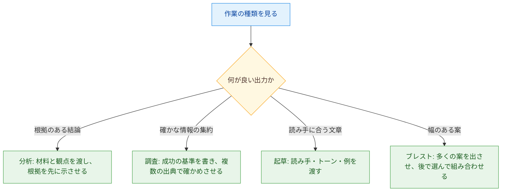

# タスクの種類に合わせたプロンプトの戦略

> ドメイン: 1. タスクの定義とプロンプト（15%） ／ 更新: 2026-11-26

!!! abstract "ひとことで"
    分析・調査・起草・ブレインストーミングでは、良い出力の条件が違うので頼み方も変える。==調査は成功の基準と出典の確認==、ブレインストーミングは先に量と幅を出させ、絞るのは後にする。

## 仕組み

同じ「詳しく、正確に」でも、分析なら根拠のある結論、起草なら読み手に合う文章、ブレインストーミングなら幅のある案が「良い出力」になる。だから、作業の種類を見て頼み方を選ぶ。種類に合わない戦略は、出力が悪い原因の1つとして、試験ガイドがはっきり挙げている。

| 種類 | 頼み方 | 合う機能 |
|---|---|---|
| 分析 | 材料（データ・資料）と見る観点を渡す。段階を追って考えさせ、結論の前に根拠を示させる。データで言えないことは「言えない」と書いてよいと伝える | 正確な計算はコード実行による分析。込み入った推論は extended thinking |
| 調査 | 何が分かれば答えになるか（成功の基準）を書く。複数の情報源で確かめさせ、出典を示させる | 単純な事実は web search。5回以上の検索が要る広い調査は research |
| 起草 | 読み手・目的・トーン・長さを書く。形式をそろえたいなら例を見せる | 長い文書や繰り返し直すものは Artifacts（推論） |
| ブレインストーミング | 初めから1案に絞らせず、10案ほど幅広く出させる。良いものを選び、組み合わせた案を作らせる | 通常の chat |

調査で「推測で埋めてよい」と頼むと、確かめられない内容が混じる。公式ブログは、情報が足りないときは足りないと言ってよいと明示すると、作り話や推測が減るとしている。逆にブレインストーミングで評価基準を細かく決めて1案に絞らせると、無難な案しか出ない（推論）。Claude Design の開発者は、10案を出させると大半は良くないが1〜2案は良いものがあり、そこから組み合わせればよいと書いている。

??? info "細かい注記"
    - research は、検索を重ね、見つけた内容から次に調べることを決める。web search を有効にする必要がある。提供プランなどの細部は変わりやすい
    - 「5回以上のツール呼び出し、1〜3分」はヘルプセンターの目安で、暗記は不要
    - research と extended thinking を併用すると、計画を立てた上で調べ、出典つきの長い報告になる（ヘルプセンター）
    - ブレインストーミングの頼み方について、claude.ai 向けの公式のまとまった指針は見つからず未確認。上の「10案から組み合わせる」は Claude Design についての記事が出典

## 試験での見分け方

| 問われること | ○ 正しい | × ひっかけ |
|---|---|---|
| アイデアが無難 | 制約をゆるめて多くの案を出させ、後で選ぶ | 評価基準を細かく決めて最良の1案に絞らせる |
| 調査の信頼性 | 成功の基準を書き、複数の出典で確かめさせる | 網羅を優先して「推測で補ってよい」と書く |
| 分析の結論が根拠不明 | 観点を指定し、根拠の数値を先に示させる | 読みやすい報告書にしてと文体だけを指定する |
| 起草の形式がそろわない | 読み手とトーンを書き、例を見せる | 調査のように出典を集めさせる |

## 確認問題

**Q1.** 経営コンサルティング会社で、コンサルタントが地方スーパーの新規事業の案を考えている。「この会社に最適な新規事業を1つ提案して」と頼むと、毎回ありきたりな案が返る。最も適切な頼み方はどれか。（1つ選べ）
{ .quiz-q }

- A. 依頼はそのまま、「もっと独創的に考えて」と1文を書き足す
- B. research を使い、他社の新規事業の事例を出典つきで集めさせる
- C. 評価基準を細かく書き、それを満たす最良の1案に絞り込ませる
- D. 1案に絞らせず、方向の違う案を10ほど出させ、良いものを選んで組み合わせる

??? success "答えと解説"
    **正解: D。** ブレインストーミングは、先に量と幅を出させ、絞るのは後にする。

    - A: 1案に絞らせる頼み方が変わらない
    - B: 事例を集めるのは調査の戦略で、案の幅を出す作業ではない
    - C: 早く絞るほど、無難な案に寄る

**Q2.** 製薬会社の研修担当が、「社内研修に e ラーニングを入れると受講の完了率は上がるか」を調べてもらう。調査の頼み方として適切なものはどれか。（2つ選べ）
{ .quiz-q }

- A. どんな根拠がそろえば「上がる・上がらない」と言えるか、成功の基準を書く
- B. 社内報の過去の記事を例に3件付け、その文体に合わせて書かせることを主にする
- C. 複数の情報源で確かめるよう頼み、主張ごとに出典を示させる
- D. 網羅性を優先し、情報が見つからない点は推測で補ってよいと書く
- E. 通常のチャットで、Claude の知識だけから答えさせ、出典は求めない

??? success "答えと解説"
    **正解: A と C。** 調査では、何が答えになるかの基準と、複数の出典での確認が要る。

    - B: 文体の例は起草の戦略で、調査の確かさを上げない
    - D: 推測で補わせると、確かめられない内容が混じる。足りないときは足りないと言わせる
    - E: 出典が無いと、主張を確かめられない

**Q3.** ネット通販会社の業務分析担当が、月次の問い合わせ件数のデータを渡し、「増えた原因を読みやすいレポートにして」と頼んだ。文章はなめらかだが、どの数字から言えるのか分からない結論が並んだ。最も適切な頼み直し方はどれか。（1つ選べ）
{ .quiz-q }

- A. 見る観点を指定し、結論の前に根拠の数値を示させ、データで言えないことはそう書かせる
- B. 過去のよくできた分析レポートを例に付け、その文体と構成に合わせて書かせる
- C. 増えた原因の候補を思いつく限り20個挙げさせ、その中から担当者が選ぶ
- D. research で業界全体の問い合わせの傾向を調べさせ、その結果で結論を補う

??? success "答えと解説"
    **正解: A。** 分析では、観点と根拠を求める。根拠の数値を先に示させれば、結論を確かめられる。

    - B: 文体と構成は整うが、根拠の無さは直らない。起草の戦略を持ち込んでいる
    - C: ブレインストーミングの戦略で、データにもとづく分析にならない
    - D: 外の情報で補っても、渡したデータから何が言えるかは分からないまま

## 出典
- [Prompting best practices](https://platform.claude.com/docs/en/build-with-claude/prompt-engineering/claude-prompting-best-practices)（公式。Research and information gathering）
- [Best practices for prompt engineering](https://claude.com/blog/best-practices-for-prompt-engineering)（公式ブログ、2025-11-10。Give permission to express uncertainty、Chain of thought）
- [When should I use web search, extended thinking, and research?](https://support.claude.com/en/articles/11095361-when-should-i-use-web-search-extended-thinking-and-research)（公式ヘルプセンター）
- [Use research on Claude](https://support.claude.com/en/articles/11088861-use-research-on-claude)（公式ヘルプセンター）
- [How the product designer who built Claude Design uses it to explore ideas before building them](https://claude.com/resources/articles/how-the-product-designer-who-built-claude-design-uses-it-to-explore-ideas-before-building-them)（公式、2026-07-24。Claude Design についての記事）
- Claude Certified Associate – Foundations Exam Guide v1.1, Domain 1・Domain 2（公式、PDF）: https://cc.sj-cdn.net/instructor/6nizmqk8tpzpfjvt6qmmav7rh/public/1794946609/Claude_Certified_Associate_-_Foundations_Exam_Guide_Updated_Dec_7.pdf
