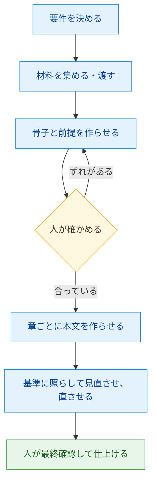

# 大きな成果物の分解と順序付け

> ドメイン: 1. タスクの定義とプロンプト（15%） ／ 更新: 2026-11-26

!!! abstract "ひとことで"
    1回の依頼に収まらない大きな成果物は、段階に分けて順に頼む。==各段階の出力を確かめてから次に渡す== ので、誤った前提が後ろの段階に広がらない。

## 仕組み

段階的なプロンプト（prompt chaining）は、作業を順につながる依頼に分け、前の出力を次の入力にする。時間はかかるが、正確さと安定が上がる。途中の出力を人が見られるので、骨子の段階で論点や前提のずれを止められる。ヘルプセンターも、複雑な依頼は手順に分けて頼むよう勧めている。

よく使う形は「下書き、基準に照らした見直し、直し」の3段だ。どの段階でも、前の段階の出力を次の依頼に貼るか、同じ会話の中で続けて、前提を引き継ぐ。段階ごとに会話を分けて前提を渡さないと、章ごとに数字や用語がずれる。

同じ背景資料を何度も使う作業は、Project にまとめる。Project の knowledge と instructions は、その Project のどのチャットにも文脈として入るので、段階ごとに資料を貼り直さずに済む。1つの長いチャットで月をまたいで続ける手もあるが、古い月のやりとりが文脈に残り続け、今月の内容と混ざりやすい（推論）。

分けすぎにも注意する。公式ガイドは、最近のモデルは多段の推論の大半を内部でこなすとし、段階に分けるのは途中の出力を確かめたいときや、決まった流れを守らせたいときとしている。短いメール1通を細かく分けても得は無い。

??? info "細かい注記"
    - 公式ブログは、長い入力を扱えるモデルでも、大きな作業を焦点のはっきりした小さな作業に分けると質が上がるとしている
    - Project の knowledge が大きくなると、有料プランでは検索（RAG）で扱える量を広げる仕組みが働く（ヘルプセンター）。上限の数値は試験に出ない
    - Claude に自分の下書きを見直させるのは、段階の1つとしては有効だ。ただし事実の確認の代わりにはならない（ドメイン2）

## 試験での見分け方

| 問われること | ○ 正しい | × ひっかけ |
|---|---|---|
| 多面的な成果物を一度に頼んで薄い | 段階に分け、骨子を確かめてから本文へ | 指示を全部1つの長い依頼に詰め込む |
| 確認の置き場所 | 前提が決まる早い段階（骨子）で人が見る | 全部できてから最後に1回だけ見る |
| 前提の引き継ぎ | 前の出力を次の依頼に渡す | 章ごとに別のチャットで同時に頼み、後で貼り合わせる |
| 同じ資料を毎回使う | Project の knowledge に置く | 毎回すべて貼り直す |
| 短い単純な依頼 | 1回で頼む | 細かい段階に分ける |

## 確認問題

**Q1.** 旅行会社のサクラツアーで、PM が新サービスの社内提案書（市場の見立て、競合、収支の見込み、実行計画）を1回の依頼で作らせた。どの章も浅く、収支の前提の数字が章によって違っていた。最も適切な進め方はどれか。（1つ選べ）
{ .quiz-q }

- A. 4章の要件をすべて細かく書いた長い依頼を作り、もう一度1回で頼む
- B. 量が多いのが原因なので、上位のモデルに切り替えて同じ依頼を1回で出す
- C. 先に骨子と前提の数字を作らせて確かめ、その出力を渡して章ごとに頼む
- D. 4章をそれぞれ別の新しいチャットで同時に頼み、最後に貼り合わせる

??? success "答えと解説"
    **正解: C。** 段階に分け、骨子と前提を確かめてから次へ渡せば、章どうしの前提がそろう。

    - A: 1回で頼む点が変わらない。途中で前提を確かめる機会が無い
    - B: モデルを替えても、前提を確かめる段階は生まれない
    - D: 前提が章どうしで共有されず、数字のずれがかえって起きやすい

**Q2.** 同じ PM が、段階に分けて提案書を作り直す。段階の間の確認として適切なものはどれか。（2つ選べ）
{ .quiz-q }

- A. 途中では確認せず、全章ができあがってから最後に1回だけまとめて読む
- B. 各段階の確認は、Claude に「問題はないか」と聞くことだけで済ませる
- C. 骨子の段階で、論点と前提の数字を PM が確かめてから本文に進む
- D. 段階は多いほど正確になるので、1段落ごとに別の依頼に分ける
- E. 確かめた前の段階の出力を、次の段階の依頼に渡して前提を引き継ぐ

??? success "答えと解説"
    **正解: C と E。** 前提が決まる早い段階で人が確かめ、その結果を次の段階へ渡す。

    - A: 最後に見つけたずれは、全章に広がった後で直すことになる
    - B: 自分の出力を見直させるのは段階の1つにはなるが、人の確認の代わりにはならない
    - D: 分けすぎると手間が増えるだけで、得が無い

**Q3.** 不動産管理会社のオペレーション担当が、毎月の業務改善レポートを4段階で作っている。毎回、同じ社内規程と前月のレポートを各段階のチャットに貼り直しており、貼り忘れで内容がずれることがある。最も適切な改善はどれか。（1つ選べ）
{ .quiz-q }

- A. 毎月1つの長いチャットを使い続け、過去の月の会話の続きとして頼む
- B. Project を作り、規程と前月のレポートを knowledge に置いて、段階の依頼をその中で行う
- C. 4段階をやめ、すべての指示と資料を1つの長い依頼にまとめて1回で頼む
- D. 今のやり方のまま、貼る資料の一覧を作って貼り忘れを防ぐ

??? success "答えと解説"
    **正解: B。** Project の knowledge は、その中のどのチャットにも文脈として入る。資料を貼り直す必要が無くなる。

    - A: 月をまたいだ会話が長くなり、古い月の内容と混ざる
    - C: 段階の間の確認ができなくなる
    - D: 貼り直す手間と、貼り忘れの余地が残る

## 出典
- [Prompting best practices](https://platform.claude.com/docs/en/build-with-claude/prompt-engineering/claude-prompting-best-practices)（公式。Chain complex prompts）
- [Best practices for prompt engineering](https://claude.com/blog/best-practices-for-prompt-engineering)（公式ブログ、2025-11-10。Prompt chaining）
- [My prompt isn't giving me a helpful answer](https://support.claude.com/en/articles/7996857-my-prompt-isn-t-giving-me-a-helpful-answer)（公式ヘルプセンター）
- [What are projects?](https://support.claude.com/en/articles/9517075-what-are-projects)（公式ヘルプセンター）
- Claude Certified Associate – Foundations Exam Guide v1.1, Domain 1 Task Decomposition and Sequencing（公式、PDF）: https://cc.sj-cdn.net/instructor/6nizmqk8tpzpfjvt6qmmav7rh/public/1794946609/Claude_Certified_Associate_-_Foundations_Exam_Guide_Updated_Dec_7.pdf
