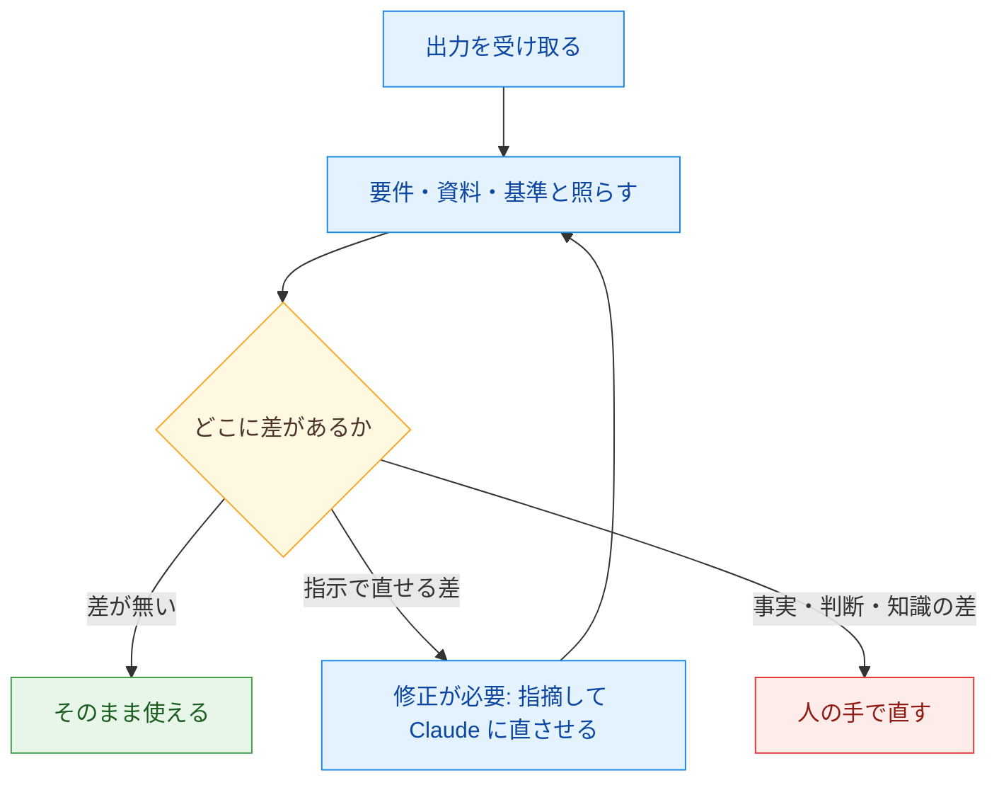

# 出力の評価と目的への適合

> ドメイン: 2. 出力の評価と品質管理（20%） ／ 更新: 2026-11-26

!!! abstract "ひとことで"
    出力は「よく書けているか」でなく、==依頼の要件・元の資料・仕事の基準==に照らして評価する。そのうえで「そのまま使える」「修正が必要」「人の手で直す」の3つに振り分ける。

## 仕組み

評価の物差しは、ガイドが挙げる4つの観点だ。正確さ（事実と資料に合っているか）、網羅性（求めた項目がそろっているか）、関連性（論点からそれていないか）、目的への適合（読み手と用途に合っているか）である。文章が整っていると完成品に見えるが、整っていることはどの観点も保証しない。だから評価は、依頼のときの要件を横に置き、1つずつ照らして行う。

| 区分 | 差の中身の例 | 次の一手 |
|---|---|---|
| そのまま使える | 要件をすべて満たし、事実も確かめた | 使う（確かめる深さは [レビューの深さ](review-depth-escalation.md) で決める） |
| 修正が必要 | 長さ・語調・構成・抜けた項目など、指示で伝えられる差 | どこが要件と違うかを具体的に伝えて直させる |
| 人の手で直す | 誤った事実、社内事情や専門的な判断が要る箇所、Claude が持たない情報 | 人が書き換える。同じ指示を繰り返しても直らない |

「修正が必要」と「人の手で直す」の境目は、差の原因が仕様の抜けか、Claude の手元に無いものかである（推論）。語調や構成のずれは、要件を言い直せば直る。一方、元の資料に無い数字や社内の判断は、何度頼んでも Claude には埋められない。むしろもっともらしく作られる危険がある。

??? info "細かい決まり・補足"
    - ガイドは評価の基準を「requirements（要件）、source material（元の資料）、professional standards（仕事の基準）」の3つとしている。分類の3区分（ready to use / requiring revision / requiring human correction）もガイドの文言
    - AI Fluency の4D のうち、出力の評価は Discernment にあたる（ガイドは4D がすべてのドメインを支えるとしている）。AI Fluency のコース本文は読めず、Discernment の下位分類の定義の文言は未確認
    - 小さな直しなら、指示を書くより自分で直す方が速いこともある。どちらでも、直したあとの版をもう一度要件と照らす（推論）

## 試験での見分け方

| 問われること | ○ 正しい | × ひっかけ |
|---|---|---|
| 何を基準に評価するか | 依頼の要件・元の資料・仕事の基準に照らす | 文章の滑らかさや見た目の完成度で判断する |
| 語調や構成がずれている | 要件との差を具体的に示して直させる | 一から書き直させる、または人が全部書き直す |
| 資料に無い数字や社内判断が要る | 人が確かめて書き換える | 「正確にして」と同じ指示を繰り返す |
| 抜けがあるか | 要件の項目を1つずつ照らして確かめる | 読んで違和感が無いので網羅できているとみなす |

## 確認問題

**Q1.** 物流会社の研修担当が、Claude で新人向けの安全研修のテキストを作った。依頼では「現場作業者向け、専門用語には説明を付ける、A4 で3枚以内」と指定した。出てきた文章は内容は正しいが、管理職向けの語調で、専門用語の説明が無く、5枚分ある。最も適切な対応はどれか。（1つ選べ）
{ .quiz-q }

- A. 内容は正しいので「そのまま使える」とし、研修で配る
- B. 「修正が必要」とし、読み手・用語の説明・分量の3点が要件と違うことを示して直させる
- C. 「人の手で直す」とし、研修担当が全文を書き直す
- D. 新しいチャットで同じ依頼文を送り、別の出力が出るまで繰り返す

??? success "答えと解説"
    **正解: B。** 差は指示で伝えられる仕様の抜けなので、どこが違うかを具体的に示して直させる。

    - A: 正確さは満たしても、読み手と分量という目的への適合を満たしていない
    - C: Claude の手元に無い情報が要る差ではない。全部を人が直すのは手間に見合わない
    - D: 何が違うかを伝えないので、同じずれが繰り返される

**Q2.** コンサルタントが、顧客との打ち合わせのメモ（アップロード済み）から、議事録の下書きを Claude に作らせた。この出力を評価するやり方として適切なものはどれか。（2つ選べ）
{ .quiz-q }

- A. 文章が読みやすく体裁も整っているので、網羅できているとみなす
- B. メモにある決定事項と宿題が、漏れなく議事録に入っているかを照らす
- C. Claude に「この議事録は正確ですか」と聞き、「はい」なら完成とする
- D. 議事録の一般的な書き方に沿っているかだけを確かめる
- E. 議事録にある発言や数字が、メモに書かれた内容と合っているかを確かめる

??? success "答えと解説"
    **正解: B と E。** 元の資料（メモ）に照らして、網羅性（B）と正確さ（E）を確かめる。

    - A: 体裁の良さは、項目の抜けが無いことを示さない
    - C: 書いた本人に聞いても、元の資料と照らしたことにならない
    - D: 書き方の型は仕事の基準の一部にすぎない。中身が資料と合うかを見ていない

**Q3.** 人事部の担当者が、来期の評価制度の変更点を社員に知らせる案内文を Claude に作らせた。文面は読みやすく構成も要件どおりだが、「変更は4月1日から適用」と、まだ社内で決まっていない日付が書かれている。最も適切な判断はどれか。（1つ選べ）
{ .quiz-q }

- A. 文面は要件どおりなので「そのまま使える」とし、そのまま全社に送る
- B. 「修正が必要」とし、「正しい日付にしてください」と Claude に頼む
- C. 案内文の作成に Claude は向かないと判断し、一から人が書く
- D. 「人の手で直す」とし、日付は決定を確かめたうえで人が書き換える

??? success "答えと解説"
    **正解: D。** 未決定の社内事情は Claude の手元に無い情報なので、人が確かめて直す。

    - A: 誤った日付が入ったまま社員に届く
    - B: Claude は決まった日付を知らない。頼めば別のもっともらしい日付が作られる
    - C: 直すべきは日付だけで、文面の他の部分は使える

## 出典
- Claude Certified Associate – Foundations Exam Guide v1.1, Domain 2「Output Evaluation and Fitness for Purpose」（公式、PDF）: https://cc.sj-cdn.net/instructor/6nizmqk8tpzpfjvt6qmmav7rh/public/1794946609/Claude_Certified_Associate_-_Foundations_Exam_Guide_Updated_Dec_7.pdf
- [Claude is providing incorrect or misleading responses. What's going on?](https://support.claude.com/en/articles/8525154-claude-is-providing-incorrect-or-misleading-responses-what-s-going-on)（公式、ヘルプセンター）
- [Reduce hallucinations](https://platform.claude.com/docs/en/test-and-evaluate/strengthen-guardrails/reduce-hallucinations)（公式）
