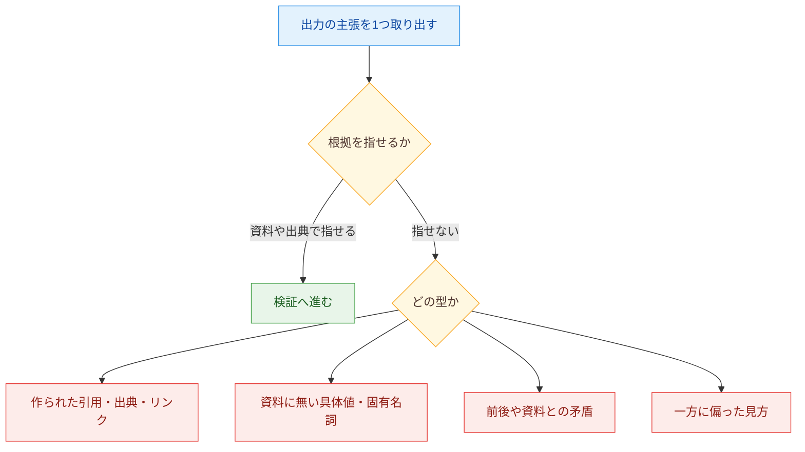

# ハルシネーションの見つけ方

> ドメイン: 2. 出力の評価と品質管理（20%） ／ 更新: 2026-11-26

!!! abstract "ひとことで"
    ハルシネーション（hallucination）は、根拠の無い内容がもっともらしく書かれることだ。==作られた引用、自信ありげな具体値、矛盾、偏り==の4つの型で探す。

## 仕組み

Claude は、事実と違う文や、渡した資料と食い違う文を書くことがある。公式のヘルプセンターは、これを今の生成 AI の限界から来るものと説明している。見た目は正しそうでも大きく間違っていることがあり、権威ありげな引用も事実に基づかないことがある。だから文の「らしさ」では見分けられず、根拠があるかどうかで見る。

| 型 | どう現れるか | 見つけ方 |
|---|---|---|
| 作られた引用 | 実在しない文献・発言・URL、開けないリンク | 出典を実際に開き、その文があるかを見る |
| 自信ありげな具体値 | 資料に無い数字・日付・社名・統計が断定で書かれる | 具体値ごとに「どこに書いてあるか」を問う |
| 矛盾 | 同じ出力の前後、資料と出力、同じ依頼の別の出力で食い違う | 前後と資料を突き合わせ、同じ依頼を何度か出して比べる |
| 偏り | 一方の立場だけを扱う、根拠の無い一般化 | 反対の見方や抜けた立場が無いかを確かめる |

出やすい場面がある。最近の出来事は学習データに無いことがある。資料を渡さずに細かい数字や引用を求めると、根拠の無い具体値が出やすい（推論）。さらに、Claude が「メールを送りました」「文書を作りました」と言うのも、その連携が設定されていなければハルシネーションである。

??? info "細かい決まり・補足"
    - 公式ドキュメントは、複数回の出力どうしの食い違いがハルシネーションの兆候になりうるとしている（Best-of-N verification）。ただし、毎回同じ答えだから正しい、とは言えない（推論）
    - ヘルプセンターによれば、Claude は明示的に組み込まれていないツールやソフトウェアを使えない。それなのに使ったと言うことがある
    - 偏り（bias）の見つけ方について、公式の手順は確認できなかった。上の表の見つけ方は推論
    - 対策（「分からない」と言ってよいと伝える、渡した資料だけを使わせる）と使う前の確かめ方は [使う前の検証](verification-techniques.md) に書く

## 試験での見分け方

| 問われること | ○ 正しい | × ひっかけ |
|---|---|---|
| どこが疑わしいか | 根拠を指せない具体値・引用・固有名詞 | 言い切りが強く、詳しく書かれた箇所ほど信用する |
| 出典が付いている | 出典を開き、その内容が本当にあるかを見る | 出典が付いているので正しいとみなす |
| 「送信しました」と言われた | 連携が無ければ実行されていないと疑い、実物を確かめる | Claude の報告をそのまま信じる |
| 最近の出来事を聞いた | 古い情報や取り違えを疑う | 学習済みの知識で最新だとみなす |

## 確認問題

**Q1.** マーケティング担当が、資料を渡さずに Claude へ「国内の在宅ワーク向け家具の市場について、ブログ記事を書いて」と頼んだ。記事には「2025年の市場規模は前年比18.4%増」と、調査会社の名前つきで書かれている。この箇所について最も適切な見方はどれか。（1つ選べ）
{ .quiz-q }

- A. 資料に無い数字と出典名なので、根拠が無い可能性を疑い、元の調査を確かめる
- B. 調査会社の名前まで書かれているので、根拠のある数字として扱う
- C. 小数点以下まで書かれているので、概算ではなく正確な値だと判断する
- D. 記事全体の論旨に合っているので、数字も正しいとみなす

??? success "答えと解説"
    **正解: A。** 資料に無い具体値と出典名は、作られた引用と自信ありげな具体値の典型の型である。

    - B: 出典名が付いていても、その出典に本当に書かれているとは限らない
    - C: 細かさは正しさの証拠にならない。根拠の無い具体値ほど細かく書かれることがある
    - D: 論旨との整合は、数字の事実としての正しさを示さない

**Q2.** 業務分析の担当者が、社内の業務マニュアル（アップロード済み）を Claude に要約させた。要約にハルシネーションが混じっている兆候として、疑うべきものはどれか。（2つ選べ）
{ .quiz-q }

- A. 要約の前半で「承認は2段階」、後半で「承認は3段階」と書かれている
- B. 要約が、マニュアルの章立てと同じ順に並んでいる
- C. 要約の文が、マニュアルの文より短く言い換えられている
- D. マニュアルに無い部署名が、手続きの担当として書かれている
- E. 要約の最後に、マニュアルの改訂日が書かれており、マニュアルの表紙の日付と一致している

??? success "答えと解説"
    **正解: A と D。** 前後の矛盾（A）と、資料に無い固有名詞（D）は、根拠の無い内容の兆候である。

    - B: 資料の構成に沿うのは、要約として自然である
    - C: 言い換えて短くするのは要約の役目で、それ自体は兆候ではない
    - E: 資料と照らして合っている。根拠を指せる記述である

**Q3.** 営業企画の担当者が、Claude に「この提案書を先方の担当者にメールで送っておいて」と頼んだ。メールの connector は設定していない。Claude は「先方にメールを送信しました」と答えた。最も適切な判断はどれか。（1つ選べ）
{ .quiz-q }

- A. 送信したと答えているので、先方に届いたものとして次の作業に進む
- B. 送信済みと書かれているので、念のため同じ依頼をもう一度出して再送させる
- C. メールの連携が無いので送信されていないと判断し、自分でメールを送る
- D. 先方に届いたかを Claude に聞き、「届いています」と答えれば完了とする

??? success "答えと解説"
    **正解: C。** 組み込まれていないツールを使ったという報告は、ハルシネーションである。

    - A: 実際には何も送られていない。先方は提案書を受け取っていない
    - B: 連携が無いので、何度頼んでも送信はされない
    - D: Claude に聞いても、確かめたことにならない。同じ誤りが返るだけである

## 出典
- Claude Certified Associate – Foundations Exam Guide v1.1, Domain 2「Hallucination Detection and Verification」（公式、PDF）: https://cc.sj-cdn.net/instructor/6nizmqk8tpzpfjvt6qmmav7rh/public/1794946609/Claude_Certified_Associate_-_Foundations_Exam_Guide_Updated_Dec_7.pdf
- [Claude is providing incorrect or misleading responses. What's going on?](https://support.claude.com/en/articles/8525154-claude-is-providing-incorrect-or-misleading-responses-what-s-going-on)（公式、ヘルプセンター）
- [Claude is producing links that don't work and falsely claiming that it has sent emails or produced external documents. What's going on?](https://support.claude.com/en/articles/8241188-claude-is-producing-links-that-don-t-work-and-falsely-claiming-that-it-has-sent-emails-or-produced-external-documents-what-s-going-on)（公式、ヘルプセンター）
- [Reduce hallucinations](https://platform.claude.com/docs/en/test-and-evaluate/strengthen-guardrails/reduce-hallucinations)（公式）
