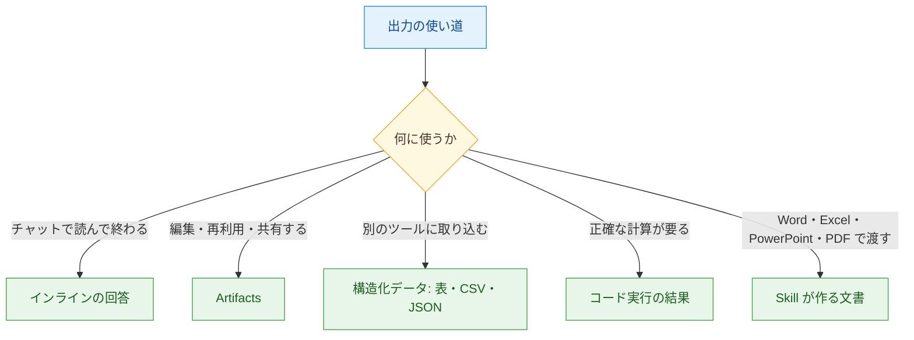

# 読み手に合わせた編集と出力形式の選択

> ドメイン: 2. 出力の評価と品質管理（20%） ／ 更新: 2026-11-26

!!! abstract "ひとことで"
    出力の形式は、読み手と届け方で選ぶ。==正確さが要る計算はコード実行の結果==にし、繰り返し使う・人に渡す成果物は Artifacts や Skill が作る文書にする。

## 仕組み

Claude の最初の出力は素材である。読み手（役員か現場か）と届け方（チャットで読む、資料として配る、別のツールに取り込む）に合わせて、編集し、形式を選ぶ。形式を誤ると、中身が正しくても使えない。たとえば暗算の合計は、桁が合わないことがある（推論）。だから集計は、アップロードしたデータに対してコードを実行させた結果にする。

| 形式 | 向いている場面 | 向かない場面 |
|---|---|---|
| インライン | 短い答え、やり取りしながら詰める相談 | 後で編集して人に渡す長い成果物 |
| Artifacts | まとまった自己完結の成果物で、編集・再利用・共有したいもの（文書、図、ダッシュボード、小さなツール） | 一言で済む答え |
| 構造化データ | 表計算や他のシステムに取り込む一覧。項目名と形式を例で示す | 人が読み物として読む文章 |
| コード実行の結果 | 合計・比率・集計など、正確さが要る計算。グラフ | 計算の無い文章の作成 |
| Skill が作る文書 | Word・Excel・PowerPoint・PDF で渡すもの。自社の書式をそろえたいときは自作の Skill | チャットの中で読んで終わるもの |

形式と並んで、読み手に合わせた編集も要る。役員向けには結論と判断材料を先に置き、現場向けには手順を具体的に書く。同じ分析でも、届け方ごとに長さと構成を変える。

??? info "細かい決まり・補足"
    - ヘルプセンターによれば、Claude は「15行を超えるような、まとまった自己完結の内容」「会話の外で編集・再利用しそうなもの」「会話が無くても意味が通るもの」「後で戻ってきそうなもの」で Artifacts を使う。Artifacts は最初は本人だけに見え、共有の設定で公開範囲を決める
    - Artifacts、Skills、ファイルの作成は、設定の Capabilities にある「コード実行とファイルの作成」が有効であることが前提（Team と Enterprise は組織の設定）。設定の名前と場所は変わりやすい
    - 組み込みの Skill（Excel、Word、PowerPoint、PDF）は、依頼に応じて Claude が自動で使う。うまく使われないときは「ブランドガイドラインの Skill を使ってスライドを作って」のように明示する
    - コード実行は隔離された環境で動く。ファイルの上限（1ファイル 30MB）など、数値は試験に出ない
    - 決まった形式の一覧を安定して出させるには、形式を正確に指定し、例を示すと効く（プロンプトのガイド）

## 試験での見分け方

| 問われること | ○ 正しい | × ひっかけ |
|---|---|---|
| 売上データの合計や前年比 | ファイルをアップロードし、コード実行で計算させる | チャットの文章で計算させ、そのまま使う |
| 何度も手直しして共有する企画書 | Artifacts で作る | 長い回答をインラインで受け取り、コピーして直す |
| 表計算に取り込む一覧 | 列名と形式を例で示し、表や CSV で出させる | 文章で書かせ、人が表に打ち直す |
| 自社の書式のスライドを毎回作る | 書式をまとめた Skill を使い、PowerPoint で出す | 毎回、依頼文に書式を長々と書く |
| 役員への報告 | 結論と判断材料を先に置いて書き直す | 分析の出力をそのまま貼る |

## 確認問題

**Q1.** ECサイトの運営担当が、半年分の注文データ（CSV）から、商品カテゴリ別の売上合計と前月比を月次報告に載せたい。最も適切なやり方はどれか。（1つ選べ）
{ .quiz-q }

- A. CSV をアップロードし、コード実行でカテゴリ別の合計と前月比を計算させる
- B. CSV の中身をチャットに貼り、文章の回答で合計と前月比を答えさせる
- C. 前月の報告書を渡し、同じ傾向が続いた場合の数字を推定させる
- D. カテゴリ別の売上の見込みを research で調べさせ、その数字を使う

??? success "答えと解説"
    **正解: A。** 正確さが要る計算は、データに対してコードを実行させた結果を使う。

    - B: 文章の回答での計算は、桁や足し算を誤るおそれがあり、計算の過程も確かめにくい
    - C: 推定は実績の集計ではない
    - D: 外部の見込みは、自社の注文データの集計ではない

**Q2.** 研修担当が、Claude で新任管理職向けの研修資料を作る。資料はこれから何度も手直しし、他の講師とも共有する。最後は社内の書式のスライドで配る。形式の選び方として適切なものはどれか。（2つ選べ）
{ .quiz-q }

- A. 手直しと共有を重ねる資料なので、Artifacts で作る
- B. 手直しのたびに、インラインの長い回答をコピーして文書ソフトに貼る
- C. 社内の書式をまとめた Skill を使い、PowerPoint のファイルで出力させる
- D. 書式は配る前に人が整えるので、プレーンテキストで出させる
- E. 講師ごとに別のチャットで同じ資料を一から作らせる

??? success "答えと解説"
    **正解: A と C。** 再利用・共有する成果物は Artifacts（A）、決まった書式のファイルは Skill が作る文書（C）にする。

    - B: 版がばらけ、共有や再利用がしにくい
    - D: 書式の作業を毎回人が抱えることになる
    - E: 講師ごとに中身がばらつき、手直しが共有されない

**Q3.** 業務分析の担当者が、Claude に社内の問い合わせの傾向を分析させた。出力は詳しい分析の文章で、結論は最後の段落にある。これを、5分で判断したい役員への報告に使う。最も適切な対応はどれか。（1つ選べ）
{ .quiz-q }

- A. 分析は正確なので、出力をそのまま役員への報告として送る
- B. 詳しさを保つため、分析の全文に加えて元のデータも添付して送る
- C. 結論と判断に要る数字を先頭に置き、短く書き直させてから送る
- D. 役員が読みやすいよう、分析の文章を箇条書きに置き換えるだけにする

??? success "答えと解説"
    **正解: C。** 読み手が短時間で判断できるよう、結論と判断材料を先に置いて書き直す。

    - A: 正確でも、読み手と届け方に合っていない
    - B: 5分で判断したい読み手に、さらに量を増やしている
    - D: 結論が最後にあるという構成の問題が残る

## 出典
- Claude Certified Associate – Foundations Exam Guide v1.1, Domain 2「Output Adaptation and Format Selection」（公式、PDF）: https://cc.sj-cdn.net/instructor/6nizmqk8tpzpfjvt6qmmav7rh/public/1794946609/Claude_Certified_Associate_-_Foundations_Exam_Guide_Updated_Dec_7.pdf
- [What are artifacts and how do I use them?](https://support.claude.com/en/articles/9487310-what-are-artifacts-and-how-do-i-use-them)（公式、ヘルプセンター）
- [Create and edit files with Claude](https://support.claude.com/en/articles/12111783-create-and-edit-files-with-claude)（公式、ヘルプセンター）
- [Use skills in Claude](https://support.claude.com/en/articles/12512180-use-skills-in-claude)（公式、ヘルプセンター）
- [Increase output consistency](https://platform.claude.com/docs/en/test-and-evaluate/strengthen-guardrails/increase-consistency)（公式）
