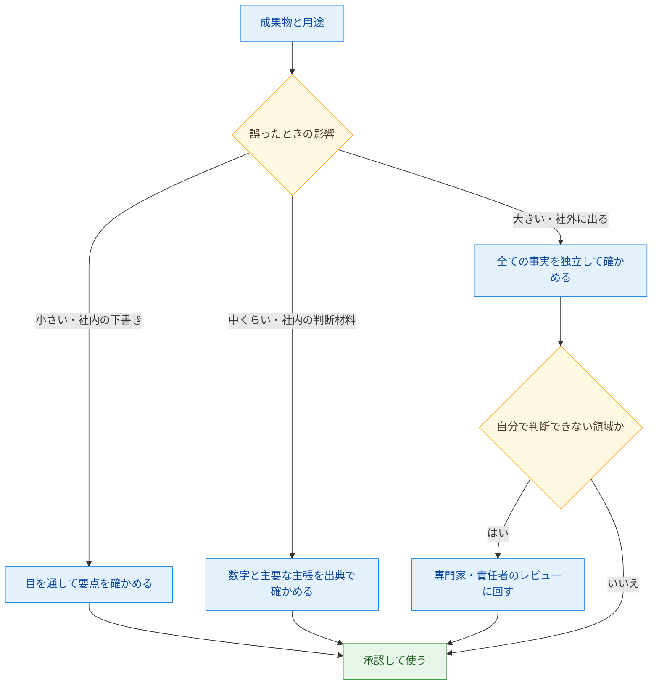

# レビューの深さとエスカレーション

> ドメイン: 2. 出力の評価と品質管理（20%） ／ 更新: 2026-11-26

!!! abstract "ひとことで"
    レビューの深さは、==誤ったときの影響==と、成果物が社内の下書きか社外に出すものかで決める。自分で確かめられない専門的な判断は、人のレビューに回す。

## 仕組み

すべての出力を同じ深さで確かめると、軽い作業では手間が見合わず、重い作業では確認が足りない。ガイドは、成果物のリスクと説明責任（risk and accountability profile）と用途を見て、何を独立して確かめ、何を直し、何を人のレビューに回すかを決めるとしている。誤りの影響が大きく、取り返しがつかず、社外の人に届くほど、確かめる範囲を広げる。出力を使って人に渡した時点で、その中身の責任は渡した人にある。

| 成果物の例 | 誤りの影響 | レビューの深さ |
|---|---|---|
| アイデア出し、自分用のメモ | 自分の中で止まり、すぐ直せる | 目を通す程度 |
| 社内会議の資料の下書き | 判断を誤らせうるが、会議で直せる | 数字と主要な主張を確かめる |
| 顧客への提案書、プレスリリース | 社外に届き、取り消しにくい | 全ての事実を独立して確かめる |
| 契約・法令・人事上の決定に関わる文書 | 法的・金銭的な影響や、個人への影響がある | 加えて、専門家や責任者のレビューに回す |

エスカレーションが要るのは、誤りの影響が大きく、しかも自分ではその正しさを判断できないときだ（推論）。たとえば法令の解釈や契約の条項は、出典を開いても専門家でなければ読み違える。ヘルプセンターも、影響の大きい助言は慎重に吟味し、Claude を唯一の情報源にしないよう求めている。

??? info "細かい決まり・補足"
    - ガイドの文言は「consequence of error（誤りの影響）」「internal-draft versus external-delivery standards（社内の下書きと社外に出すものの基準の違い）」
    - AI Fluency の Diligence には、人に渡す AI の成果物に責任を持つことが含まれるとされる。コース本文は読めず、定義の文言は未確認
    - 表の4段階は、ガイドの考え方を整理した例で、公式の区分ではない（推論）
    - 確かめ方そのものは [使う前の検証](verification-techniques.md) に書く

## 試験での見分け方

| 問われること | ○ 正しい | × ひっかけ |
|---|---|---|
| 社内のブレインストーミングの出力 | 軽く目を通して使う | 全ての記述を出典で確かめてから使う |
| 社外に出す文書 | 全ての事実を独立して確かめる | 社内向けと同じ確認で済ませる |
| 法令・契約・人事の判断を含む | 専門家や責任者のレビューに回す | 自分で出典を読み、納得したら出す |
| 誰が責任を持つか | 出力を使って人に渡した人 | 「AI が作った」ので責任は AI 側にある |

## 確認問題

**Q1.** 小売チェーンの PM が、Claude で3種類の文書を作った。①チーム内の企画会議で使うアイデアの一覧、②役員会に出す新店舗の投資判断の資料、③取引先に送る価格改定の通知文。レビューの深さの配分として最も適切なものはどれか。（1つ選べ）
{ .quiz-q }

- A. 3つとも全ての記述を独立して確かめ、同じ深さでレビューする
- B. 3つとも Claude が作ったものなので、誤字と体裁だけを確かめる
- C. ①は目を通す程度、②は数字と主要な主張を確かめ、③は全ての事実を確かめる
- D. ①を最も丁寧に確かめ、②と③は担当者の判断に任せる

??? success "答えと解説"
    **正解: C。** 誤りの影響と、社内か社外かに合わせて、確かめる範囲を変える。

    - A: アイデアの一覧にまで全件の確認をすると、手間が見合わない
    - B: 社外に出る通知文や投資判断の資料で、事実を確かめていない
    - D: 影響の大きさの順が逆である

**Q2.** 人事部の担当者が、Claude で就業規則の改定案の説明資料と、改定に伴う労使協定の条文案を作った。社員への説明会の前に、何をどうレビューするかを決めたい。適切なものはどれか。（2つ選べ）
{ .quiz-q }

- A. 条文案は Claude が法令を踏まえて書いたので、そのまま協定の案として使う
- B. 条文案は、労務の専門家や法務の担当者のレビューに回す
- C. 説明資料は社内向けなので、誤りがあっても説明会で直せばよく、確かめない
- D. 説明資料に書かれた改定点が、改定案の本文と合っているかを確かめる
- E. 条文案を Claude に「法令に違反していないか」確かめさせ、問題無しなら確定する

??? success "答えと解説"
    **正解: B と D。** 法的な判断を含む条文は専門家に回し（B）、説明資料は元の改定案と照らす（D）。

    - A: 法的な影響がある文書を、確かめずに使っている
    - C: 社内向けでも、社員の処遇に関わる情報で、誤りの影響は小さくない
    - E: Claude の自己確認は独立した確認にならず、専門家の判断の代わりにもならない

**Q3.** 社員研修の会社のコンサルタントが、Claude で顧客企業向けの研修報告書を作った。報告書には受講者アンケートの集計値と、顧客企業の業界の動向が書かれている。報告書は顧客の役員に提出される。最も適切な対応はどれか。（1つ選べ）
{ .quiz-q }

- A. 社外に出す文書として、集計値は元のデータと、業界の動向は出典と照らして確かめる
- B. 社内の下書きと同じく、読みやすさを確かめてから提出する
- C. 報告書の末尾に「AI が作成」と書き添えれば、内容の確認は省いてよい
- D. 業界の動向は一般論なので、集計値だけを確かめて提出する

??? success "答えと解説"
    **正解: A。** 社外に出す成果物なので、全ての事実を元のデータと出典で確かめる。

    - B: 社外向けの基準で確かめていない
    - C: AI の利用を書き添えても、渡した人が中身に責任を持つことは変わらない
    - D: 業界の動向にも、作られた数字や引用が混じりうる

## 出典
- Claude Certified Associate – Foundations Exam Guide v1.1, Domain 2「Review Depth and Escalation」（公式、PDF）: https://cc.sj-cdn.net/instructor/6nizmqk8tpzpfjvt6qmmav7rh/public/1794946609/Claude_Certified_Associate_-_Foundations_Exam_Guide_Updated_Dec_7.pdf
- [Claude is providing incorrect or misleading responses. What's going on?](https://support.claude.com/en/articles/8525154-claude-is-providing-incorrect-or-misleading-responses-what-s-going-on)（公式、ヘルプセンター）
- [Reduce hallucinations](https://platform.claude.com/docs/en/test-and-evaluate/strengthen-guardrails/reduce-hallucinations)（公式）
- [Enable and use web search](https://support.claude.com/en/articles/10684626-enable-and-use-web-search)（公式、ヘルプセンター）
