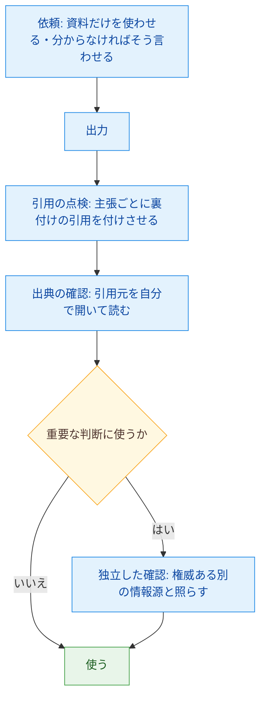

# 使う前の検証

> ドメイン: 2. 出力の評価と品質管理（20%） ／ 更新: 2026-11-26

!!! abstract "ひとことで"
    使う前に、==出典の確認・引用の点検・独立した確認==で主張の根拠を確かめる。Claude に「正しいか」と聞くだけでは検証にならない。

## 仕組み

検証は、出力の主張を Claude の外にある根拠と結び付ける作業だ。ガイドは、出典の確認（source checking）、引用の点検（citation review）、独立した確認（independent confirmation）の3つを挙げる。公式ドキュメントも、ハルシネーションを減らす工夫は誤りを無くすわけではないので、重要な情報は必ず確かめよとしている。だから、依頼の段階で減らす工夫と、使う前の確認の両方を行う。

| 手法 | やること | 何を防ぐか |
|---|---|---|
| 依頼の段階の予防 | 「分からなければ分からないと言ってよい」と許す。渡した資料だけを使わせる。長い資料はまず関係する箇所を原文のまま抜き出させる | 根拠の無い補完、一般知識の混入 |
| 引用の点検 | 主張ごとに資料の引用を付けさせる。引用が見つからない主張は取り下げさせる | 資料に無い主張 |
| 出典の確認 | 引用元・リンク先を開き、その内容が本当にあるかを読む | 作られた引用、要約で落ちた文脈 |
| 独立した確認 | 公式の資料や原本など、Claude と別の権威ある情報源と照らす | Claude の中だけで完結する誤り |

引用の点検は Claude に手伝わせられるが、出典の確認と独立した確認は人が行う。ヘルプセンターも、web 検索の出力では引用元を見るよう勧めている。元のページには、Claude の要約が落とした文脈があるかもしれないからだ。同じチャットで「本当に正しいか」と聞き返しても、確かめる材料は同じ会話の中にしか無い（推論）。

??? info "細かい決まり・補足"
    - web 検索の出力には引用が付く。ヘルプセンターは、引用元を突き合わせること、重要な判断には権威ある情報源を使うことを勧めている。リンクが開けないこともある
    - research は web 検索をオンにして使い、web と connectors の情報源を調べる。research の引用の見せ方は、2026-11-26 時点のヘルプの記事に記載が無く未確認
    - 公式ドキュメントの「原文のまま抜き出させる」は、とくに長い資料（目安 20k トークン超）向けの工夫として書かれている
    - 同じ依頼を何度か出して比べると、食い違いからハルシネーションに気づけることがある（Best-of-N verification）
    - 計算の正しさは、文章で確かめるよりコード実行で計算し直す方が確実である。形式の選び方は [出力形式の選択](output-format-selection.md)

## 試験での見分け方

| 問われること | ○ 正しい | × ひっかけ |
|---|---|---|
| 引用が付いた調査の出力 | 引用元を開き、その主張が本当に書かれているかを読む | 引用の数が多いので信頼できるとみなす |
| 資料から作る文書の事実確認 | 主張ごとに資料の引用を付けさせ、引用の無い主張は外す | 書き終えたあとで「正確ですか」と聞く |
| 重要な判断に使う数字 | 公式の資料や原本と照らす | 別のチャットで Claude に同じ質問をして一致を見る |
| 依頼の段階でできること | 資料だけを使わせ、分からないと言ってよいと伝える | 「絶対に間違えないで」と書く |

## 確認問題

**Q1.** 広報担当が、新製品の製品仕様書（アップロード済み）をもとに、Claude にプレスリリースの下書きを作らせる。製品仕様書に無い性能の主張が混じるのを防ぎたい。最も適切な依頼の仕方はどれか。（1つ選べ）
{ .quiz-q }

- A. 「正確な情報だけを書くこと」と依頼文の冒頭に強調して書く
- B. 下書きのあとで「この内容に誤りはありますか」と Claude に聞く
- C. 説得力を上げるため、業界の一般的な知識も補って書くよう頼む
- D. 主張ごとに仕様書の引用を付けさせ、引用が無い主張は削らせる

??? success "答えと解説"
    **正解: D。** 主張と資料の引用を結び付けさせると、資料に無い主張を見つけて外せる。

    - A: 指示を強めても、何が根拠かを確かめる手段にならない
    - B: 書いた本人に聞いても、資料と照らしたことにならない
    - C: 一般知識を混ぜると、仕様書に無い主張が入る道を広げる

**Q2.** プロダクトマネージャーが、research で海外の規制の動向を調べさせた。報告書には引用が多数付いている。経営会議の資料に使う前の検証として適切なものはどれか。（2つ選べ）
{ .quiz-q }

- A. 引用の数が十分に多いので、主張は裏付けられているとみなす
- B. 同じチャットで「この報告書は正確ですか」と聞き、肯定されたら使う
- C. 結論を支える主要な主張について、引用元を開いて本当に書かれているかを読む
- D. 報告書の体裁と論理の流れが整っているかを確かめる
- E. 規制の要点を、当局の公式の発表や原文と照らして確かめる

??? success "答えと解説"
    **正解: C と E。** 出典の確認（C）と、権威ある別の情報源での独立した確認（E）を行う。

    - A: 引用の数は、引用元にその内容があることを示さない
    - B: 同じ会話の中での自己確認で、独立していない
    - D: 体裁と論理の流れは、事実の正しさを示さない

**Q3.** オペレーション部門の担当者が、180ページの社内規程集を渡し、「出張の精算に関する決まり」を Claude にまとめさせたい。規程集に無いことが混ざるのを減らしたい。最も適切な依頼の仕方はどれか。（1つ選べ）
{ .quiz-q }

- A. 規程集の全文を短く要約させてから、その要約をもとにまとめさせる
- B. まず関係する条文を原文のまま抜き出させ、その抜き出しだけをもとにまとめさせる
- C. 一般的な出張規程の例も参考にして、抜けの無いまとめにするよう頼む
- D. まとめを3回作らせ、いちばん詳しいものを採用する

??? success "答えと解説"
    **正解: B。** 長い資料では、先に原文のまま引用を抜き出させると、まとめが資料に基づく。

    - A: 要約の段階で条文の細部が落ち、言い換えも混ざる
    - C: 一般の規程の知識が混ざり、規程集に無い決まりが入る
    - D: 詳しさは正しさを示さない。比べるなら食い違いを探すために使う

## 出典
- Claude Certified Associate – Foundations Exam Guide v1.1, Domain 2「Hallucination Detection and Verification」（公式、PDF）: https://cc.sj-cdn.net/instructor/6nizmqk8tpzpfjvt6qmmav7rh/public/1794946609/Claude_Certified_Associate_-_Foundations_Exam_Guide_Updated_Dec_7.pdf
- [Reduce hallucinations](https://platform.claude.com/docs/en/test-and-evaluate/strengthen-guardrails/reduce-hallucinations)（公式）
- [Claude is providing incorrect or misleading responses. What's going on?](https://support.claude.com/en/articles/8525154-claude-is-providing-incorrect-or-misleading-responses-what-s-going-on)（公式、ヘルプセンター）
- [Enable and use web search](https://support.claude.com/en/articles/10684626-enable-and-use-web-search)（公式、ヘルプセンター）
- [Use research on Claude](https://support.claude.com/en/articles/11088861-use-research-on-claude)（公式、ヘルプセンター）
