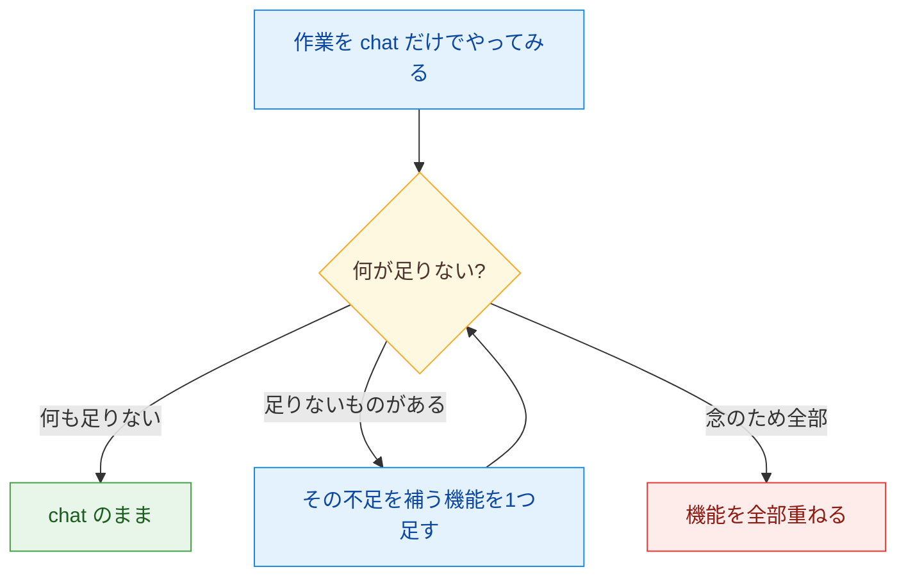

# タスクに合う機能の組み合わせ

> ドメイン: 3. 機能・モデル・コンテキストの選択（15%） ／ 更新: 2026-11-26

!!! abstract "ひとことで"
    出発点はふつうの chat。そこに==作業に足りないものだけを、機能で1つずつ足す==。足りないものが無い作業に機能を重ねない。

## 仕組み

claude.ai の機能は、それぞれ chat に欠けている1つの要素を補う。毎回同じ背景資料が要るなら Projects、毎回同じ手順や書式が要るなら Skills、社内のサービスにある最新のデータが要るなら connectors を足す。だから選ぶときは「この作業を chat だけでやると、何が足りないか」を先に言葉にし、その不足に対応する機能を選ぶ。

| 足りないもの | 足す機能 | 足さなくてよい場面 |
|---|---|---|
| 繰り返し使う背景資料と、作業ごとのまとまり | Projects（knowledge と instructions） | 一回きりの相談 |
| 繰り返す手順・書式（どのチャットでも） | Skills | その場かぎりの依頼 |
| Google Drive・Gmail などにある最新のデータ | connectors | 手元のファイル1つで足りる |
| 外の情報を多角的に、出典つきで調べる | research | 知っている事実の確認、文章の推敲 |
| 正確な計算、Excel や Word などのファイル | コード実行とファイル作成 | 計算の無い文章の作業 |
| 人に見せる・操作できる成果物 | Artifacts | チャットの返事で足りる短い答え |
| 役割・好み・進行中の仕事の持ち越し | memory | 決まった資料や手順の保管 |

Projects と Skills は役割が違う。Project は、その中のチャットで毎回読み込まれる固定の背景知識だ。Skill は、必要なときだけ読み込まれる手順で、Project の外でも使える。だから「ある案件についての資料」は Project に、「どの案件でも同じやり方」は Skill に置き、両方要る作業では組み合わせる。connectors は外のサービスへの接続で、Skill は作業の手順なので、これも併用できる。memory は日々の仕事の文脈を覚える仕組みで、決まった書式や手順を確実に守らせる置き場には向かない（推論）。

??? info "機能どうしの前提と、変わりやすい細部"
    - Skills はコード実行が有効になっている必要がある。Artifacts を作るにも、設定でコード実行とファイル作成（Create and edit files）が有効になっている必要がある。2026-09-16 より前のチャットで作られた古い形式（legacy）の Artifacts は今も動くが、新しくは作れない
    - research はウェブ検索がオンでないと動かない
    - connectors で読めるのは、自分のアカウントが元のサービスで読めるものだけ。Team / Enterprise では、組織のオーナーが connector を有効にしてから個人が認証する
    - incognito chats は Project の中では使えない
    - プランごとの提供状況、設定の場所、上限値はよく変わる。使う前にヘルプセンターの最新の記事を確認する

## 試験での見分け方

| 問われること | ○ 正しい | × ひっかけ |
|---|---|---|
| 毎週の定型レポートを最新データで作る | connectors でデータを読み、書式は Skill にする | 毎回ファイルをアップロードし、書式も毎回貼る |
| 一回きりの短い相談 | ふつうの chat で済ませる | そのために Project や Skill を作る |
| どの案件でも同じ書式 | Skill にする | 案件ごとの Project の instructions に同じ文を書き写す |
| 決まった手順を守らせたい | Skill や instructions に書く | memory が覚えてくれるのを当てにする |
| 機能が多い方が品質が上がると考える | 不足に対応する機能だけを足す | 使える機能を全部オンにする |

## 確認問題

**Q1.** 物流会社のオペレーション部の担当者は、毎週月曜に、Google Drive に置かれる最新の在庫レポートを読み、部で決めた5項目の書式で要約を作っている。今は毎回レポートをダウンロードしてチャットにアップロードし、書式の説明も毎回貼り付けている。最も適切な組み合わせはどれか。（1つ選べ）
{ .quiz-q }

- A. 書式の説明は memory に覚えさせ、レポートは今までどおり毎回アップロードする
- B. Google Drive の connector で最新のレポートを読ませ、5項目の書式は Skill にする
- C. research をオンにし、レポートの内容をウェブ上の情報と合わせて要約させる
- D. レポートを Project の knowledge に一度アップロードし、書式は毎回貼り付ける

??? success "答えと解説"
    **正解: B。** 足りないのは「最新のデータ」と「毎回同じ書式」なので、connectors と Skill で補う。

    - A: memory は書式を確実に守らせる置き場ではない。アップロードの手間も残る
    - C: 社内の在庫レポートの要約に、外の調査は要らない
    - D: knowledge に置いたレポートは毎週古くなる。書式を貼る手間も残る

**Q2.** IT 企業の研修担当者が、新入社員研修を準備している。機能と作業の組み合わせとして適切なものはどれか。（2つ選べ）
{ .quiz-q }

- A. 研修後アンケート300件の CSV から、設問ごとの平均と分布をコード実行で計算させる
- B. 一度だけ送る社内メールの言い回しを相談するために、新しい Project を作る
- C. 毎年使う社内規程と過去の研修資料を Project の knowledge に置き、研修づくりのチャットをそこで行う
- D. 最新の労働関係の法改正の動向を、memory に残った過去の会話の内容から答えさせる
- E. 研修で使うクイズを1問作るために、research で検索を何度も重ねさせる

??? success "答えと解説"
    **正解: A と C。** 正確な計算にはコード実行、繰り返し使う背景資料には Project が合う。

    - B: 一回きりの相談は chat で足りる。Project は過剰
    - D: memory は仕事の文脈を覚える仕組みで、外の最新情報の出どころにはならない
    - E: 外の調査が要らない作業に research は過剰

**Q3.** SaaS 企業の PM が、役員会で見せる資料を今回1回だけ作る。プロジェクトの進捗を、チームごとにクリックで切り替えて見られる1ページにしたい。最も適切な進め方はどれか。（1つ選べ）
{ .quiz-q }

- A. チャットの返事に長い Markdown の表で出させ、それをコピーして資料にする
- B. 進捗報告の Skill を作り、その Skill に今回の資料を作らせる
- C. research をオンにして、進捗の情報を集めて資料にまとめさせる
- D. Artifact として作らせ、表示を見ながらチャットで直していく

??? success "答えと解説"
    **正解: D。** 人に見せる、操作できる成果物は Artifacts が合う。

    - A: クリックで切り替える表示は作れない
    - B: 今回1回だけの作業なので、手順を Skill にする理由が無い
    - C: 社内の進捗は外の調査で集まらない。足りないのは見せ方の方

## 出典
- Claude Certified Associate – Foundations Exam Guide v1.1, Domain 3: Capability Selection（公式、PDF）: https://cc.sj-cdn.net/instructor/6nizmqk8tpzpfjvt6qmmav7rh/public/1794946609/Claude_Certified_Associate_-_Foundations_Exam_Guide_Updated_Dec_7.pdf
- [What are projects?](https://support.claude.com/en/articles/9517075-what-are-projects)（公式、ヘルプセンター）
- [What are skills?](https://support.claude.com/en/articles/12512176-what-are-skills)（公式、ヘルプセンター）
- [Use connectors](https://support.claude.com/en/articles/11176164-use-connectors)（公式、ヘルプセンター）
- [Use research on Claude](https://support.claude.com/en/articles/11088861-use-research-on-claude)（公式、ヘルプセンター）
- [Create and edit files with Claude](https://support.claude.com/en/articles/12111783-create-and-edit-files-with-claude)（公式、ヘルプセンター）
- [What are artifacts and how do I use them?](https://support.claude.com/en/articles/17153992-what-are-artifacts-and-how-do-i-use-them)（公式、ヘルプセンター）
- [Use Claude's chat search and memory to build on previous context](https://support.claude.com/en/articles/11817273-use-claude-s-chat-search-and-memory-to-build-on-previous-context)（公式、ヘルプセンター）
- [Use incognito chats](https://support.claude.com/en/articles/12260368-use-incognito-chats)（公式、ヘルプセンター）
