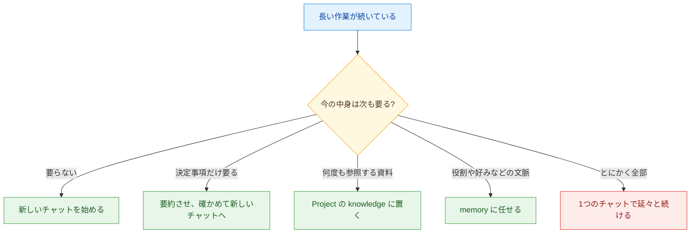

# 長い作業のコンテキスト管理

> ドメイン: 3. 機能・モデル・コンテキストの選択（15%） ／ 更新: 2026-11-26

!!! abstract "ひとことで"
    長い作業では、==続ける・要約して新しく始める・Project に残す・memory に任せる==のどれかを選ぶ。決め手は、今のチャットの中身が次も要るか、どれだけ正確に要るか。

## 仕組み

1つのチャットで Claude が扱える量は、コンテキストウィンドウ（context window）の大きさで決まる。コード実行が有効なら、上限に近づくと Claude が古いメッセージを自動で要約して会話を続ける。ただし、自動の要約が働くほど長いチャットは、使用量の上限を多く使う。ヘルプセンターは、長いチャットで使用量の上限に近づいたら、新しいチャットを始めるよう勧めている。

新しく始めるべきなのは、上限のときだけではない。途中で前提が変わったのに古い前提が出力に混じる、試行錯誤が積み重なって話がそれた、というときも、決定事項だけを要約させて新しいチャットに渡す方がよい（推論）。要約は Claude に作らせてよいが、渡す前に自分で読み、誤りや古い前提を直す。

| 置き場 | 向いているもの | 向いていないもの |
|---|---|---|
| 今のチャット | 進行中の1つの作業 | 前提が変わった後や、話がそれた後 |
| 要約して新しいチャット | 決定事項と、変わった前提 | 一字一句が要る資料 |
| Project の knowledge | 仕様書・用語集など、何度も参照する資料 | 毎週入れ替わるデータ |
| memory | 役割・好み・進行中の仕事などの文脈 | 正確に守らせたい手順や数字（推論） |

Project の knowledge は、その Project のどのチャットでも背景として使われる。だから何度も参照する資料は、チャットに毎回貼るより knowledge に置く。ただし knowledge が多すぎると無駄に使用量を使うので、使わなくなった資料は外し、instructions は短く保つ。memory は自動で文脈を覚えるが、何をどう覚えたかは自分で見直さないと分からない。memory の質の保ち方は別のノートで扱う。

??? info "細かい決まり（2026-11 時点、変わりやすい）"
    - 自動の要約の後も、チャットの全履歴は残り、Claude は参照できる。最初のメッセージが極端に大きいなど、まれに上限にかかる場合がある
    - 「メッセージが長すぎる」というエラーは、1通のメッセージが大きすぎるという意味で、使用量の上限とは別。短くするか、ファイルを減らす
    - Project の knowledge が上限に近づくと、有料プランでは必要な部分だけを読み込む方式（RAG）に自動で切り替わる
    - 有料プランでは、過去のチャットを検索させて、新しいチャットに文脈を持ち込める（設定で切れる）
    - 使用量を節約する方法として、ヘルプセンターは、定型の作業での effort を下げる、要らない thinking を切る、使わない connectors を外す、を挙げている
    - コンテキストウィンドウの大きさはモデルとプランで違う。試験は数値を問わない

## 試験での見分け方

| 問われること | ○ 正しい | × ひっかけ |
|---|---|---|
| 前提が変わったのに古い前提が混じる | 決定事項を要約させ、直してから新しいチャットへ | 同じチャットで毎回訂正を書き足す |
| 何度も参照する資料 | Project の knowledge に置く | 毎回のチャットに全文を貼り直す |
| 長いチャットで使用量の上限が近い | 新しいチャットを始める | 自動の要約があるので、使用量は気にせず続ける |
| 前のチャットの中身を持ち込む | 要る部分だけを要約して渡す | 前のチャットの全文を貼る |
| 決まった資料を残す | knowledge に置く | memory が覚えているはずと考え、どこにも置かない |

## 確認問題

**Q1.** 製薬会社の研修担当者が、1つのチャットで3週間、研修プログラムを作り続けてきた。途中で対象を「新入社員」から「中途入社の社員」に変えたが、最近の出力に新入社員向けの前提が混じるようになった。最も適切な対応はどれか。（1つ選べ）
{ .quiz-q }

- A. 同じチャットで、依頼のたびに「対象は中途入社の社員です」と書き足して続ける
- B. effort を最大に上げ、同じチャットで続ける
- C. ここまでの決定事項を要約させ、対象の前提を直してから新しいチャットに渡して始め直す
- D. memory をリセットしてから、同じチャットで続ける

??? success "答えと解説"
    **正解: C。** 古い前提が積み重なったチャットは、決定事項だけを直して新しく始める方が確実だ。

    - A: 古い前提はチャットに残ったままなので、また混じる
    - B: 考える量を増やしても、チャットに残る古い前提は消えない
    - D: リセットはすべての memory を消すうえ、混じる原因はこのチャットの中身にある

**Q2.** 家具メーカーの PM が、半年続く新製品の立ち上げで Claude を使う。話題ごとに複数のチャットを使う予定だ。コンテキストの扱いとして適切なものはどれか。（2つ選べ）
{ .quiz-q }

- A. 製品の仕様書と用語集など、何度も参照する資料は Project の knowledge に置く
- B. 決まったことは memory が覚えるので、資料はどこにも置かずに進める
- C. すべての議論を1つのチャットに集め、新しいチャットは作らない
- D. 使わなくなった資料は Project から外し、instructions は短く保つ
- E. 新しいチャットを始めるたびに、冒頭にすべての資料を貼り付け直す

??? success "答えと解説"
    **正解: A と D。** 何度も参照する資料は knowledge に置き、要らないものを外して軽く保つ。

    - B: memory は文脈を覚える仕組みで、決まった資料を正確に残す置き場ではない
    - C: 長いチャットは使用量を多く使い、話題の違う内容が混じる
    - E: 同じ資料を毎回貼るのは手間で、knowledge に置けば済む

**Q3.** 保険会社の営業企画の担当者が、長いチャットで代理店の分析を続けてきて、使用量の上限が近い。次は、これまでの話とは関係の無い新商品の資料の要約をしたい。最も適切な対応はどれか。（1つ選べ）
{ .quiz-q }

- A. 新しいチャットを始め、新商品の資料を渡して要約を頼む
- B. 自動の要約があるので、同じチャットで続けて頼む
- C. 新しいチャットに、前のチャットの全文を貼ってから要約を頼む
- D. incognito chat に切り替えて、同じ内容を続ける

??? success "答えと解説"
    **正解: A。** 前の中身が要らない作業で、使用量の上限も近いので、新しいチャットが合う。

    - B: 長いチャットは使用量を多く使う。関係の無い話題を足す理由も無い
    - C: 要らない文脈を持ち込み、使用量も無駄に使う
    - D: incognito は履歴と memory に残さない機能で、長いチャットの使用量の問題とは関係が無い

## 出典
- Claude Certified Associate – Foundations Exam Guide v1.1, Domain 3: Context and Memory Management（公式、PDF）: https://cc.sj-cdn.net/instructor/6nizmqk8tpzpfjvt6qmmav7rh/public/1794946609/Claude_Certified_Associate_-_Foundations_Exam_Guide_Updated_Dec_7.pdf
- [How usage and length limits work](https://support.claude.com/en/articles/11647753-how-do-usage-and-length-limits-work)（公式、ヘルプセンター）
- [What are projects?](https://support.claude.com/en/articles/9517075-what-are-projects)（公式、ヘルプセンター）
- [Troubleshoot Claude error messages](https://support.claude.com/en/articles/12466728-troubleshoot-claude-error-messages)（公式、ヘルプセンター）
- [Use Claude's chat search and memory to build on previous context](https://support.claude.com/en/articles/11817273-use-claude-s-chat-search-and-memory-to-build-on-previous-context)（公式、ヘルプセンター）
