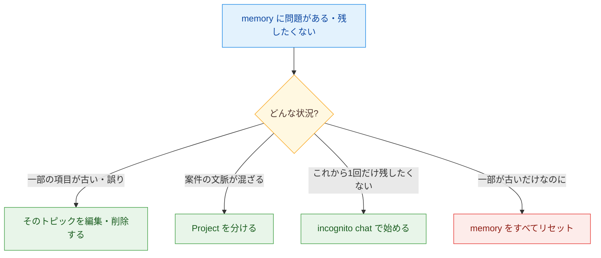

# memory の仕組みと質の保ち方

> ドメイン: 3. 機能・モデル・コンテキストの選択（15%） ／ 更新: 2026-11-26

!!! abstract "ひとことで"
    memory は放っておくと、古い文脈や混ざった文脈がたまる。==定期的に見直し、編集・削除する==。残したくない一回きりの会話は、incognito chat で始める。

## 仕組み

memory は、役割、進行中の仕事、伝え方の好みなどの仕事の文脈を、会話の中でトピックごとに保存する。保存した内容は以後の会話で使われるので、異動して役割が変わった、案件が終わった、といった変化を放っておくと、古い文脈のまま答えが出る。だから memory は「勝手に正しくなるもの」でなく、自分で手入れするものとして扱う。

手入れの方法は2つある。設定の memory の管理画面でトピックを開き、直接編集・削除する。または、チャットで「これを覚えて」「これを変えて」「これを忘れて」と頼む。どちらも以後の会話から効く。案件どうしを混ぜないためには、Project を分ける。各 Project は自分の memory を持ち、その Project では、Project の memory と Project 外のチャットの memory を使うが、ほかの Project の memory は使わない。

| 操作 | 何が起きるか | 使う場面 |
|---|---|---|
| トピックの編集・削除 | その項目だけが直り、以後の会話に効く | 役割や担当の変化、誤って覚えた内容 |
| incognito chat | 履歴にも memory にも残らず、既存の memory も使わない | 残す必要の無い一回きりの試し |
| チャット単位で memory を切る | そのチャットは memory を使わず保存もしないが、履歴には残る | 履歴は残したいが memory には混ぜたくない |
| 一時停止（pause） | 既存の memory は残し、使うことも新しく作ることもやめる | しばらく memory 無しで使いたい |
| リセット | Project の memory も含め、すべて消える。元に戻せない | 全体を作り直したいとき |

Project の中まで Project 外の memory を持ち込みたくないときは、その Project で「Use account memory」を切ると完全に分けられる。incognito chat は Project の中では使えない。Project の中で memory に残したくない会話は、チャット単位で memory を切る。保存や学習への利用、組織での保持など、プライバシーの観点はドメイン6で扱う。

??? info "細かい決まり（2026-11 時点、変わりやすい）"
    - memory の管理画面の場所は、設定の「Your Claude」→「Your memory」の「Manage」（設定の画面の版で名前が違う）
    - 健康・政治・宗教などの機微な話題は、既定では memory に保存しない（設定で含められる）。身分証の番号や金融口座の番号は保存しない
    - 以前の memory（legacy）は、会話をまとめた要約を24時間ごとに更新する方式。一部の Team / Enterprise の組織では今もこの方式で、機微な話題の設定とチャット単位の memory オフが効かない
    - incognito chat は、一度始めると通常のチャットに変えられず、履歴にも保存できない。過去のチャットを検索させても、incognito chat は対象にならない
    - Team / Enterprise では、memory を使えるかどうかをオーナーが決める。incognito chat は、組織のデータの書き出しに含まれる
    - プランごとの既定（オンかどうか）は変わりやすい。最新のヘルプセンターで確認する

## 試験での見分け方

| 問われること | ○ 正しい | × ひっかけ |
|---|---|---|
| 異動前の役割を前提に答えが出る | 該当するトピックを編集・削除する | 毎回のプロンプトで訂正し続ける、全体をリセットする |
| 顧客Aの文脈が顧客Bの作業に混ざる | 顧客ごとに Project を分ける | 1つのチャットで両方扱い、毎回顧客名を書く |
| 一回きりで、履歴も memory も要らない | incognito chat で始める | 通常のチャットの後で memory を一時停止する（一時停止は消さない） |
| Project の中で memory に残したくない | チャット単位で memory を切る | Project の中で incognito chat を使う（使えない） |
| memory の質の管理 | 定期的に見直し、直す | memory は自動で正しくなると考え、放っておく |

## 確認問題

**Q1.** 化粧品会社でマーケティングを担当していた社員が、人事部に異動した。採用の相談をすると、Claude が広告の効果測定の観点を持ち込んだ答えを返す。最も適切な対応はどれか。（1つ選べ）
{ .quiz-q }

- A. memory をすべてリセットし、最初から覚え直させる
- B. memory の管理画面で、マーケティング担当という役割のトピックを直すか消す
- C. 毎回のプロンプトの冒頭に「今は人事部の担当です」と書き添える
- D. 以後の相談はすべて incognito chat で行う

??? success "答えと解説"
    **正解: B。** 古くなったのは一部の項目なので、そのトピックだけを直す。

    - A: リセットは Project の memory を含めてすべて消し、元に戻せない。一部の誤りに対して過剰
    - C: memory の古い項目は残るので、書き忘れたときにまた混じる
    - D: memory を使わなくなるだけで、古い項目は直らない。有用な文脈も使えなくなる

**Q2.** 独立系のコンサルタントが、競合関係にある2社（A社とB社）の案件を同時に担当している。一方の会社の文脈が、もう一方の作業に混ざらないようにしたい。適切なものはどれか。（2つ選べ）
{ .quiz-q }

- A. 顧客ごとに Project を分け、それぞれの作業をその Project の中で行う
- B. 各 Project で「Use account memory」を切り、Project 外のチャットの memory も持ち込まない
- C. B社の作業はすべて incognito chat で行い、Project は使わない
- D. 文脈が混ざったと気づくたびに、memory をすべてリセットする
- E. 1つのチャットで両社を扱い、依頼のたびに顧客名を明記する

??? success "答えと解説"
    **正解: A と B。** Project はほかの Project の memory を使わない。Project 外の memory まで切れば、完全に分けられる。

    - C: B社の作業の履歴も資料も残らず、続けて作業する土台が作れない
    - D: リセットは両社の memory も含めすべて消す。混ざる仕組みも直らない
    - E: 同じチャットに両社の文脈が並び、混ざりやすくなる

**Q3.** 物流会社の人事担当者が、自社の求人票とは関係の無い職種の書き方を、一度だけ試しに Claude に相談したい。この話題を memory に残したくなく、チャットの履歴も要らない。最も適切な対応はどれか。（1つ選べ）
{ .quiz-q }

- A. 通常のチャットで相談し、終わったら memory を一時停止する
- B. 人事の Project の中で相談し、後で Project の instructions を見直す
- C. memory をすべてリセットしてから、通常のチャットで相談する
- D. Project の外で incognito chat を始めて相談する

??? success "答えと解説"
    **正解: D。** incognito chat は履歴にも memory にも残らない。

    - A: 一時停止は既存の memory を消さない。相談中に保存された内容は残る
    - B: Project の memory に残るおそれがあり、履歴も残る
    - C: 必要な memory まで消える。リセット後の相談はまた memory に残る

## 出典
- Claude Certified Associate – Foundations Exam Guide v1.1, Domain 3: Context and Memory Management（公式、PDF）: https://cc.sj-cdn.net/instructor/6nizmqk8tpzpfjvt6qmmav7rh/public/1794946609/Claude_Certified_Associate_-_Foundations_Exam_Guide_Updated_Dec_7.pdf
- [Use Claude's chat search and memory to build on previous context](https://support.claude.com/en/articles/11817273-use-claude-s-chat-search-and-memory-to-build-on-previous-context)（公式、ヘルプセンター）
- [Use incognito chats](https://support.claude.com/en/articles/12260368-use-incognito-chats)（公式、ヘルプセンター）
