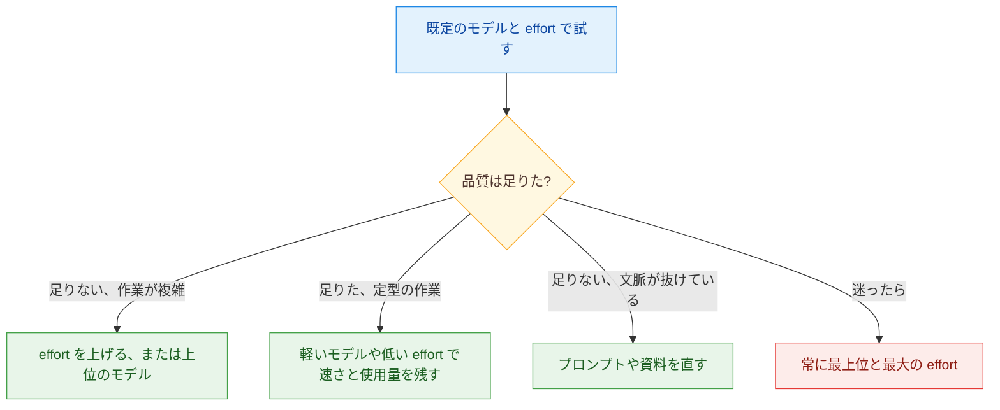

# モデルの階層と effort レベルの選び方

> ドメイン: 3. 機能・モデル・コンテキストの選択（15%） ／ 更新: 2026-11-26

!!! abstract "ひとことで"
    モデルと effort は、作業の複雑さと誤りの影響（stakes）に合わせて選ぶ。==速く軽い選択で品質が足りる作業には、上位の設定を使わない==。

## 仕組み

Claude のモデルには階層がある。Haiku は最も速く軽い。Sonnet は日々の仕事で速さと能力の釣り合いをとる。Opus は複雑な作業向けで、その上に最上位のモデルが置かれることもある。claude.ai では、送信ボタンの横のモデルのメニューで、モデル・effort・thinking を選ぶ。

effort は、同じモデルの中で、1つの応答にどれだけ考える量を使うかを決める。高くすると答えは丁寧になるが、時間がかかり、使用量の上限に早く届く。ヘルプセンターは、ふだんの作業は既定のままにし、多段の分析や詳しい文書の分析のような複雑な作業で上げるよう勧めている。だから選び方は「まず既定で試し、品質が足りなければ上げ、足りていれば下げる」になる。

| 作業 | 選び方 | 理由 |
|---|---|---|
| 案内文の言い回し、短い要約、簡単な質問 | 軽いモデル、低い〜中くらいの effort | 誤りの影響が小さく、すぐ見て直せる |
| ふだんの文書作成やデータの読み取り | 既定のまま | 品質と速さの釣り合いがとれている |
| 顧客の意思決定に関わる多段の分析 | 上位のモデル、高い effort | 複雑で、誤りの影響が大きい |
| 最も難しく、正確さが決定的な作業 | 最大の effort | 時間と使用量を使ってでも深く考えさせる |

選んだ設定は、品質・速さ・コストの3つで説明できるようにしておく。claude.ai でのコストは主に使用量の上限で、選んだモデルや effort が使用量に影響する。上位の設定は、プロンプトの抜けを補わない。渡すべき文脈が抜けて答えがずれているなら、直すのはプロンプトや資料の方だ（推論）。上位のモデルの出力でも、使う前の確認は省けない（推論、ドメイン2）。

??? info "具体的なモデル名と細部（2026-11 時点、変わりやすい）"
    - 開発者向けドキュメントのモデル選びの表では、最上位が Claude Fable 5.2、複雑な作業が Opus 5.5、日々の作業が Sonnet 5.5、最も速く安いのが Haiku 5.5。試験は料金などの数値の暗記を問わない
    - effort の段階: low / medium は定型の作業向けで使用量を延ばせる。high は品質と速さの釣り合いが最もよい。xhigh は長いコーディングやエージェントの作業向け（Opus 4.7 以降）。max は最も深く考える
    - 既定の effort はモデルごとに違い、メニューに「Default」と表示される
    - thinking（応答の前に考える過程を見せる）は effort とは別の設定。thinking を切れないモデルでは、effort を下げると考える量が減る
    - モデル・effort・thinking はチャットの途中でも変えられ、次の応答から効く
    - Enterprise では、管理者が役割ごとにモデルや effort を使えなくしていることがある
    - 開発者向けドキュメントは「effort の調整は、モデルを替えるよりよい手段であることが多い」としている（API の文脈）

## 試験での見分け方

| 問われること | ○ 正しい | × ひっかけ |
|---|---|---|
| 誤りの影響が小さい定型の作業 | 軽いモデルや低い effort を選ぶ | 念のため最上位と最大の effort にする |
| 複雑で、誤りの影響が大きい分析 | 上位のモデルや高い effort を選ぶ | 使用量を惜しんで最も軽い設定で済ませる |
| 文脈が足りずに答えがずれる | プロンプトや資料を直す | effort を上げて補おうとする |
| 選んだ理由を説明する | 品質・速さ・コストと、試した結果で説明する | 「上位の方が常に正しい」「軽い方が常に誤りが少ない」と説明する |
| 上位のモデルを使った後 | 影響に応じて確認する | 上位なので確認を省く |

## 確認問題

**Q1.** 食品メーカーの人事担当者が、社内チャットに流す懇親会の案内文を、言い回しを変えて5パターン出したい。最も適切な設定の選び方はどれか。（1つ選べ）
{ .quiz-q }

- A. 誤りがあると困るので、最上位のモデルと最大の effort を選ぶ
- B. 既定のモデルのまま effort を最大にし、気に入るまで何度も出し直す
- C. research をオンにして、他社の懇親会の案内文を調べさせてから書かせる
- D. 軽いモデルか低い effort を選び、速さと使用量を優先する

??? success "答えと解説"
    **正解: D。** 単純で誤りの影響が小さく、すぐ見て直せる作業なので、速く軽い選択で品質が足りる。

    - A: 案内文の言い回しに、最上位の設定を使う理由が無い
    - B: 最大の effort は時間と使用量を多く使ううえ、言い回しの好みは考える量では決まらない
    - C: 外の調査が要らない作業に research は過剰

**Q2.** 経営コンサルタントが、ふだんの作業と、顧客の事業撤退の判断に使う分析の両方で Claude を使っている。設定の選び方として適切なものはどれか。（2つ選べ）
{ .quiz-q }

- A. 事業撤退の判断に使う多段の分析には、上位のモデルか高い effort を選ぶ
- B. 上位のモデルで分析したので、数字や前提の確認は省いて顧客に出す
- C. 議事録の誤字直しのような定型の作業は低い effort で済ませ、使用量を残す
- D. 顧客の業界の事情を渡していないために答えがずれているので、effort を最大にして補う
- E. どの作業でも最上位のモデルと最大の effort に固定し、作業ごとに選び直さない

??? success "答えと解説"
    **正解: A と C。** 作業の複雑さと誤りの影響に合わせて、上げる作業と下げる作業を分ける。

    - B: 上位のモデルでも、影響の大きい出力の確認は省けない
    - D: 抜けているのは文脈。effort を上げても、渡していない事情は補えない
    - E: 定型の作業で時間と使用量を無駄に使う

**Q3.** 通販会社のオペレーションのマネージャーが、毎日の問い合わせを5つのカテゴリに振り分ける作業で、軽いモデルと低い effort を使っている。チームから「なぜ上位の設定にしないのか」と聞かれた。選択の説明として最も適切なものはどれか。（1つ選べ）
{ .quiz-q }

- A. 軽いモデルの方が、どの作業でも誤りが少ないから
- B. 作業が単純で誤りの影響も小さく、試した出力の品質が足りていたので、速さと使用量を優先したから
- C. 上位のモデルは、問い合わせの振り分けのような定型の作業を扱えないから
- D. effort は回答の長さを変えるだけの設定で、品質には影響しないから

??? success "答えと解説"
    **正解: B。** 選択は、作業の複雑さと影響、試した結果、品質・速さ・コストで説明する。

    - A: 軽いモデルが常に誤りが少ないわけではない。複雑な作業では上位が勝る
    - C: 上位のモデルも定型の作業は扱える。使わない理由は過剰だから
    - D: effort は考える量を変え、答えの丁寧さに影響する

## 出典
- Claude Certified Associate – Foundations Exam Guide v1.1, Domain 3: Model and Effort Selection（公式、PDF）: https://cc.sj-cdn.net/instructor/6nizmqk8tpzpfjvt6qmmav7rh/public/1794946609/Claude_Certified_Associate_-_Foundations_Exam_Guide_Updated_Dec_7.pdf
- [Change the model, effort, and extended thinking settings](https://support.claude.com/en/articles/8664678-change-the-model-effort-and-extended-thinking-settings)（公式、ヘルプセンター）
- [How usage and length limits work](https://support.claude.com/en/articles/11647753-how-do-usage-and-length-limits-work)（公式、ヘルプセンター）
- [Choosing the right model](https://platform.claude.com/docs/en/about-claude/models/choosing-a-model)（公式、開発者向けドキュメント。モデルの位置づけの参考）
