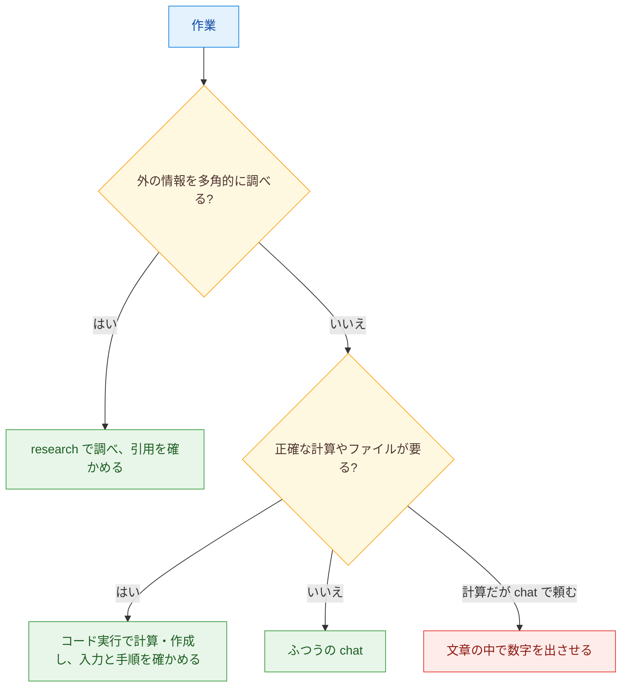

# research とコード実行による分析の使いどころ

> ドメイン: 3. 機能・モデル・コンテキストの選択（15%） ／ 更新: 2026-11-26

!!! abstract "ひとことで"
    外の情報を多角的に調べるなら research、==正確でなければならない計算==ならコード実行を選ぶ。どちらの結果も、使う前に出典と入力を確かめる。

## 仕組み

research は、検索を1回で終えない。前の検索で分かったことをもとに次の検索を決め、問いの別々の観点を順に調べていく。connectors を有効にしていれば、Gmail や Google Docs などの社内の情報も合わせて調べる。だから「観点が複数あり、外の最新の情報が要る問い」に向き、知っている事実を1つ確かめるだけの問いには重い（推論）。

コード実行（code execution and file creation）は、隔離された環境で Claude が実際にコードを動かす機能だ。CSV の集計、グラフの作成、数式の入った Excel、Word や PDF の作成ができる。数字を文章として「書く」のでなく、計算を「実行する」ので、試験ガイドは正確さが必要な計算の結果をコード実行で出すことを挙げている。

| 作業の例 | 選ぶ機能 | 決め手 |
|---|---|---|
| 新しい市場の規制・商習慣・主な事業者を、出典つきで調べる | research | 観点が複数あり、外の最新の情報が要る |
| 1年分の問い合わせログを、カテゴリ別・月別に集計する | コード実行 | 件数や増減は正確でなければならない |
| 前提を変えて試せる予算表を作る | コード実行（数式の入った .xlsx） | 計算をファイルの中に残せる |
| 報告書の言い回しを整える | ふつうの chat | 外の情報も計算も要らない |

どちらの機能も、出力をそのまま使ってよい理由にはならない。research の出力は、引用した資料に本当にその内容があるかを確かめる。コード実行は計算そのものは正確でも、読み込んだデータや集計の前提がずれていれば結果もずれる。だから使ったコードや手順を出させ、元のデータと数行を照合する。機密のデータをアップロードしてよいかは、別に判断する（ドメイン6）。

??? info "細かい決まり（2026-11 時点、変わりやすい）"
    - research はウェブ検索がオンでないと動かない。モバイルではウェブだけを調べ、connectors は使わない。Claude Desktop のローカルの MCP サーバーのツールも使わない
    - research は、チャットで選んだモデルにかかわらず決まったモデル（Opus 5.5、使えないときは Opus 4.8）で動く。Team / Enterprise で管理者が両方を止めていると使えない
    - research は通常のチャットと同じ使用量の上限を使うが、多くの資料を読むので早く減る。ファイルの作成も通常のチャットより使用量を多く使う
    - コード実行のファイルの上限は、アップロード・ダウンロードとも1ファイル 30MB
    - コード実行の環境からの外部通信は、プランと設定で変わる（Team / Enterprise は既定で無効）。外部のファイルやサイトに仕込まれた指示で、データを外に送らされる危険があると、ヘルプセンター自身が注意している
    - research がかかる時間と、引用の表示のしかたは、ヘルプセンターの記事に記載が無く未確認

## 試験での見分け方

| 問われること | ○ 正しい | × ひっかけ |
|---|---|---|
| 新しい分野を多角的に調べる | research を使い、引用を確かめる | ふつうの chat で知っていることを書かせる（出典が無く、情報も古いことがある） |
| 大量のデータの件数・平均・増減 | コード実行で計算する | データを貼り付けて、文章で数えさせる |
| 計算の正確さを上げたい | 計算はコード実行に移す | effort を上げて、文章のまま計算させる |
| コード実行の結果の確認 | 使った手順と入力データを照合する | コードで計算したので確認は要らないとする |
| 社内データの代わり | 自社のデータを集計する | research で調べた業界の平均で代用する |

## 確認問題

**Q1.** 法人向け研修の会社の事業企画担当が、東南アジアでのサービス展開を検討している。現地の規制、市場の規模感、商習慣を複数の観点から調べ、出典つきで上司に報告したい。最も適切な進め方はどれか。（1つ選べ）
{ .quiz-q }

- A. research をオンにして調べさせ、報告に使う前に引用元の内容を確かめる
- B. ふつうの chat で、Claude が知っている範囲の情報を出典つきの形式でまとめさせる
- C. コード実行を使い、市場の規模を Claude に計算させて報告の中心にする
- D. Project を作り、instructions に「必ず最新の情報で答えること」と書いてから質問する

??? success "答えと解説"
    **正解: A。** 外の最新の情報を多角的に調べる作業なので research が合い、引用は使う前に確かめる。

    - B: 外の情報を調べないので、出典の形式だけ整っても中身の裏付けにならない
    - C: 計算の元になるデータが無い。足りないのは調査の方
    - D: instructions に書いても、外の情報を調べる機能は足されない

**Q2.** 家電メーカーの業務分析の担当者が、1年分の問い合わせログ（CSV、約2万行）からカテゴリ別の件数と月ごとの増減を出し、部長に報告する。進め方として適切なものはどれか。（2つ選べ）
{ .quiz-q }

- A. コード実行で CSV を集計させ、結果の表とグラフを出させる
- B. CSV の中身をチャットに貼り付け、コード実行は使わずに件数を数えて答えさせる
- C. research で業界の平均的な問い合わせ件数を調べ、自社の件数の代わりに報告する
- D. 集計の手順と使った列を説明させ、いくつかのカテゴリの件数を元のデータで照合する
- E. 正確さを上げるために effort を最大にし、文章の中で集計させる

??? success "答えと解説"
    **正解: A と D。** 正確でなければならない計算はコード実行で行い、その手順と入力を照合してから使う。

    - B: 文章の中で数えた件数は、正確さの保証が無い
    - C: 報告に要るのは自社の数字。業界の平均は代わりにならない
    - E: effort を上げても、計算を実行していない点は変わらない

**Q3.** 飲料メーカーの営業企画の担当者が、来期の価格改定案を作る。値上げ率や販売数量の前提を、会議の場で変えて試せる表にしたい。最も適切な進め方はどれか。（1つ選べ）
{ .quiz-q }

- A. チャットの返事に計算済みの表を出させ、数字を手で Excel に写す
- B. research で他社の値上げ率を調べさせ、その値を表に書き込む
- C. コード実行で、数式の入った Excel ファイルを作らせ、いくつかの値を手で検算する
- D. 価格改定の計算方法を Skill に書き、チャットの返事として表を出させる

??? success "答えと解説"
    **正解: C。** 前提を変えて試すには、計算がファイルの中に数式として残っている必要がある。

    - A: 写した数字は固定の値なので、前提を変えると計算し直せない
    - B: 他社の数字を調べても、自社の前提を変えて試す表にはならない
    - D: 手順を Skill にしても、返事の表は数式を持たない

## 出典
- Claude Certified Associate – Foundations Exam Guide v1.1, Domain 2: Output Adaptation and Format Selection、Domain 3: Capability Selection（公式、PDF）: https://cc.sj-cdn.net/instructor/6nizmqk8tpzpfjvt6qmmav7rh/public/1794946609/Claude_Certified_Associate_-_Foundations_Exam_Guide_Updated_Dec_7.pdf
- [Use research on Claude](https://support.claude.com/en/articles/11088861-use-research-on-claude)（公式、ヘルプセンター）
- [Create and edit files with Claude](https://support.claude.com/en/articles/12111783-create-and-edit-files-with-claude)（公式、ヘルプセンター）
