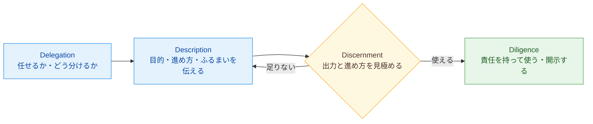

# AI Fluency の4D

> ドメイン: 4. ワークフローの設計と組み込み（18%） ／ 更新: 2026-11-26

!!! abstract "ひとことで"
    AI Fluency の4つのコンピテンシーは、==Delegation（任せるか決める）・Description（伝える）・Discernment（見極める）・Diligence（責任を持つ）==。場面を見て、どの力が欠けているかを言い当てられるようにする。

## 仕組み

AI Fluency Framework は、Rick Dakan と Joseph Feller が Anthropic と作った枠組みだ。AI と「効果的に・効率よく・倫理的に・安全に」協働する力を、4つのコンピテンシーに分ける。ガイドは、この4つが ==すべてのドメインの目標を支える== と書いている。

| コンピテンシー | 定義（公式の要約） | 中の3つの力 | 主に効くドメイン |
|---|---|---|---|
| Delegation | 何を人がやり、何を AI がやり、どう分けるかを決める | Problem Awareness（目的と作業を先に理解する）、Platform Awareness（AI に何ができて何ができないかを知る）、Task Delegation（人と AI で作業を分ける） | 3（機能の選択）、4（任せる・人が持つの振り分け）、6（任せる範囲の限界） |
| Description | 欲しいものを、AI が役に立つ出力を返せるように伝える | Product / Process / Performance Description（成果物・進め方・ふるまいを伝える） | 1（プロンプト）、5（永続的な指示）（推論） |
| Discernment | AI の出力・進め方・ふるまいが役に立つかを批判的に評価する | Product（正確さ・適切さ・一貫性・関連性）、Process（推論の誤りや抜け）、Performance（やりとりのふるまい） | 2（出力の評価、ハルシネーション） |
| Diligence | AI をどう使ったか、その結果に責任を持つ | Creation（使う AI とやりとりを慎重に選ぶ）、Transparency（AI の役割を正直に伝える）、Deployment（出力を使う責任を負う） | 2（レビューの深さ）、6（ポリシー、倫理、Diligence の欠如） |

Description と Discernment は1組で回る（Description-Discernment ループ）。伝えて、返ってきたものを見極め、足りなければ伝え直す。だから「出力が悪い」場面では、見極め（どこが足りないか）を先にし、その結果で伝え方を直す。Diligence は最後の工程ではなく、使う AI の選び方から公開・開示までを通して効く。

ドメインとの対応は、ガイドの文言に4Dの語が出るものと、自分で当てたものがある。Delegation はドメイン4の Delegation and Workflow Redesign（「Delegation criteria」）とドメイン6の「delegation limits」に、Diligence はドメイン6の「Diligence lapses」に、ガイドの語として出る。それ以外の対応は（推論）。

??? info "細かい決まり・確認の状況"
    - フレームワークは AI との関わり方を3つの型で説明する: Automation（AI が決まった作業をこなす）、Augmentation（人と AI が考える相棒として協働する）、Agency（AI が自分で動けるよう人が設定する）
    - 4つのコンピテンシーにそれぞれ3つの下位の力があり、計12。下位の力の名前と定義は、Anthropic の配布資料（cheat sheet）の検索結果の抜粋で確かめた。公式のコースページ（Skilljar）と PDF の本文は、この環境から読めなかった。正確な文面は未確認
    - 教材は CC BY-NC-SA 4.0 で公開されている（検索結果の抜粋。未確認）
    - コースの所要時間やレッスン数は試験に出ない

## 試験での見分け方

| 問われること | ○ 正しい | × ひっかけ |
|---|---|---|
| 出力が的外れ・浅い | Discernment でどこが足りないかを特定し、Description を直す | 同じ依頼を何度も再生成する |
| どの工程を AI に任せるか | Delegation で、目的と AI の得手不得手を踏まえて振り分ける | AI に全部任せるか、全部人がやるかの二択で決める |
| AI が作った資料を社外に出す | Diligence で、検証の責任を自分が負い、AI の関与を必要に応じて開示する | 「AI が作った」と添えれば検証は不要とする |
| 4Dのどれの欠如か | 検証せずに使った → Diligence（Deployment）／見極めの欠如 → Discernment | 誤りの原因をいつも Description（プロンプト）のせいにする |

## 確認問題

**Q1.** 研修会社の教材担当が、新人向け研修のワークブックの草案を Claude で作っている。出てきた章立ては整っているが、自社の研修の型に合わず、演習が抽象的だ。担当者は同じ依頼で3回再生成したが、毎回似た出力になる。4D の考え方に沿った次の一手として最も適切なものはどれか。（1つ選べ）
{ .quiz-q }

- A. 依頼文はそのままにし、出力が良くなるまで再生成を続ける
- B. 出力のどこが型と合わないかを書き出し、その点を例と条件として依頼に足す
- C. 草案づくりは AI に向かないと判断し、ワークブックを人が一から書く
- D. 研修の型を AI が知っているはずとみて、より上位のモデルで同じ依頼を出す

??? success "答えと解説"
    **正解: B。** Discernment で足りない点を特定し、それを Description に戻すのが Description-Discernment ループだ。

    - A: 依頼が同じなら似た出力が返る。見極めも伝え直しもしていない
    - C: 足りないのは伝え方で、任せること自体の誤りとは限らない。Delegation の判断を早まっている
    - D: 自社の型は Claude が知らない文脈で、モデルを変えても補えない

**Q2.** 4D の定義として正しいものはどれか。（2つ選べ）
{ .quiz-q }

- A. Delegation には、AI に何ができて何ができないかを知る Platform Awareness が含まれる
- B. Description は、AI の出力が正確かどうかを評価する力である
- C. Diligence は、出力を公開した後にだけ問われる責任である
- D. Discernment は、AI に作業を任せるかどうかを決める力である
- E. Discernment には、出力の中身だけでなく、AI の推論の進め方を評価することも含まれる

??? success "答えと解説"
    **正解: A と E。** Platform Awareness は Delegation の下位の力。Discernment は Product・Process・Performance の3つを見る。

    - B: 出力の評価は Discernment。Description は伝える力
    - C: Diligence は、使う AI とやりとりを選ぶ段階（Creation）から開示・公開（Transparency、Deployment）まで通して効く
    - D: 任せるかどうかの判断は Delegation

**Q3.** 広報担当が、Claude で作ったプレスリリースの数字を確かめずに配信し、後から誤りが見つかった。プロンプトは具体的で、出力の体裁にも問題は無かった。4D のうち、最も直接に欠けていたものはどれか。（1つ選べ）
{ .quiz-q }

- A. Delegation。プレスリリースの作成を AI に任せたこと自体が誤りだった
- B. Description。数字の正確さを求める指示がプロンプトに無かった
- C. Platform Awareness。Claude の機能の一覧を把握していなかった
- D. Diligence。出力を確かめずに社外へ出し、その責任を果たさなかった

??? success "答えと解説"
    **正解: D。** 出力を使う前に確かめ、結果に責任を持つのは Diligence（Deployment）の役目だ。

    - A: 下書きを AI に任せることは妥当で、欠けていたのは使う前の確認
    - B: 「正確に」と書いても誤りは防げない。確かめる責任は使う人にある
    - C: 機能の把握の問題ではない。誤りは確認の欠如から生じた

## 出典
- [Claude Certified Associate – Foundations Exam Guide v1.1](https://cc.sj-cdn.net/instructor/6nizmqk8tpzpfjvt6qmmav7rh/public/1794946609/Claude_Certified_Associate_-_Foundations_Exam_Guide_Updated_Dec_7.pdf)（公式、PDF。Section 3、Section 5 の Domain 4・6、Section 6）
- [AI Fluency: Framework & Foundations](https://www.anthropic.com/ai-fluency)（公式。Anthropic Academy のコース。本文は環境から読めず、検索結果の抜粋で確認）
- [AI Fluency の用語の配布資料（PDF）](https://www-cdn.anthropic.com/4396730ed190e691a3712cf2fd6bfe35509deca2.pdf)（公式。本文は環境から読めず、検索結果の抜粋で確認）
