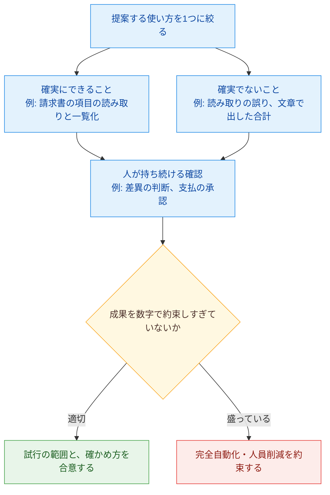

# AI になじみの薄い関係者への伝え方

> ドメイン: 4. ワークフローの設計と組み込み（18%） ／ 更新: 2026-11-26

!!! abstract "ひとことで"
    提案する使い方ごとに、==確実にできること・確実でないこと・人が持ち続ける確認・現実的な成果== の4つを、具体的に伝える。できることを盛っても、怖がらせて控えめに言ってもいけない。

## 仕組み

AI になじみの薄い関係者は、AI を「何でも正しく答える」か「まったく信用できない」かのどちらかで捉えやすい。どちらの思い込みのまま導入しても、失敗する。過大な期待は確認の手抜きにつながり、過小な評価は使える場面を捨てる。だから能力を一般論で語らず、その関係者の業務の1つの使い方に絞って、できる範囲と人の役割を示す。例として、業務分析の担当が経理部長に「請求書の照合の補助」に Claude を使う案を説明する場面を通して使う。

| 伝え方 | 例（請求書の照合） | 問題 |
|---|---|---|
| 盛りすぎ | 「AI が照合を全部やるので、確認は要りません」 | 誤りは起こりうる。確認の手抜きと、事故の責任の曖昧さを招く |
| 控えめすぎ | 「AI は嘘をつくので、経理には使えません」 | 読み取りや下書きのように、確かめやすく役に立つ場面を捨てる |
| 適切 | 「一覧化と差異の候補出しは任せられる。差異の判断と支払の承認は今までどおり担当が行う。まず1か月分で試して、確認にかかる時間を比べる」 | — |

確実でないことは、根拠を添えて具体的に言う。Anthropic のヘルプは、Claude がときに誤った・誤解を招く回答をすること、唯一の情報源として頼らないこと、重要な判断は独立に確かめることを挙げている。一方で、ガイドは正確さが要る計算にコード実行の結果を使い、research を出典つきの調査に使うとしている。Google Workspace の connectors の回答も、使ったメールや文書を出典として示す。出典があれば、人が確かめやすい。こうした「確かめ方つきでできること」を示すと、過大にも過小にもならない。成果は時間の短縮のような見込みを、試行で測る前提で伝える。

??? info "細かい注記"
    - 伝える内容は、AI Fluency の Platform Awareness（AI に何ができて何ができないかを知る）と Transparency Diligence（AI の役割を正直に伝える）に当たる（推論。[AI Fluency の4D](ai-fluency-4d.md) を参照）
    - ヘルプは、web 検索の回答では引用元を確かめるよう勧めている。引用元には、要約から落ちた文脈があることがある
    - 「どの程度の誤りの率か」のような数値は、公式に一般化した値が無く、未確認。使い方ごとに試行で測る

## 試験での見分け方

| 問われること | ○ 正しい | × ひっかけ |
|---|---|---|
| 導入をためらう上司への説明 | その業務の1つの使い方で、できること・人の確認・試し方を示す | AI 全般の性能の高さや、他社の成功例を並べる |
| 期待の大きすぎる関係者 | 確実でないことと、残す人の確認を具体的に伝える | 期待に合わせて「完全自動化」を約束する |
| 不安の強い関係者 | 確かめやすい用途と、確かめ方を示す | 不安に合わせて「重要な仕事には使えない」と言い切る |
| 成果の見込み | 試行で測る前提の見込みとして伝える | 削減時間や人員を、確定の数字として約束する |

## 確認問題

**Q1.** 物流会社の業務改善担当が、Claude で配送の問い合わせメールの返信を下書きする案を、AI を使ったことの無い現場の課長に説明する。課長は「AI に任せれば、問い合わせ対応の人を減らせるのか」と尋ねた。最も適切な答え方はどれか。（1つ選べ）
{ .quiz-q }

- A. 「はい。返信は AI が全部作るので、対応の人数は半分にできます」と答える
- B. 「AI は誤りが多いので、人数は減らせません。参考程度に使うものです」と答える
- C. 「AI の性能は年々上がっているので、いずれ人は要らなくなります」と答える
- D. 「下書きは任せられ、送る前の確認は担当が行う。まず1か月試し、1件あたりの時間を比べます」と答える

??? success "答えと解説"
    **正解: D。** できること・人が持つ確認・測って確かめる見込みの3つを、その業務に絞って伝えている。

    - A: 確認の要らない完全自動化と人員削減を約束し、盛りすぎ
    - B: 下書きのように役に立つ場面まで否定し、控えめすぎ
    - C: 一般論の将来予測で、この使い方での能力も人の役割も伝えていない

**Q2.** マーケティング部長が、社外向けの業界レポートを Claude の research で作る案を、法務部に説明する。法務部は AI になじみが薄い。説明に含めるべきことはどれか。（2つ選べ）
{ .quiz-q }

- A. research は出典つきでまとめるが、数字や引用は担当が引用元で確かめてから使うこと
- B. research の出力は出典付きなので、法務の確認は要らないこと
- C. 公開の前に、誰が何を確かめ、誰が承認するかという人の確認の流れ
- D. AI は誤りを起こしうるので、レポートの作成に AI は一切使わないこと
- E. Claude の内部の仕組み（学習の方法や推論の原理）の詳しい説明

??? success "答えと解説"
    **正解: A と C。** できること（出典つきの調査）と確実でないこと（確かめが要る）、残す人の確認を伝える。

    - B: 出典があっても誤りは起こりうる。確認を外すのは盛りすぎ
    - D: 確かめ方のある用途まで否定し、控えめすぎ
    - E: 関係者の判断に要るのは、この使い方での能力と人の役割で、内部の仕組みではない

**Q3.** 教育委員会の研修担当が、教員向けに Claude の使い方の説明会を開く。参加者の多くは「AI の答えはいつも正しい」と考えている。説明として最も適切なものはどれか。（1つ選べ）
{ .quiz-q }

- A. 授業プリントの下書きの例で、誤りが起こりうる箇所と、使う前の確かめ方を実演する
- B. 誤りの話をすると使われなくなるので、便利な使い方だけを紹介する
- C. 誤りが起こりうるので、授業の準備には使わないよう呼びかける
- D. AI の誤りの率は一般に低いので、気にしなくてよいと伝える

??? success "答えと解説"
    **正解: A。** 参加者の仕事の1つの使い方で、確実でないことと確かめ方を具体的に示している。

    - B: 確実でないことを伝えず、過大な期待を残す
    - C: 下書きのように確かめれば使える場面まで否定する
    - D: 根拠の無い一般化で、確認の手抜きを招く

## 出典
- [Claude Certified Associate – Foundations Exam Guide v1.1](https://cc.sj-cdn.net/instructor/6nizmqk8tpzpfjvt6qmmav7rh/public/1794946609/Claude_Certified_Associate_-_Foundations_Exam_Guide_Updated_Dec_7.pdf)（公式、PDF。Domain 4: Capability Communication）
- [Claude is providing incorrect or misleading responses](https://support.claude.com/en/articles/8525154-claude-is-providing-incorrect-or-misleading-responses-what-s-going-on)（公式）
- [Use research on Claude](https://support.claude.com/en/articles/11088861-use-research-on-claude)（公式）
- [Use Google Workspace connectors](https://support.claude.com/en/articles/10166901-use-google-workspace-connectors)（公式）
- [Create and edit files with Claude](https://support.claude.com/en/articles/12111783-create-and-edit-files-with-claude)（公式）
