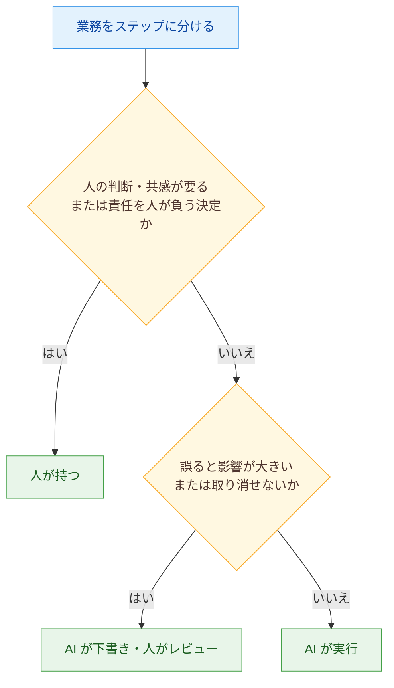

# 任せる・人が持つ・人がレビューするの振り分け

> ドメイン: 4. ワークフローの設計と組み込み（18%） ／ 更新: 2026-11-26

!!! abstract "ひとことで"
    業務の各ステップを、==取り消せるか・影響の大きさ・人の判断や共感が要るか・誰が責任を負うか== の4つで見て、AI が実行・人がレビュー・人が持つ、に振り分ける。業務単位でなく、ステップ単位で決める。

## 仕組み

ガイドは、既存の業務を Delegation の基準で見直し、ステップごとに「AI-executed」「human-reviewed」「human-retained」を割り当てる力を問う。業務を丸ごと「任せる・任せない」で決めると、任せすぎか、任せなさすぎのどちらかになる。だからステップに分けてから、4つの基準を当てる。例として、人事部が中途採用の流れを見直す場面を通して使う。

| 採用のステップ | 振り分け | 決め手 |
|---|---|---|
| 求人票の下書き、面接日程の候補出し | AI が実行 | 取り消せて、誤っても影響が小さい |
| 応募書類の要約、面接質問の案、候補者への連絡文 | AI が下書き・人がレビュー | 社外に出る、または評価に影響する |
| 合否の判断、不合格の伝え方、条件交渉 | 人が持つ | 人の判断と共感が要り、責任を人が負う |

任せすぎ（over-delegation）は、人が持つべき判断を AI の出力のまま通す状態だ。見た目は「人がレビューしている」でも、レビュー担当が中身を見ずに承認しているなら、実質は AI が実行している。Anthropic の Usage Policy は、採用の選考・順位付け・合否のような高リスクの用途で、資格のある人が AI の推奨を実質的にレビューし、変更できる権限を持つことを求めている。

??? info "細かい決まり・注記"
    - Usage Policy の高リスクの領域には、法律、医療、保険、金融、雇用、住宅、教育・資格の判定などが挙がる。これらでは、人による実質的なレビューと、AI を使ったことの開示が求められる（詳細はドメイン6のノート）
    - 振り分けの図の順序（判断・共感 → 影響・取り消し）は、ガイドの4つの基準を判断しやすく並べた自分の整理（推論）
    - AI Fluency の Delegation の下位の力（Problem Awareness、Platform Awareness、Task Delegation）は [AI Fluency の4D](ai-fluency-4d.md) を参照

## 試験での見分け方

| 問われること | ○ 正しい | × ひっかけ |
|---|---|---|
| 業務の見直し | ステップに分け、ステップごとに振り分ける | 業務全体を AI に任せるか否かで決める |
| 影響が大きく取り消せない送付・確定 | AI が下書きし、人がレビューしてから実行 | 効率のため AI が直接送る・確定する |
| 共感や責任が要る対応 | 人が持ち、AI は準備の資料づくりに使う | AI の文面をそのまま送り、人は署名だけする |
| レビューが形だけになっている | 任せすぎと判断し、レビューの観点と責任者を決め直す | 承認の手順があるので問題なしとする |

## 確認問題

**Q1.** 保険代理店のオペレーション担当が、顧客からの解約申請の処理を見直している。手順は「申請メールの分類」「必要書類の不足の確認」「解約に伴う返戻金の確定と通知」「引き止めの面談」の4つだ。振り分けとして最も適切なものはどれか。（1つ選べ）
{ .quiz-q }

- A. 4つとも AI が実行する。人は月に1度、結果の一覧を眺める
- B. 4つとも人が持つ。顧客対応なので AI は使わない
- C. 分類と書類の確認は人が持ち、返戻金の確定と面談を AI に実行させる
- D. 分類は AI が実行、書類の確認と返戻金の通知は人がレビュー、面談は人が持つ

??? success "答えと解説"
    **正解: D。** 取り消せて影響の小さい分類は AI、影響の大きい確定と通知はレビュー、共感と判断が要る面談は人が持つ。

    - A: 返戻金の確定は取り消しにくく影響が大きい。任せすぎ
    - B: 影響の小さいステップまで人がやり、Delegation の判断をしていない
    - C: 振り分けが逆。影響と責任が大きいステップほど AI に任せている

**Q2.** あるマーケティング部では、Claude が作った顧客向けメールを担当者が承認して配信している。調べると、担当者は1日200通を数分で承認していた。この状態についての判断として正しいものはどれか。（2つ選べ）
{ .quiz-q }

- A. 形の上ではレビューでも、実質は AI が実行している任せすぎの状態である
- B. 承認の手順があるので、人がレビューしているとみなしてよい
- C. 何を確かめるか（事実、約束、表現）を決め、確かめられる量に絞るか、抜き取りの基準を作る
- D. レビューは不要なので、承認の手順をやめて自動で配信する
- E. Claude に「誤りが無いか確認して」と書き足せば、人のレビューの代わりになる

??? success "答えと解説"
    **正解: A と C。** 中身を見ないレビューは任せすぎ。レビューの観点と量を、実際に確かめられる形に直す。

    - B: 手順の有無でなく、実質的に確かめているかで判断する
    - D: 社外に出るメールは誤りの影響が大きく、レビューを外す理由にならない
    - E: Claude の自己点検は、人の責任ある確認の代わりにならない

**Q3.** 中堅メーカーの人事部が、社内公募の選考に Claude を使う計画を立てた。応募書類の要約、評価基準に沿った点数付け、合否の決定を、すべて Claude に任せる案だ。最も適切な見直しはどれか。（1つ選べ）
{ .quiz-q }

- A. 案のまま進め、Claude の点数に偏りが無いかを年に1度だけ集計する
- B. 要約と点数の案は Claude が作り、合否は権限を持つ人が中身を見て決める
- C. 合否も Claude が決め、結果の通知だけ人の名前で送る
- D. 選考は高リスクなので、書類の要約も含めて Claude の利用をすべてやめる

??? success "答えと解説"
    **正解: B。** 採用・昇進の判断は高リスクの用途で、資格のある人が実質的にレビューし、変える権限を持つ必要がある。

    - A: 合否を AI に任せたまま。年1回の集計では個々の判断を直せない
    - C: 人の名前で送っても、判断は AI のまま。任せすぎで、透明性も欠く
    - D: 要約のような影響の小さいステップまでやめる必要は無い

## 出典
- [Claude Certified Associate – Foundations Exam Guide v1.1](https://cc.sj-cdn.net/instructor/6nizmqk8tpzpfjvt6qmmav7rh/public/1794946609/Claude_Certified_Associate_-_Foundations_Exam_Guide_Updated_Dec_7.pdf)（公式、PDF。Domain 4: Delegation and Workflow Redesign）
- [Anthropic Usage Policy](https://www.anthropic.com/legal/aup)（公式。高リスクの用途と、人によるレビューの要件）
- [Claude is providing incorrect or misleading responses](https://support.claude.com/en/articles/8525154-claude-is-providing-incorrect-or-misleading-responses-what-s-going-on)（公式）
