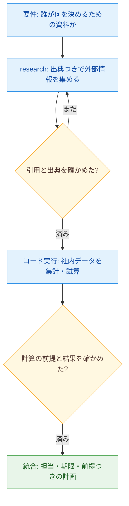

# 調査・分析・計画の成果物を最初から最後まで作る

> ドメイン: 4. ワークフローの設計と組み込み（18%） ／ 更新: 2026-11-26

!!! abstract "ひとことで"
    大きな成果物は ==要件 → 出典つきの調査 → コード実行による分析 → 実行できる計画== の段階に分け、段階ごとに人が確かめてから次へ進む。各段階には、その仕事に合う機能を使う。

## 仕組み

調査・分析・計画の成果物を1回の依頼で作らせると、前提の取り違えや作られた数字が最後まで混ざったまま残る。だから段階に分け、各段階の出力を次の段階の入力にする。段階の境目で人が確かめれば、誤りが後ろの段階に広がらない。例として、オペレーション部門が「物流拠点の再編案」を作る場面を通して使う。

| 段階 | 使う機能 | 人が確かめること |
|---|---|---|
| 要件 | chat（Project で文脈を持たせてもよい） | 意思決定者・判断の論点・制約・期限が合っているか |
| 調査 | research（web と、つないだ connectors を何度も検索して出典つきでまとめる） | 引用元を開き、主張と出典が対応しているか |
| 分析 | コード実行（アップロードした CSV などを Python で集計し、図やファイルを作る） | 計算の前提、使った列、外れ値の扱い |
| 統合 | chat、Artifacts、ファイル作成 | 計画の各項目が調査と分析のどこに根拠を持つか |

要件の段階を飛ばすと、正確だが使えない資料ができる。再編案なら「役員会で拠点を2つに絞るかを決める」のか「現場に移行手順を示す」のかで、集める情報も計画の粒度も変わる。ガイドは、正確さが要る計算にはコード実行の結果を使うとしている。chat の文章の中で出た合計や伸び率は、そのまま計画に入れない。計画は「何を・誰が・いつまでに」と、置いた前提を書いて初めて実行できる。

??? info "機能の細部（変わりやすい）"
    - research は、前の検索結果をもとに次に調べることを決めながら、複数の検索を重ねる。web 検索を有効にする必要があり、有料プランのみ。Claude Mobile で始めると web だけを検索し、connectors は使わない
    - research は通常の chat より利用枠を早く使う
    - コード実行（Create and edit files）は隔離された環境で動き、.xlsx・.pptx・.docx・PDF を作れる。生成したファイルは使う前に確かめる、とヘルプにある
    - research の所要時間と、引用の表示のされ方は、ヘルプに記載が無く未確認

## 試験での見分け方

| 問われること | ○ 正しい | × ひっかけ |
|---|---|---|
| 大きな計画書を作る | 段階に分け、境目で人が確かめる | 1回の長いプロンプトで完成版を作らせる |
| 外部の市場情報を集める | research で出典つきで集め、引用元を開いて確かめる | 通常の chat の記憶に頼り、出典の無い数字を使う |
| 社内データの集計・試算 | コード実行で計算させ、前提を確かめる | chat の文章で出た合計値をそのまま計画に入れる |
| 計画を仕上げる | 担当・期限・前提・根拠を付ける | 調査結果の要約を並べて計画と呼ぶ |

## 確認問題

**Q1.** 小売チェーンの営業企画担当が、来期の新店舗の出店計画書を作る。地域の人口動態の公開情報と、自社の既存店の売上データ（CSV）を使う予定だ。Claude の使い方として最も適切な進め方はどれか。（1つ選べ）
{ .quiz-q }

- A. CSV と目的を1回のプロンプトで渡し、調査・分析・計画をまとめた完成版を書かせる
- B. 通常の chat で人口動態の数字を挙げさせ、売上の伸び率もその文章の中で計算させる
- C. 計画で決めることを先に定め、research で出典つきの調査、コード実行で売上の集計をし、段階ごとに確かめる
- D. research に計画書の作成まで任せ、出てきた計画をそのまま役員会の資料にする

??? success "答えと解説"
    **正解: C。** 要件 → 出典つきの調査 → コード実行の分析 → 統合、の段階を踏み、境目で確かめる。

    - A: 1回で作らせると、前提の取り違えや誤りが最後まで残り、どこで生じたか分からない
    - B: 出典の無い数字と、文章で出した計算は、どちらも使う前の根拠にならない
    - D: research は調査の段階の機能で、出力も確かめずに使ってはいけない

**Q2.** 同じ計画書で、research の出力をもとに市場規模の節を書く。使う前にすべきことはどれか。（2つ選べ）
{ .quiz-q }

- A. 出典が付いているので、数字はそのまま使う
- B. 計画の結論に効く数字は、引用元を開いて、その数字が実際に書かれているか確かめる
- C. Claude に「すべての出典は正確か」と尋ね、正確と答えれば使う
- D. 出典の主張と、計画での使い方（年・地域・定義）が合っているかを確かめる
- E. research の出力は長いので、要約だけを読んで計画に使う

??? success "答えと解説"
    **正解: B と D。** 出典は確かめる手がかりにすぎない。中身と、使い方の一致を人が確かめる。

    - A: 出典があっても、その数字が出典に書かれているとは限らない
    - C: Claude の自己申告は、独立した確認にならない
    - E: 要約だけでは、出典との対応を確かめられない

**Q3.** 人事のアナリストが、退職率の改善計画を作っている。調査と分析は終わり、Claude に最終の計画をまとめさせた。出てきた計画は「エンゲージメントを高める」「1on1 を充実させる」などの方針が並ぶだけだった。最も適切な直し方はどれか。（1つ選べ）
{ .quiz-q }

- A. 各施策に担当・期限・測る指標と、根拠にした分析結果を付けるよう求めて書き直させる
- B. より上位のモデルに切り替え、同じ依頼でもう一度まとめさせる
- C. 調査の段階に戻り、research で退職率の公開情報をもう一度集めさせる
- D. 方針の数を増やすよう求め、選択肢の多い計画にする

??? success "答えと解説"
    **正解: A。** 実行できる計画は、何を・誰が・いつまでに・どう測るかと、その根拠を持つ。

    - B: 足りないのは計画の要件の指定で、モデルの能力ではない
    - C: 調査と分析は済んでいる。欠けているのは統合の段階の要件
    - D: 方針を増やしても、実行できる形にはならない

## 出典
- [Claude Certified Associate – Foundations Exam Guide v1.1](https://cc.sj-cdn.net/instructor/6nizmqk8tpzpfjvt6qmmav7rh/public/1794946609/Claude_Certified_Associate_-_Foundations_Exam_Guide_Updated_Dec_7.pdf)（公式、PDF。Domain 4: End-to-End Deliverable Workflows）
- [Use research on Claude](https://support.claude.com/en/articles/11088861-use-research-on-claude)（公式）
- [Create and edit files with Claude](https://support.claude.com/en/articles/12111783-create-and-edit-files-with-claude)（公式）
- [Claude is providing incorrect or misleading responses](https://support.claude.com/en/articles/8525154-claude-is-providing-incorrect-or-misleading-responses-what-s-going-on)（公式）
