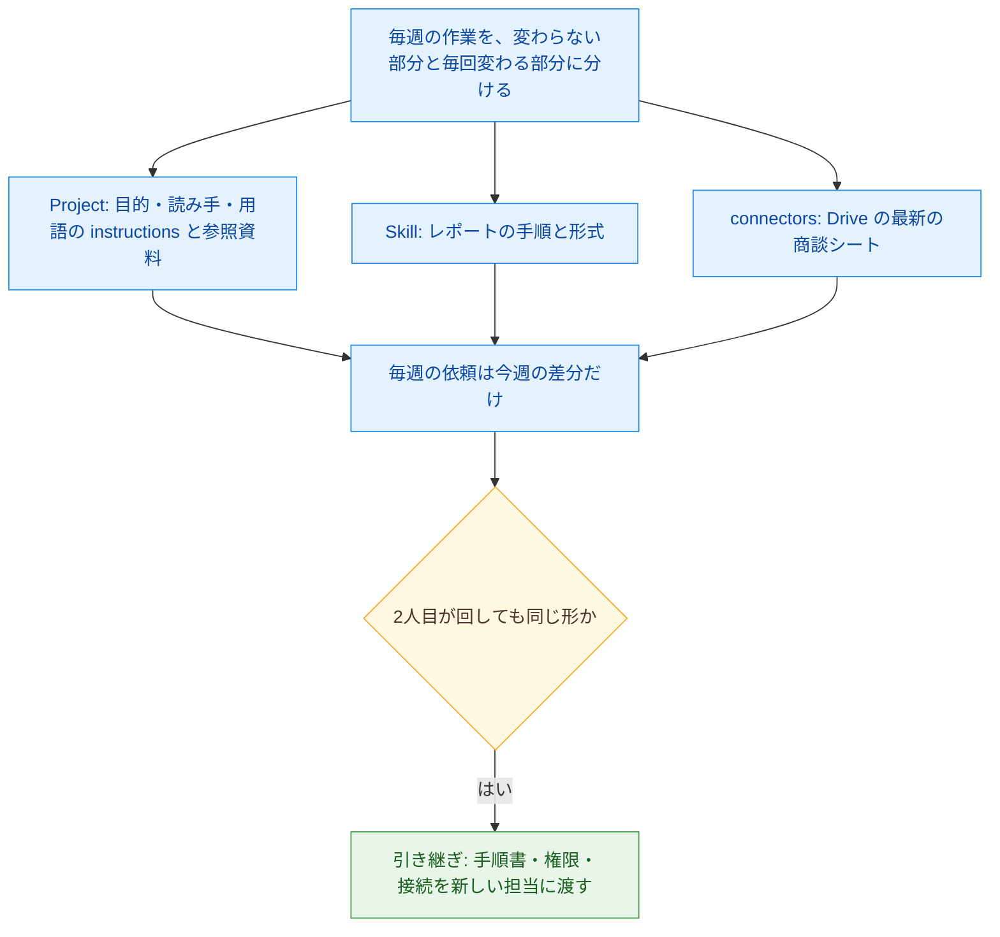

# 繰り返す作業の仕組み化と引き継ぎ

> ドメイン: 4. ワークフローの設計と組み込み（18%） ／ 更新: 2026-11-26

!!! abstract "ひとことで"
    毎回プロンプトを書き直している作業は、==背景は Project、手順と形式は Skill、最新のデータは connectors、正確な計算はコード実行== に分けて持たせる。誰がいつ回しても同じ結果になり、同僚が引き継いで自分で直せる形にする。

## 仕組み

場当たりのプロンプトで回す作業は、書く人と日によって結果がぶれる。前回うまくいった指示が、その人の頭の中と過去のチャットにしか残らないからだ。そこで、変わらない部分を設定に移し、毎回の依頼は「今回の差分」だけにする。例として、営業企画が毎週作る「週次の商談レポート」を通して使う。

| 持たせるもの | 置き場所 | 理由 |
|---|---|---|
| 目的、読み手、社内用語、過去の見本 | Project の instructions と knowledge | その Project のチャットで常に読み込まれる背景 |
| 集計の手順、見出しの構成、表の形式 | Skill | 必要なときに読み込まれ、作業を同じやり方で繰り返す。Project の外でも使える |
| 毎週変わる商談データ | connectors（Google Drive など） | Drive から同期され、最新の版を読む。毎週アップロードし直さない |
| 合計、前週比などの数値 | コード実行の手順 | 文章の生成でなく計算で出す |

引き継ぎでは、新しい担当が自分で直せることを確かめる。Project の共有で「Can edit」を渡せば、instructions と knowledge を編集できる。connectors は各自が自分の Google アカウントで認証するので、新しい担当は自分で接続し直す必要がある。共有した Skill は受け取った人には閲覧のみで、中身を直せない。だから Skill の持ち主を誰にするか（組織の公開にするか）も決めて渡す。自分の memory に頼っていた前提は、引き継ぐ相手には届かないので、instructions に書き出しておく（推論）。

??? info "機能の細部（変わりやすい）"
    - Project の共有と「Can view / Can edit」の権限は Team と Enterprise プランのみ
    - 共有した Skill を更新すると、受け取った人は次に使うときに新しい版になる。組織に公開した Skill は、更新を公開し直すと承認を通り、承認されるまで全員が承認済みの版のまま使う
    - Skills にはコード実行の有効化が必要
    - Google Drive の connectors は、各自の Google の権限の範囲でしか読めない。文書はテキストとして読み、埋め込みの画像は処理しない
    - Project や Skill の持ち主を別の人に移す方法は、ヘルプで確かめられず未確認

## 試験での見分け方

| 問われること | ○ 正しい | × ひっかけ |
|---|---|---|
| 毎回プロンプトを貼り付けている作業 | 背景を Project、手順と形式を Skill に移す | うまくいったプロンプトを各自のメモに保存して回す |
| 毎週変わる元データ | connectors で最新の版を読む | 毎週ファイルを Project にアップロードし直す |
| 担当者ごとに形式がぶれる | 形式を Skill に持たせ、全員が同じものを使う | 各自に「形式を守って」と口頭で伝える |
| 同僚への引き継ぎ | 編集権限、各自の接続、Skill の持ち主、暗黙の前提の書き出しを渡す | Project を閲覧のみで共有し、使い方だけ説明する |

## 確認問題

**Q1.** 研修担当が、毎月の研修のアンケート結果をまとめる報告書を作っている。毎回、前回のチャットから長いプロンプトを探して貼り付け、CSV をアップロードしている。報告書の章立ては月によってずれ、満足度の平均値が手計算と合わないこともある。最も適切な仕組み化はどれか。（1つ選べ）
{ .quiz-q }

- A. 背景を Project に、章立てと平均値の計算の手順を Skill にし、計算はコード実行で行わせる
- B. 長いプロンプトを共有の文書に保存し、毎月そこからコピーして貼り付ける
- C. 章立てが毎月ずれるので、より上位のモデルに切り替えて同じプロンプトを使う
- D. memory を有効にし、前回の章立てと計算を Claude に覚えさせる

??? success "答えと解説"
    **正解: A。** 変わらない背景と手順を設定に移し、正確さが要る数値は計算で出す。

    - B: 貼り付けの手間とぶれは残る。平均値の計算の問題も解決しない
    - C: ぶれの原因は手順が固定されていないことで、モデルの能力ではない
    - D: memory は手順を確実に再現する仕組みでなく、他の人にも共有されない

**Q2.** あるコンサルタントが、顧客ごとの週次の進捗報告を作る Project を、後任の同僚に引き継ぐ。引き継いだ後、同僚が1人で運用し、直せるようにするために必要なことはどれか。（2つ選べ）
{ .quiz-q }

- A. Project を「Can view」で共有し、毎週の依頼の書き方を伝える
- B. Project を「Can edit」で共有し、instructions と knowledge を同僚が直せるようにする
- C. 自分の Google Drive の接続をそのまま使い続けてもらう
- D. 自分の memory に残った顧客の前提は、Claude が同僚にも引き継ぐので書き出さない
- E. 自分の頭の中にあった前提や例外の扱いを、instructions に書き出しておく

??? success "答えと解説"
    **正解: B と E。** 引き継いだ人が自分で直せる権限と、暗黙だった前提の書き出しが要る。

    - A: 閲覧のみでは、instructions や knowledge を直せない
    - C: connectors は各自のアカウントで認証する。同僚は自分で接続し直す
    - D: memory は個人のもので、同僚には届かない（推論）。前提は instructions に書く

**Q3.** 地方自治体向けのコンサル会社で、提案書の「体制図と工程表」の節を、5人の担当がそれぞれ Claude で作っている。形式が人によって違い、品質管理の担当が毎回直している。最も適切な対応はどれか。（1つ選べ）
{ .quiz-q }

- A. 5人に、形式を守るよう依頼のたびにプロンプトの冒頭で書いてもらう
- B. 品質管理の担当が、完成した節を毎回直す運用をこのまま続ける
- C. 節の手順と形式を Skill にまとめて組織で共有し、5人が同じ Skill を使う
- D. 5人それぞれが自分用の Project を作り、各自の instructions に形式を書く

??? success "答えと解説"
    **正解: C。** 人をまたいで同じ形を出すには、手順と形式を1つの Skill にして全員で使う。

    - A: 書き方が人ごとにぶれ、ばらつきの原因が残る
    - B: 直す手間が続き、仕組み化になっていない
    - D: instructions が5つに分かれ、形式もまた人ごとにずれる

## 出典
- [Claude Certified Associate – Foundations Exam Guide v1.1](https://cc.sj-cdn.net/instructor/6nizmqk8tpzpfjvt6qmmav7rh/public/1794946609/Claude_Certified_Associate_-_Foundations_Exam_Guide_Updated_Dec_7.pdf)（公式、PDF。Domain 4: Repeatable Workflow Design）
- [What are projects?](https://support.claude.com/en/articles/9517075-what-are-projects)（公式）
- [What are skills?](https://support.claude.com/en/articles/12512176-what-are-skills)（公式）
- [Use skills in Claude](https://support.claude.com/en/articles/12512180-use-skills-in-claude)（公式）
- [Use Google Workspace connectors](https://support.claude.com/en/articles/10166901-use-google-workspace-connectors)（公式）
- [Create and edit files with Claude](https://support.claude.com/en/articles/12111783-create-and-edit-files-with-claude)（公式）
