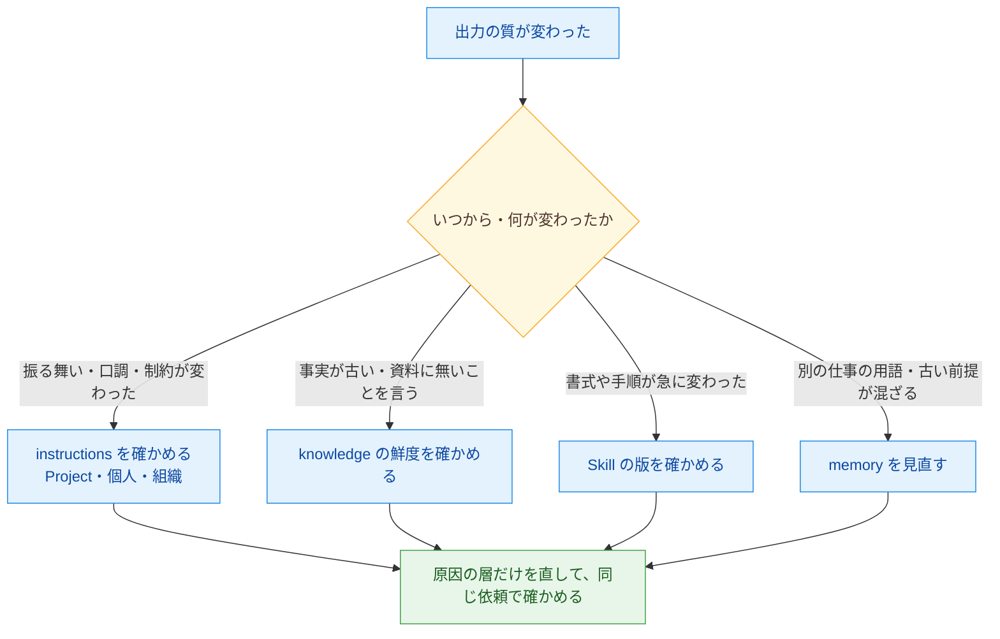

# 設定の劣化の原因の層を特定する

> ドメイン: 5. 設定とナレッジの管理（15%） ／ 更新: 2026-11-26

!!! abstract "ひとことで"
    うまく動いていた設定の出力が変わったら、==いつから・何が変わったか== を確かめ、症状に合う層（instructions・knowledge の鮮度・Skill の版・たまった memory）だけを直す。変わっていない層を書き直しても戻らない。

## 仕組み

1つの Project の出力は、いくつもの層の重なりで決まる。どれかの層が変わると、出力も変わる。層には、人が書き換えるもの（instructions、knowledge）と、知らないうちに変わるもの（同期する Drive の文書、自動で届く Skill の新しい版、会話からたまる memory）がある。後者は、自分が何も触っていなくても動くので見落としやすい。

| 層 | 知らないうちに変わる道 | 典型的な症状 | 直し方 |
|---|---|---|---|
| instructions | Can edit の同僚が Project instructions を直した。組織や個人の instructions が足された | 口調・構成・守っていた制約が変わる | 変更点を確かめ、意図に合わせて戻すか直す |
| knowledge | アップロードした写しが古くなった。同期している Drive の文書をほかの人が直した | 古い数字や手順を言う。前は答えられたことに答えられない | 写しを入れ替える。Drive の元の文書の変更を確かめる |
| Skill | 共有された Skill は作者が直すと次に使うときから新しい版になる。公開した Skill は承認された版に替わる | 書式や手順が一斉に変わる | 版の変更点を作者に確かめ、直してもらう |
| memory | 会話のたびに少しずつたまる | 別の仕事の用語、古い前提、前の役割が混ざる | 該当する memory を編集・削除する。Project を切り離す |

原因の層を外すと、直したつもりで別の問題を足すことになる。たとえば、knowledge が古いせいで数字を間違えているときに instructions へ「最新の数字を使う」と足しても、Claude が見られる資料は古いままだ。だから、まず変わった時期と症状を手がかりに層を絞り、その層だけを直して、前と同じ依頼で結果を比べる。

??? info "細かい決まり・注記"
    - 会話を削除しても、その会話から作られた memory は消えない。memory は Settings > Your Claude の「Your memory」で、トピックごとに直接編集・削除する。チャットで Claude に「忘れて」「こう直して」と伝えてもよい
    - Project の中では、その Project の memory と、Project の外のチャットの memory が使われる。Project の外から混ざるなら、Project のページで「Use account memory」を切る
    - memory を一時停止すると、既存の memory は残るが使われず、新しくも作られない。リセットは Project の memory も含めて全部消え、元に戻せない
    - 組織の instructions は、変更が全体に効くまで最大1時間ほどかかることがある
    - Project instructions や knowledge の変更の履歴を claude.ai の画面で見られるかは、確認できなかった（未確認）

## 試験での見分け方

| 問われること | ○ 正しい | × ひっかけ |
|---|---|---|
| instructions は変わっていないのに口調が変わった | ほかの層（組織・個人の instructions、Skill）の変更を確かめる | instructions をさらに厳しく書き直す |
| 書式が一斉に変わった | Skill の新しい版を疑う | knowledge を全部入れ替える |
| 別の仕事の用語が混ざる | 該当する memory を編集・削除する | その話をした会話を削除して済ませる |
| 資料に無い古い事実を言う | knowledge の写しや同期元を確かめる | 依頼のたびに「最新の情報で」と書く |
| 原因の層が分からない | 変わった時期と症状から層を絞り、1つずつ直して比べる | 全部の層を一度に作り直す |

## 確認問題

**Q1.** 研修担当のチームが、新人研修のスライドを作る Project を半年使っている。先週から、スライドの見出しの付け方と1枚あたりの構成が、全員の分で一斉に変わった。Project instructions と knowledge はこの間だれも変えていない。スライドの作り方は、組織に公開されている Skill を使っている。原因の層として最初に確かめるべきものはどれか。（1つ選べ）
{ .quiz-q }

- A. 各メンバーの memory に、別の研修の構成が覚えられていないか
- B. knowledge のスライドの見本が、古い版になっていないか
- C. 公開されている Skill に、先週承認された新しい版が無いか
- D. Project instructions の書き方が、時間とともに効かなくなっていないか

??? success "答えと解説"
    **正解: C。** 書式が全員の分で一斉に変わり、instructions と knowledge は変わっていない。全員に同時に届くのは、承認された Skill の新しい版だ。

    - A: memory は人ごとにたまるので、全員の分が同じ週に一斉に変わる説明になりにくい
    - B: knowledge はだれも変えていない。古い見本が原因なら、以前から同じ症状が出ている
    - D: 変えていない instructions が、ある週から急に効かなくなる根拠は無い

**Q2.** PM が、前の製品チームから新しい製品チームに移った。新しい製品の Project で作る仕様書の下書きに、前の製品の名前や前のチームの略語が混ざる。前の製品の話は、Project の外のチャットでしていた。前のチャットはすでに削除した。適切な対応はどれか。（2つ選べ）
{ .quiz-q }

- A. Settings > Your Claude の memory を開き、前の製品とチームについてのトピックを直すか削除する
- B. 前のチャットは削除したので、時間がたてば memory からも消えるのを待つ
- C. Project instructions に「前の製品の名前は使わない」と書き足して済ませる
- D. 新しい製品の Project で「Use account memory」を切り、Project の外の memory を使わせない
- E. 今後の仕様書づくりは、すべて incognito chat で行う

??? success "答えと解説"
    **正解: A と D。** 混ざっているのは、Project の外でたまった memory だ。memory を直接直すか、Project を外の memory から切り離す。

    - B: 会話を削除しても、その会話から作られた memory は消えない
    - C: 原因の memory が残ったままで、言い換えた形で混ざり続ける
    - E: incognito chat は今ある memory を直さない。Project の knowledge や project memory の利点も失う

**Q3.** 営業企画の担当が、四半期の販売計画を作る Project を使っている。knowledge には、商品部が Google Drive で管理する「販売方針」のドキュメントを Drive から足してある。今週から、計画に重点商品の記述が出なくなった。Project instructions と使っている Skill は変わっていない。最初にすべきことはどれか。（1つ選べ）
{ .quiz-q }

- A. Drive の「販売方針」のドキュメントが今週変わっていないかを、商品部に確かめる
- B. Project instructions に「重点商品を必ず書くこと」と書き足す
- C. Skill を一度削除して、上げ直す
- D. 新しいチャットを始めて、同じ依頼をもう一度試す

??? success "答えと解説"
    **正解: A。** Drive から足した文書は最新の版と同期する。ほかの人が元の文書を直すと、自分が何も触らなくても knowledge が変わる。

    - B: 重点商品の情報が knowledge から消えていれば、指示を足しても正しく書けない
    - C: Skill は変わっていないので、上げ直しても症状の説明にならない
    - D: 原因の層を確かめないまま試し直しても、同じ knowledge を見るので戻らない

## 出典
- Claude Certified Associate – Foundations Exam Guide v1.1, Domain 5「Configuration Lifecycle and Degradation」（公式、PDF）
- [Use Claude's chat search and memory to build on previous context](https://support.claude.com/en/articles/11817273-use-claude-s-chat-search-and-memory-to-build-on-previous-context)（公式。memory の編集・削除、削除した会話と memory、project memory）
- [Use skills in Claude](https://support.claude.com/en/articles/12512180-use-skills-in-claude)（公式。共有・公開した Skill の更新）
- [Provision and manage skills for your organization](https://support.claude.com/en/articles/13119606-provision-and-manage-skills-for-your-organization)（公式。承認された版への切り替え）
- [Use Google Workspace connectors](https://support.claude.com/en/articles/10166901-use-google-workspace-connectors)（公式。Drive の文書の同期）
- [Set organization instructions](https://support.claude.com/en/articles/14546867-set-organization-instructions)（公式）
