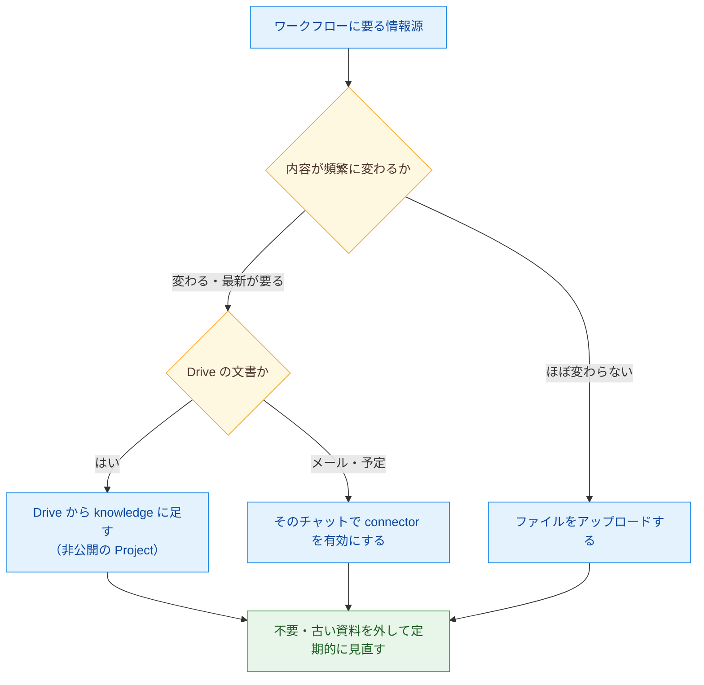

# connectors とアップロードの使い分け、ナレッジを新しく保つ

> ドメイン: 5. 設定とナレッジの管理（15%） ／ 更新: 2026-11-26

!!! abstract "ひとことで"
    よく変わる資料や、メール・予定のように毎回の最新が要るものは connector でつなぎ、変わらない資料はアップロードする。knowledge は ==必要なものだけを入れ、古いものを外して== 新しく保つ。

## 仕組み

connector は、Google Drive・Gmail・Google Calendar などのサービスに Claude をつなぐ仕組みだ。Claude はその人の権限をそのまま引き継ぐので、本人が見られないものには届かない。Google Drive から Project の knowledge に足した Google ドキュメントは、Drive の最新の版と同期する。一方、アップロードしたファイルが元のファイルの変更に追随するという記述は、ヘルプに無い。アップロードした時点の写しと考え、元を直したら上げ直す（推論）。

| | アップロード | connector |
|---|---|---|
| 鮮度 | 上げた時点の写し（推論）。直したら上げ直す | Drive の文書は最新の版と同期する。Gmail・Calendar は聞いたときに取りに行く |
| 向いている資料 | 改訂の少ない規程、確定した報告書、社外から受け取ったファイル | 更新が続く企画書、日々のメール、予定 |
| 手間・注意 | 写しが古くなっても気づきにくい | 最初に認証が要る。Team / Enterprise では管理者が有効にしてから使う。権限の範囲で何でも届く |

knowledge は多ければよいわけではない。マーケティング部のキャンペーン企画の Project に、終わったキャンペーンの案や別の商品の資料が残っていると、関係の薄い資料が答えに混ざる。だから、ファイル名を中身の分かる名前にし、関係する資料を同じ Project にまとめ、使わなくなった資料は外す。依頼の中で資料の名前を挙げると、Claude はその資料に絞って探せる。

connector も同じで、そのチャットで使わないものは切る。connector はチャットごとに「+」メニューからオン・オフでき、もう使わないサービスは接続自体を外す。

??? info "細かい決まり・注記"
    - Google Drive の connector で knowledge に足せるのは、非公開（private）の Project の Files だけ。共有した Project ではこの方法が使えない
    - Drive から読むのは文字だけで、文書に埋め込まれた画像は読まない
    - 送信・転送・共有・移動・ゴミ箱への移動は、Auto mode でなければ、Claude が1回ごとに承認を求める
    - connector で取得した Gmail・Drive・Calendar のデータを、Anthropic はモデルの学習に使わないとしている（学習に同意した個人向けアカウントで、内容をチャットに写した場合は別の注記あり）
    - 有効な connector が多い（ヘルプの目安は10以上）ときは、「Tool access」を On demand にすることが勧められている
    - アップロードの上限（ファイルの大きさ・数など）はヘルプにあるが、試験では数値を問わない
    - Drive の Sheets・Slides・PDF が knowledge でも同期するかは、ヘルプの記述が「Google Docs は最新の版」とだけあり、未確認

## 試験での見分け方

| 問われること | ○ 正しい | × ひっかけ |
|---|---|---|
| 毎週更新される企画書を参照する | Drive から knowledge に足して同期させる | 毎週アップロードし直す運用にする（忘れると古い版が残る） |
| 社外から届いた確定版の PDF | アップロードする | 一時的な資料のために connector を増やす |
| 答えに関係の薄い資料が混ざる | 不要な資料を外し、ファイル名を分かりやすくする | 資料はそのまま、instructions で「関係ない資料は無視」と書く |
| 共有した Project に Drive の文書を入れたい | 非公開の Project でしか使えないことを踏まえて運用を決める | 共有した Project でも Drive から足せると考える |
| connector を付けたまま別の仕事をする | 使わない connector はそのチャットで切る | 全部つないでおけば便利と考える |

## 確認問題

**Q1.** 広報担当が、プレスリリースの下書きを作る Project を使っている。製品の仕様書は開発部が Google ドキュメントで毎週更新している。担当は月初めに仕様書を PDF にしてアップロードしたが、月末の下書きに、すでに変わった仕様が書かれていた。今後の対応として最も適切なものはどれか。（1つ選べ）
{ .quiz-q }

- A. instructions に「仕様は最新のものを使うこと」と書き足す
- B. 依頼のたびに「仕様書は古いかもしれない」と断ってから下書きを頼む
- C. 過去の版の PDF も残したまま、新しい PDF を毎週足していく
- D. PDF を外し、仕様書の Google ドキュメントを Drive から knowledge に足す

??? success "答えと解説"
    **正解: D。** 更新が続く Drive の文書は、Drive から knowledge に足せば最新の版と同期する。

    - A: 手元にあるのは月初めの写しだけなので、指示を足しても最新の仕様は分からない
    - B: 断っても、Claude が見られるのは古い写しのままだ
    - C: 古い版と新しい版が混ざり、どちらを使うかが揺れる。古い版は外す

**Q2.** 業務分析の担当が、受発注の業務フローを分析する Project を整えている。knowledge には3年分の会議メモ、業務マニュアルの旧版と現行版、ほかの部署の資料が入っており、答えに古い手順が混ざる。対応として適切なものはどれか。（2つ選べ）
{ .quiz-q }

- A. 業務マニュアルの旧版と、ほかの部署の資料を knowledge から外す
- B. 資料はすべて残し、instructions で「古い資料は使わないこと」と書く
- C. 残す資料のファイル名を、中身と時点が分かる名前に付け直す
- D. 情報が多いほど良いので、関係しそうな資料をさらに足す
- E. 会議メモを全部まとめて1つのファイルにし、ファイル名は「資料」にする

??? success "答えと解説"
    **正解: A と C。** 不要な資料を外し、残すものは名前で中身が分かるようにする。

    - B: 古い資料が残っている限り、検索で拾われる。指示での区別より、外す方が確実
    - D: 関係の薄い資料が増えるほど、答えに混ざる
    - E: 中身の分からない名前の大きなファイルは、探すときの手がかりにならない

**Q3.** 人事部の担当が、全社で共有している「研修の運営」Project に、Google Drive の研修日程表を足そうとしたが、Drive から足す選択肢が使えない。担当の個人の Project では同じ操作ができる。最も考えられる理由はどれか。（1つ選べ）
{ .quiz-q }

- A. 研修日程表の Drive の権限が担当に無いので、connector が使えない
- B. Drive の connector で knowledge に足せるのは、非公開の Project だけだから
- C. Project の knowledge が多すぎて、RAG に切り替わったから
- D. Gmail の connector を先に有効にしないと、Drive が使えないから

??? success "答えと解説"
    **正解: B。** Drive から knowledge に足す方法は、非公開の Project の Files でだけ使える。共有した Project では使えない。

    - A: 個人の Project では同じ文書を足せるので、権限の問題ではない
    - C: RAG は knowledge の量に応じて自動で切り替わる仕組みで、Drive から足せるかとは関係ない
    - D: connector はサービスごとに独立して有効にする

## 出典
- Claude Certified Associate – Foundations Exam Guide v1.1, Domain 5「Connector and Knowledge Management」（公式、PDF）
- [Use Google Workspace connectors](https://support.claude.com/en/articles/10166901-use-google-workspace-connectors)（公式。Drive の同期、非公開の Project の制限、権限）
- [Use connectors to extend Claude's capabilities](https://support.claude.com/en/articles/11176164-use-connectors-to-extend-claude-s-capabilities)（公式）
- [Upload files to Claude](https://support.claude.com/en/articles/8241126-upload-files-to-claude)（公式）
- [Retrieval augmented generation (RAG) for projects](https://support.claude.com/en/articles/11473015-retrieval-augmented-generation-rag-for-projects)（公式。ファイル名と資料のまとめ方）
