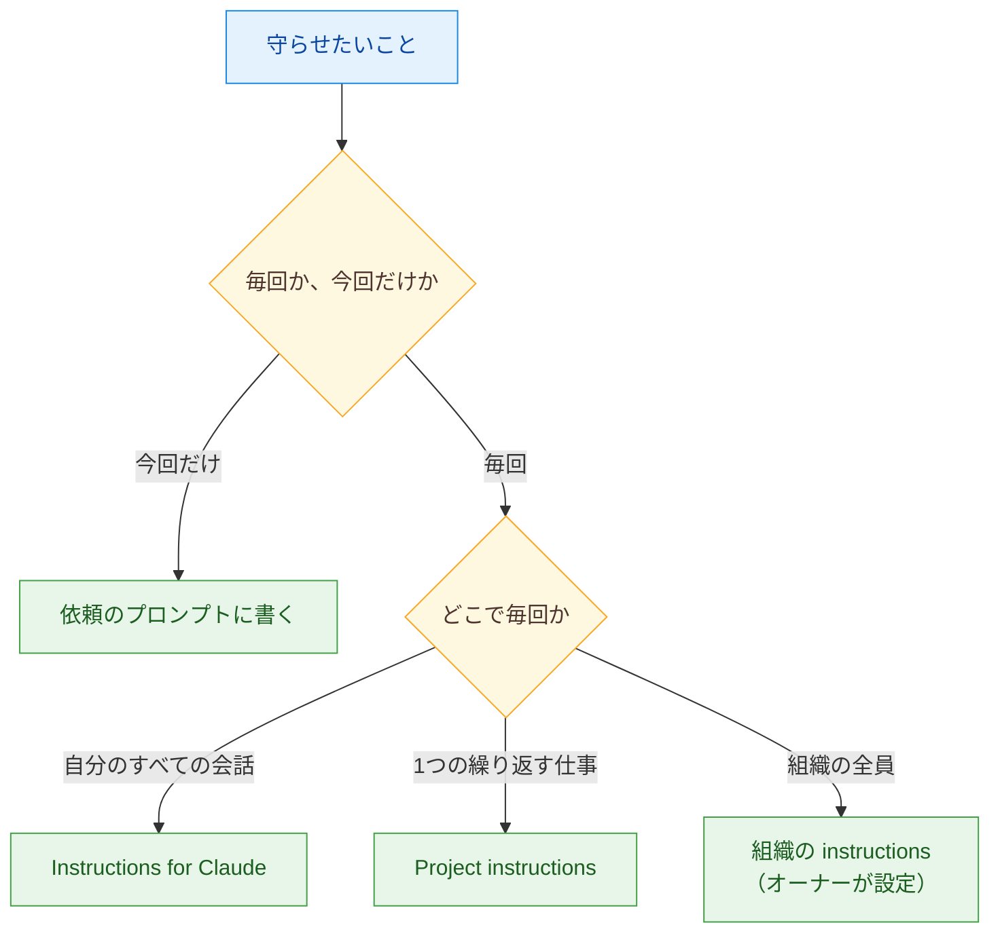

# 永続的な指示の設計

> ドメイン: 5. 設定とナレッジの管理（15%） ／ 更新: 2026-11-26

!!! abstract "ひとことで"
    毎回同じに守らせることは永続的な指示に、その依頼だけの事情は依頼のプロンプトに書く。永続的な指示は、==効く範囲が合う層==（アカウント全体・Project・組織）を選び、起こりうる場面と制約を先に書いておくと出力がそろう。

## 仕組み

永続的な指示は、書いておけば毎回の会話に効く指示だ。層ごとに効く範囲が違う。アカウントの「Instructions for Claude」（プロフィールの設定）は、その人のすべての会話に効く。Project instructions は、その Project のチャットにだけ効く。Team / Enterprise では、オーナーが組織全体の instructions も設定できる。

| 層 | 効く範囲 | 書くこと（例: 営業部の「顧客へのお礼メール」Project） |
|---|---|---|
| 組織の instructions | 組織の全員のすべての会話 | 全社の表記ルール、コンプライアンス上の注意 |
| Instructions for Claude | 自分のすべての会話 | 自分の役割、よく使う用語、全般の好み |
| Project instructions | その Project のチャット | メールの構成、敬語の水準、署名の形、情報が足りないときの扱い |
| 依頼のプロンプト | その1回 | 相手の名前、商談で出た話題、送る期限 |

依頼のたびに同じ前提を書いていると、書き忘れた回だけ出力が崩れる。だから、毎回の前提は Project instructions に移し、依頼には今回の事情だけを書く。逆に、特定の顧客の事情を instructions に書くと、ほかの顧客へのメールにも効いてしまう。

出力をそろえるには、起こりうる場面を instructions に先に書いておく。お礼メールの例なら、商談の記録が無いとき・相手が初めての顧客のとき・値引きの約束を頼まれたときに、どうするかを決めておく。決めていない場面では、Claude はその都度もっともらしく判断するので、回ごとに扱いが変わる。

??? info "細かい決まり・注記"
    - 組織の instructions と個人の instructions がぶつかったときは、組織が優先される。組織の instructions が触れていないことには、個人の instructions が効く。ただしヘルプは、まれな矛盾では動きが揺れうるので試すよう勧めている
    - 組織の instructions と Project instructions の優先関係は、ヘルプで確認できなかった（未確認）
    - 組織の instructions の書き方として、ヘルプは「短く、具体的に、互いに矛盾させない」を勧めている。組織の instructions で、Claude の安全のための方針は外せない
    - Instructions for Claude の場所は Settings > Your Claude（古い画面では Account）。Cowork の全体の指示もここにまとめられた
    - styles（応答の書きぶりを選ぶ機能）は、読めたヘルプ（personalization features）に載っていない。同じヘルプは、口調や形式の調整、自分の文章に合わせた書きぶりを Skills の役割として挙げている。styles が Skills へ移行中という検索結果を見たが、本文は読めず未確認

## 試験での見分け方

| 問われること | ○ 正しい | × ひっかけ |
|---|---|---|
| 毎回の依頼に同じ前提を書いている | 前提を Project instructions に移す | 依頼の定型文を作って毎回貼る |
| 1社だけの特別な事情 | その依頼のプロンプトに書く | Project instructions に足す（ほかの顧客にも効く） |
| 1つの仕事の書式を、ほかの仕事に持ち込みたくない | Project instructions に書く | Instructions for Claude に書く（すべての会話に効く） |
| 例外の場面で出力がばらつく | 例外の場面と扱いを instructions に先に書く | ばらついた回だけ依頼で直す |
| 全社で表記をそろえたい | オーナーが組織の instructions に書く | 各自の Instructions for Claude に任せる |

## 確認問題

**Q1.** カスタマー対応の研修担当が、問い合わせの返信の練習問題を作る Project を使っている。依頼のたびに「受講者は入社1年目」「1問ごとに模範解答と採点の観点を付ける」と書いているが、書き忘れた回は模範解答が付かない。最も適切な対応はどれか。（1つ選べ）
{ .quiz-q }

- A. 依頼の定型文をメモ帳に保存し、毎回の依頼の先頭に貼り付ける
- B. 2つの前提を Instructions for Claude（アカウントの設定）に書く
- C. 2つの前提を Project instructions に書き、依頼には今回の題材だけを書く
- D. 模範解答が付かなかった回だけ、「模範解答を付けて」と追加で頼む

??? success "答えと解説"
    **正解: C。** 毎回の前提は、その仕事の Project instructions に置く。依頼には今回だけの事情を書く。

    - A: 貼り忘れの心配が残り、持続する設定にならない
    - B: アカウントの設定はすべての会話に効く。研修の問題作り以外の会話にも模範解答が付いてしまう
    - D: 崩れた後で直す運用で、出力はそろわない

**Q2.** 経理部が、取引先からの請求書の問い合わせに返信の下書きを作る Project を作った。担当者によって下書きの扱いが違うという声が出ている。Project instructions に書き足すと効果があるものはどれか。（2つ選べ）
{ .quiz-q }

- A. 今週問い合わせてきた取引先3社の名前と、それぞれの未払いの金額
- B. 支払日を確約する依頼が来たときは、確約せずに担当者の確認が要ると書くこと
- C. 「いつも丁寧に、正確に、分かりやすく書くこと」という一文
- D. 請求書の番号が問い合わせに無いときは、番号を尋ねる一文を入れること
- E. 担当者それぞれの好みの文体を、全員分すべて並べて書くこと

??? success "答えと解説"
    **正解: B と D。** 起こりうる場面と、そのときの扱いを先に決めておくと、だれが頼んでも同じ扱いになる。

    - A: 今週だけの事情は、その依頼に書く。instructions に残すと古くなり、ほかの取引先にも効く
    - C: 抽象的すぎて、場面ごとの扱いが決まらない
    - E: 互いにぶつかる指示を並べると、どれに従うかが揺れる

**Q3.** ある会社のオーナーが、組織の instructions に「社外向けの文書は常体でなく敬体で書く」と設定した。マーケティング部の社員は、自分の Instructions for Claude に「文章はくだけた口調で」と書いている。この社員が社外向けのメールの下書きを頼んだときの動きとして、ヘルプの説明に沿うものはどれか。（1つ選べ）
{ .quiz-q }

- A. 組織の instructions が優先され、敬体で書かれる
- B. 個人の instructions の方が新しいので、くだけた口調で書かれる
- C. 2つの指示を半分ずつ取り入れた口調で書かれる
- D. 指示がぶつかるので、Claude は下書きを作らずに確認を求める

??? success "答えと解説"
    **正解: A。** 組織と個人の instructions がぶつかるときは、組織が優先される。

    - B: 優先は設定した時期では決まらない
    - C: ヘルプは、矛盾したときは組織の指示に従うと説明している
    - D: 下書きを止めるという説明は無い。組織の指示に沿って書く

## 出典
- Claude Certified Associate – Foundations Exam Guide v1.1, Domain 5「Persistent-Instruction Design」（公式、PDF）
- [Understanding Claude's personalization features](https://support.claude.com/en/articles/10185728-understanding-claude-s-personalization-features)（公式）
- [Set organization instructions](https://support.claude.com/en/articles/14546867-set-organization-instructions)（公式。組織と個人の優先関係）
- [How can I create and manage projects?](https://support.claude.com/en/articles/9519177-how-can-i-create-and-manage-projects)（公式）
