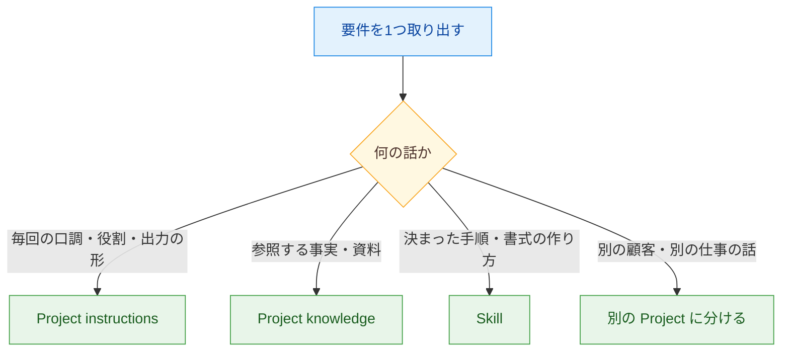

# Project の設定と、instructions・knowledge・Skill の使い分け

> ドメイン: 5. 設定とナレッジの管理（15%） ／ 更新: 2026-11-26

!!! abstract "ひとことで"
    繰り返す仕事1つにつき Project を1つ作り、要件ごとに置き場所を選ぶ。==毎回の振る舞いは instructions、参照する資料は knowledge、決まった手順は Skill== に置き、無関係な仕事は別の Project に分けて混ぜない。

## 仕組み

Project は、専用のチャット履歴と knowledge を持つ作業場だ。knowledge に上げた資料と、Project instructions は、その Project のすべてのチャットで使われる。一方で、チャットどうしは文脈を共有しない。あるチャットで決めたことを次のチャットでも使いたいなら、knowledge に足す必要がある。

| 置き場所 | 効く範囲 | 向いている要件 | 例（営業企画の「週次の商談レビュー」Project） |
|---|---|---|---|
| Project instructions | その Project の全チャット | 役割、口調、出力の形、守る制約 | 「営業企画の分析担当として、結論から書く」 |
| Project knowledge | その Project の全チャット | 参照する事実（資料、規程、過去の成果物） | 商談の評価基準、製品の価格表 |
| Skill | アカウント全体。関係する依頼のときだけ読み込まれる | 何度も同じ手順で作るもの | 社内テンプレートどおりのレビュー資料の作り方 |
| project memory | その Project の中 | 会話から Claude が覚えた文脈 | チームの略語、よく見る指標 |

Skill は、関係する依頼のときだけ読み込まれる。だから、Project instructions に長い手順を書き込むより、繰り返す手順は Skill に切り出す方が、ほかのチャットの邪魔をしない。逆に、毎回必ず守らせたい口調や制約は、呼ばれたときだけ効く Skill には向かない。

memory は Project ごとに分かれている。Project の中では、その Project の memory と、Project の外のチャットの memory が使われ、ほかの Project の memory は使われない。顧客ごとに Project を分けるのは、knowledge と memory を混ぜないためでもある。さらに完全に切り離したいときは、Project のページで「Use account memory」を切る。

??? info "細かい決まり・注記"
    - Project の名前と説明（description）は、Claude からは見えない。振る舞いの指示は instructions に書く
    - 有料プランでは、knowledge がコンテキストウィンドウの上限に近づくと自動で RAG に切り替わり、関係する部分だけを検索して使う。利用者が RAG を選ぶことはできない
    - Team / Enterprise では、Project を「Can view」「Can edit」で共有できる。Can edit の人は instructions と knowledge を変えられる
    - 1つのチャットだけ memory を使わないときは、最初のメッセージの前に「+」メニューで Memory を切る
    - Skill を特定の Project にだけ結び付ける設定があるかは、公式のヘルプで確認できなかった（未確認）。ヘルプが示すのは、Customize > Skills でアカウント単位に有効・無効を切り替える方法

## 試験での見分け方

| 問われること | ○ 正しい | × ひっかけ |
|---|---|---|
| 毎回の振る舞いを決めたい | Project instructions に書く | Project の説明欄に書く（Claude には見えない） |
| 前のチャットで決めた方針を次も使う | knowledge に足す | 同じ Project なら自動で引き継がれると考える |
| 毎週同じ書式の資料を作る | 手順と書式を Skill にする | 長い手順を instructions に貼り続ける |
| 顧客 A と顧客 B の仕事 | Project を分ける | 1つの Project に両方の資料を入れる |
| 1つの Project を完全に切り離す | 「Use account memory」を切る | Project を分けたので何もしなくてよいと考える |

## 確認問題

**Q1.** 人事部の採用担当が、職種ごとの求人票を作る Project を作った。説明欄に「常に応募者目線で、差別的な表現を避けて書く」と書いたが、出てくる求人票にその配慮が見られない。最も適切な直し方はどれか。（1つ選べ）
{ .quiz-q }

- A. 説明欄の文を太字にし、文頭に「必ず守ること」と書き足す
- B. 同じ内容を Project instructions に書き、説明欄は見出し程度にとどめる
- C. 同じ内容を書いた文書を knowledge に上げ、ファイル名を「ルール」にする
- D. 求人票を頼むたびに、説明欄を読んでから書くよう依頼の中で伝える

??? success "答えと解説"
    **正解: B。** Project の名前と説明は Claude から見えない。全チャットで守らせる振る舞いは instructions に書く。

    - A: 説明欄はそもそも Claude に渡らないので、書き方を強めても効かない
    - C: knowledge は参照する資料の置き場所で、毎回の振る舞いを決める場所ではない
    - D: Claude は説明欄を読めない。依頼のたびに頼むのでは、持続する設定にならない

**Q2.** コンサルタントが、2社の顧客の業務改善を並行して担当している。どちらも毎週、同じ形式の進捗報告を作る。設定として適切なものはどれか。（2つ選べ）
{ .quiz-q }

- A. 顧客ごとに Project を分け、それぞれの knowledge にその顧客の資料だけを入れる
- B. 1つの Project に2社分の資料を入れ、instructions で「顧客を混同しないこと」と書く
- C. 進捗報告の作り方を、2つの Project の instructions にそれぞれ長文で貼る
- D. 進捗報告の手順と書式を Skill にして、両方の Project で使えるようにする
- E. 2社の違いは毎回の依頼で説明し、Project は使わない

??? success "答えと解説"
    **正解: A と D。** 顧客ごとの資料と memory は Project を分けて切り離し、共通の手順は Skill にまとめる。

    - B: 指示で区別させても、同じ knowledge と memory に2社分が混ざる
    - C: 同じ手順を2か所に持つと、片方だけ直し忘れる。手順は Skill に1つ置く
    - E: 毎回の説明に頼ると、資料と方針が積み上がらず、結果もばらつく

**Q3.** PM が新製品の開発の Project を使っている。月曜のチャットでリリースの判定基準を Claude と詰めて合意した。水曜に同じ Project で新しいチャットを始めると、Claude はその基準を知らなかった。最も適切な対応はどれか。（1つ選べ）
{ .quiz-q }

- A. 同じ Project の中なので、時間がたてば月曜の内容が反映されるとみて、そのまま続ける
- B. 月曜のチャットを Project の外に移し、memory に覚えさせ直す
- C. 判定基準を Project の説明欄に書き、次からはそこを見るよう伝える
- D. 合意した判定基準を文書にして、Project の knowledge に足す

??? success "答えと解説"
    **正解: D。** 同じ Project でも、チャットどうしは文脈を共有しない。続けて使う決定事項は knowledge に足す。

    - A: Project の中でも、チャットの内容は knowledge に足さない限り共有されない。待っても反映されない
    - B: Project の外に出すと、knowledge や instructions とも切り離される。memory は何を覚えるかを細かく決められない
    - C: 説明欄は Claude に見えない

## 出典
- Claude Certified Associate – Foundations Exam Guide v1.1, Domain 5「Project Configuration」（公式、PDF）
- [What are projects?](https://support.claude.com/en/articles/9517075-what-are-projects)（公式）
- [How can I create and manage projects?](https://support.claude.com/en/articles/9519177-how-can-i-create-and-manage-projects)（公式。説明欄が Claude に見えないこと、チャット間で文脈を共有しないこと、project memory）
- [Retrieval augmented generation (RAG) for projects](https://support.claude.com/en/articles/11473015-retrieval-augmented-generation-rag-for-projects)（公式）
- [What are skills?](https://support.claude.com/en/articles/12512176-what-are-skills)（公式。Projects と Skills の違い）
- [Use Claude's chat search and memory to build on previous context](https://support.claude.com/en/articles/11817273-use-claude-s-chat-search-and-memory-to-build-on-previous-context)（公式）
